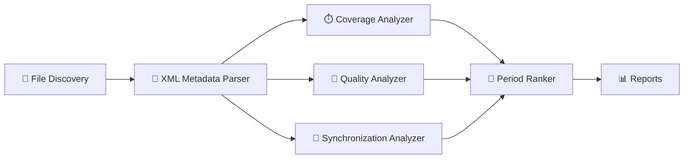

<div align="center">

# 🔴 MDRPA

### MEDA Data Research & Period Analyzer

**A transparent, reproducible research-support platform for evaluating NASA Perseverance MEDA calibrated data and comparing candidate observation periods.**

<br>


<br>

[Overview](#-overview) •
[Engine](#-analytical-engine) •
[Principles](#-scientific-principles) •
[Roadmap](#-analytical-roadmap) •
[Status](#-development-status) •
[Data Source](#-data-source)

</div>

---

## 🌌 Overview

**MDRPA** answers a question every researcher faces before using mission data:

> *Which parts of this dataset are actually worth investigating, and why?*

It examines NASA Perseverance **MEDA (Mars Environmental Dynamics Analyzer)** calibrated products, reads their official XML metadata, evaluates data integrity, quality-related indicators, and temporal behavior, then compares candidate Sol windows through **explainable, configurable** analysis.

MDRPA is built around one idea: **every number it produces must be traceable, and nothing is guessed.**

<table>
<tr>
<td width="25%" align="center"><h3>🔍</h3><b>Inspect</b><br><sub>Files, XML metadata, fields, units, documented ranges</sub></td>
<td width="25%" align="center"><h3>🧪</h3><b>Evaluate</b><br><sub>Coverage, integrity, quality indicators, uncertainty</sub></td>
<td width="25%" align="center"><h3>🔗</h3><b>Synchronize</b><br><sub>Timestamp relationships across MEDA products</sub></td>
<td width="25%" align="center"><h3>🏁</h3><b>Compare</b><br><sub>Explainable ranking of candidate Sol periods</sub></td>
</tr>
</table>

### Current scope

| Attribute | Value |
|---|---|
| Mission | Mars 2020 |
| Rover | Perseverance |
| Instrument | MEDA |
| Data category | **Calibrated** environmental data |
| Formats | CSV + XML (PDS4) |
| Out of scope | Derived and Partially Processed products |

> The long-term vision is a broader NASA data analysis platform. Each new dataset requires its own development and validation, so support is never assumed.

---

## ⚙️ Analytical Engine



| Module | Responsibility |
|---|---|
| **File Discovery** | Finds Sol directories, product codes, and CSV/XML pairs; records missing counterparts and file issues. |
| **XML Metadata Parser** | Extracts field definitions, units, data types, documented ranges, and special constants. |
| **Coverage Analyzer** | Record counts, timestamp parsing, temporal boundaries, gaps, duplicates, and sampling behavior. |
| **Quality Analyzer** | Field-level characteristics: missing, numeric and non-numeric values, uncertainty-related fields, documented range checks. |
| **Synchronization Analyzer** | Timestamp matching between products with a configurable tolerance in the selected time coordinate. |
| **Period Ranker** | Divides a Sol range into candidate windows and compares them using available, documented indicators. |

> 🪐 **A higher rank is comparative evidence, not scientific certification.**

---

## 🧭 Scientific Principles

MDRPA treats scientific caution as a feature, not a disclaimer.

| Principle | What it means in practice |
|---|---|
| **Availability ≠ completeness** | A file existing does not mean its measurements are complete or interpretable. |
| **Completeness ≠ quality** | Many numeric values can still carry limitations or uncertainty. |
| **Metadata guides interpretation** | Units, ranges, special constants, and flags are read from authoritative documentation. |
| **No guessed flags** | Quality-related values never receive undocumented meanings. `1 = good` is never assumed. |
| **Special values are not measurements** | Documented special constants are kept apart from ordinary numeric data. |
| **Range checks are limited** | Documented `valid_minimum` / `valid_maximum` checks do not establish physical validity. |
| **Time systems are not interchangeable** | LMST, LTST, and UTC are never silently converted without an authoritative reference. |
| **Overlap ≠ identical sampling** | Products may overlap in time while sampling differently. |
| **Location-specific data** | MEDA measures conditions at the rover, not continuous spatial coverage. |
| **Unavailable stays unavailable** | Missing metrics are reported as such, never replaced with invented values. |
| **Rankings are exploratory** | Scores depend on the selected metrics and configuration. |

---

## 🛰️ Analytical Roadmap

The next stage deepens the Quality Analyzer, then feeds the results into ranking. Phases are ordered by dependency.

| # | Phase | Goal |
|:-:|---|---|
| 1 | **Special Constants** | Classify every value as ordinary numeric, missing, special constant, or non-numeric, using XML definitions. |
| 2 | **Official Quality Flags** | Interpret flags only through documented NASA/PDS definitions; undocumented values stay `Unknown`. |
| 3 | **Uncertainty Analysis** | Structured statistics per uncertainty field, with units and documented associations. |
| 4 | **Range & Physical Plausibility** | Separate documented-range compliance from physics-based plausibility; flag `Review Required` instead of declaring invalid. |
| 5 | **Period Ranker Integration** | Add quality indicators with per-indicator contributions, visible gaps, and sensitivity testing. |
| 6 | **Coverage–Quality Consistency** | One shared value classification used by every analyzer. |

**Ranking principles:** weights are documented and configurable · partial windows are never treated as equivalent to complete ones · every score discloses which indicators were available · a changed weight requires a testable justification.

---

## 🖥️ Application Architecture

```text
MDRPA
├── backend/      Scientific analyzers, pipeline, run manager, workers, reporting
├── gui/          PySide6 desktop interface (PyQtGraph visualizations)
├── application/  Application entry and wiring
├── tests/        Technical and regression tests
├── docs/         Design and development documentation
└── user_data/    Per-run inputs, outputs, configs (kept separate from source)
```

- The GUI never reimplements scientific logic. Backend modules stay independent of rendering.
- Every run gets a **unique Run ID**, its own configuration, metadata, and output folder, so repeated analyses never overwrite each other.
- Reports are structured **CSV and JSON** artifacts that preserve traceability from inputs to results.

---

## 📈 Development Status

> ⚠️ **MDRPA is under intensive active development. It is not yet a complete, integrated, or fully validated application.**

**Estimated overall progress: ~30%** toward a feature-complete, integrated, and validated release for calibrated MEDA data. This is an engineering estimate, not an automated measurement or formal acceptance result.

| Area | Progress | |
|---|---:|---|
| Scientific Analytical Engine | 60% | `██████░░░░` |
| Testing & Validation | 35% | `███▌░░░░░░` |
| Reporting & Outputs | 35% | `███▌░░░░░░` |
| Backend Pipeline & Integration | 20% | `██░░░░░░░░` |
| Run Management | 15% | `█▌░░░░░░░░` |
| Graphical Interface | 5% | `▌░░░░░░░░░` |
| Packaging & Release | 0% | `░░░░░░░░░░` |

Implementation, testing, and acceptance are separate milestones. A finished piece of code is not a validated result.

---

## 📡 Data Source

| | |
|---|---|
| **Repository** | NASA Planetary Data System (PDS), Atmospheres Node |
| **Documentation** | [MEDA instrument documentation](https://pds-atmospheres.nmsu.edu/data_and_services/atmospheres_data/PERSEVERANCE/meda.html) |
| **Calibrated data** | [data_calibrated_env](https://atmos.nmsu.edu/PDS/data/PDS4/Mars2020/mars2020_meda/data_calibrated_env/) |

MDRPA preserves original NASA filenames and never modifies source data.

---

## 🔗 Related Project

MDRPA is an independent utility within the broader **MarsWalk Intelligence (MWI)** research initiative. It assesses MEDA data before selected datasets enter later research and data-preparation workflows, and is maintained as a separate project.

---

## 📜 License

Released under the **MIT License**. See [LICENSE](LICENSE).
The license covers this project's code only. It does not override the terms or attribution requirements of NASA/PDS data or other third-party materials.

---

## 🙏 Acknowledgments

With thanks to NASA, the Mars 2020 and Perseverance teams, the MEDA instrument team, and the PDS Atmospheres Node for making mission data and documentation available to the research community.

<div align="center">

<br>

**MDRPA** · *Structured analysis. Transparent evaluation. Reproducible research.*

</div>