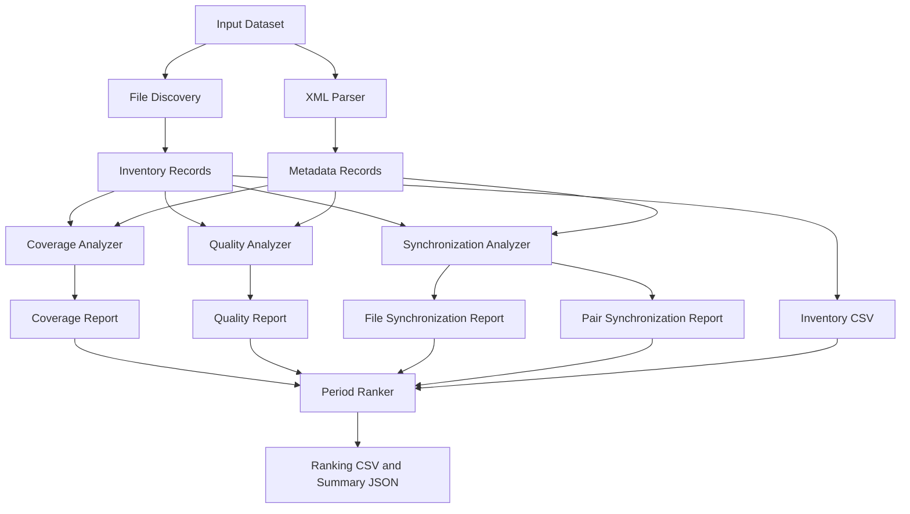

# Analyzer Documentation

## MEDA Data Research & Period Analyzer (MDRPA)

## 1. Purpose

This document provides the technical reference for the scientific analysis modules located in:

`backend/analyzers/`

It describes each analyzer's responsibility, public functions, inputs, outputs, processing behavior, limitations, and integration considerations.

The document reflects the analyzer source code currently present in the repository. It does not define a new scientific methodology or authorize changes to existing analyzer behavior.

The following distinctions are used throughout:

- **Implemented:** A function or module exists in the inspected source code.
- **Input Contract:** The information a function expects to receive.
- **Output Contract:** The information a function returns or writes.
- **Limitation:** A boundary that must be respected when interpreting results.
- **Integration Note:** A requirement for future pipeline integration.

## 2. Analyzer Package Structure

```text
backend/
└── analyzers/
    ├── __init__.py
    ├── meda_common.py
    ├── file_discovery.py
    ├── xml_parser.py
    ├── coverage_analyzer.py
    ├── quality_analyzer.py
    ├── synchronization_analyzer.py
    └── period_ranker.py
```

The analyzers form a collection of independently callable modules.

They do not yet establish a single standardized analyzer interface. In particular, some modules return records directly, while the period ranker consumes previously generated report files.

## 3. Shared Utilities — `meda_common.py`

### 3.1 Responsibility

`meda_common.py` provides shared utilities for:

- Time-axis recognition and parsing.
- XML field ordering.
- XML field metadata structural validation.
- Numeric field identification.
- Time-column selection.
- Normalization of field and column names.

It does not perform complete scientific validation.

### 3.2 Time-Axis Support

The module supports the following time kinds:

| Time Kind | Handling | Important Limitation |
|---|---|---|
| SCLK | Parsed as a finite numeric coordinate | Not converted to UTC |
| UTC | Timezone-aware ISO-8601 values normalized to UTC epoch seconds | Naive timestamps are not assumed to be UTC |
| LMST | Converted to a linear Mars-sol coordinate | Not a UTC conversion |
| LTST | Converted to a nominal Sol/local-clock coordinate | Not a precise elapsed SI-time scale |
| ISO Naive | Timezone-naive ISO values retained as a separate coordinate | Timezone remains unspecified |

The mean Mars solar day constant used by the implementation is:

`SOL_SECONDS = 88775.244`

This is used as a coordinate scale for LMST and nominal LTST handling. It must not be interpreted as an Earth UTC conversion.

### 3.3 Main Functions

| Function | Responsibility |
|---|---|
| `norm(value)` | Normalize names for comparisons |
| `parse_sclk(text)` | Parse a numeric SCLK coordinate |
| `parse_lmst(text)` | Parse LMST into a linear Sol coordinate |
| `parse_ltst(text)` | Parse LTST into a nominal coordinate |
| `parse_iso(text, want_aware)` | Parse ISO-8601 while preserving timezone-awareness rules |
| `column_time_kind(name)` | Identify supported time kinds from field names |
| `ordered_fields(fields)` | Order XML fields by field number, retaining document order as fallback |
| `validate_field_metadata(fields)` | Report structural field metadata warnings |
| `pick_time_column(fields, preference)` | Select a supported time field according to a preference list |
| `numeric_column_indexes(fields, skip)` | Identify XML-declared numeric columns while excluding time fields |

### 3.4 Important Behavior

- Non-finite numeric values are rejected by the shared numeric parser.
- Naive and timezone-aware ISO timestamps are treated separately.
- Missing or invalid XML field numbers do not automatically cause field definitions to be discarded.
- Duplicate field names and field numbers are reported structurally.
- Time-column discovery is based on field names and metadata; it does not prove that the actual CSV values are valid.

### 3.5 Integration Requirements

All analyzers using these utilities must preserve the selected time-axis kind and report parsing failures appropriately.

A parsed coordinate must not automatically be described as a scientifically validated timestamp.

---

## 4. File Discovery — `file_discovery.py`

### 4.1 Responsibility

The File Discovery analyzer recursively inventories supported CSV and XML files inside Sol directories.

It identifies:

- Sol folder names.
- Sol numbers.
- MEDA product codes.
- File extensions.
- Relative paths.
- File sizes.
- Empty-file status.
- CSV/XML matching information.
- File and pair status.
- Inventory issues.

### 4.2 Main Functions

| Function | Signature | Description |
|---|---|---|
| `get_sol_number` | `get_sol_number(folder_name: str) -> int \| None` | Extract a Sol number from a folder name |
| `get_filename_sol` | `get_filename_sol(filename: str) -> int \| None` | Extract a Sol number from a MEDA filename |
| `get_product_code` | `get_product_code(filename: str) -> str \| None` | Extract the product code following `CAL_` |
| `discover_files` | `discover_files(input_dir: Path) -> list[dict]` | Recursively discover and inventory supported files |
| `write_inventory` | `write_inventory(records: list[dict], output_file: Path) -> None` | Write inventory records to CSV |

### 4.3 Input

`discover_files` expects:

- An existing directory.
- A directory containing supported Sol folders.
- Files organized under recognized Sol directory names.

Recognized Sol folder patterns include forms such as:

- `SOL100`
- `SOL_0100`
- `SOL-100`

The implementation supports `.csv` and `.xml` extensions.

### 4.4 Output

The inventory CSV uses the following columns:

| Column | Meaning |
|---|---|
| `sol_folder` | Source Sol folder name |
| `sol_number` | Extracted Sol number |
| `filename` | File name |
| `relative_path` | Path relative to the input root |
| `extension` | File extension |
| `product_code` | Extracted product code |
| `file_size_bytes` | File size |
| `file_status` | File-level status |
| `is_empty` | Whether the file is empty |
| `matching_file` | Matching file name, when found |
| `matching_relative_path` | Matching relative path, when found |
| `pair_status` | CSV/XML pair status |
| `issues` | Recorded inventory issues |

### 4.5 Pairing Behavior

CSV/XML matching requires:

- The same directory.
- A case-insensitive matching filename stem.

Files in different subdirectories must not be paired merely because their names are similar.

The analyzer also avoids assigning nested Sol files to an outer Sol directory.

### 4.6 Limitations

File discovery establishes inventory information only.

It does not establish:

- Successful XML parsing.
- Valid CSV structure.
- Measurement completeness.
- Measurement quality.
- Scientific validity.

A discovered file must not automatically be treated as usable scientific data.

---

## 5. XML Metadata Parser — `xml_parser.py`

### 5.1 Responsibility

The XML Parser extracts documented metadata from MEDA XML files.

It prepares metadata records used by downstream analyzers.

Its responsibilities include:

- XML structure parsing.
- Product metadata extraction.
- Table metadata extraction.
- PDS4 field definition extraction.
- Sol and product identification.
- Matching XML records to CSV files.
- Structural metadata warning generation.
- Metadata inventory creation.

### 5.2 Main Functions

| Function | Responsibility |
|---|---|
| `local_name(tag)` | Extract a namespace-independent XML element name |
| `element_to_dict(element)` | Convert an XML element into a dictionary representation |
| `extract_field_metadata(root)` | Extract documented field definitions |
| `classify_candidate_fields(fields)` | Identify metadata-based field candidates |
| `extract_product_metadata(root)` | Extract product-level metadata |
| `extract_table_metadata(root)` | Extract table-level metadata |
| `parse_xml_file(xml_path, input_root=None, include_full_xml=False)` | Parse one XML file |
| `build_metadata_warning_summary(records)` | Summarize structural metadata warnings |
| `discover_xml_files(input_dir)` | Discover XML files |
| `build_metadata_inventory(input_dir, include_full_xml=False)` | Build the complete metadata inventory |
| `save_json(data, output_file)` | Save metadata as JSON |

### 5.3 Main Input

`parse_xml_file` accepts:

```python
parse_xml_file(
    xml_path: Path,
    input_root: Path | None = None,
    include_full_xml: bool = False,
) -> dict
```

Parameters:

- `xml_path`: XML file to parse.
- `input_root`: Optional root directory used to produce a relative source path.
- `include_full_xml`: Whether to include the complete XML tree in the output.

### 5.4 Metadata Record

A parsed record contains information about the source file and its extracted metadata.

The record includes parsing status and, where available:

- Source path.
- Sol information.
- Product code.
- Product metadata.
- Table metadata.
- Field definitions.
- Structural metadata warnings.
- Parsing error information.

The exact record structure is defined by the current implementation and must be preserved when integrating downstream modules.

### 5.5 Metadata Inventory

`build_metadata_inventory` returns a dictionary containing the parsed metadata records and inventory-level information.

The metadata inventory is saved as JSON through `save_json`.

The current coverage and quality analyzers consume metadata in dictionary form, normally containing a `records` collection.

The synchronization analyzer accepts a list of metadata records instead. The integration layer must adapt this representation without changing record contents.

### 5.6 Structural Validation

The parser reports structural metadata problems separately.

Examples include:

- Missing field names.
- Duplicate field names.
- Missing or invalid field numbers.
- Duplicate field numbers.
- Missing data types.

These warnings describe metadata structure.

They do not determine scientific validity or interpret the meaning of quality flags.

### 5.7 Important Limitation

The XML parser extracts documented metadata. It must not invent meanings for undocumented fields or automatically repair source metadata.

---

## 6. Coverage Analyzer — `coverage_analyzer.py`

### 6.1 Responsibility

The Coverage Analyzer examines CSV file coverage and data structure using the file inventory and XML metadata.

It analyzes:

- CSV row counts.
- Time-field selection.
- Timestamp parsing.
- Missing timestamps.
- Invalid timestamps.
- Duplicate timestamps.
- Out-of-order timestamps.
- Time-coordinate span.
- Median positive time step.
- Large time gaps.
- Numeric value counts.
- Missing numeric values.
- Invalid numeric values.
- Column mapping status.

### 6.2 Main Functions

| Function | Responsibility |
|---|---|
| `load_file_inventory(path)` | Load the file inventory |
| `load_metadata_inventory(path)` | Load metadata inventory |
| `build_metadata_index(metadata)` | Index metadata records for matching |
| `find_xml_record(csv_record, metadata_index)` | Find the corresponding XML metadata record |
| `resolve_csv_path(input_dir, inventory_record)` | Resolve a CSV path |
| `build_column_mapping(header, fields, has_header)` | Map CSV columns to XML field definitions |
| `analyze_csv(csv_path, xml_record, axis_preference, gap_factor)` | Analyze one CSV file |
| `analyze_coverage(input_dir, inventory_records, metadata, gap_factor)` | Analyze CSV coverage across the inventory |
| `build_product_summary(reports, start_sol, end_sol)` | Summarize product coverage |
| `save_coverage_csv(reports, output_file)` | Save coverage reports |
| `save_summary_json(summary, output_file)` | Save coverage summary |

### 6.3 Main Analysis Interface

```python
analyze_coverage(
    input_dir: Path,
    inventory_records: list[dict],
    metadata: dict,
    gap_factor: float = 2.5,
) -> list[dict]
```

Inputs:

- `input_dir`: Root of the source dataset.
- `inventory_records`: File inventory records.
- `metadata`: XML metadata inventory dictionary.
- `gap_factor`: Multiplier used for gap detection.

The analyzer processes CSV inventory entries and uses XML metadata to interpret column definitions.

### 6.4 Gap Detection

The gap threshold is based on the median positive time step.

A gap is identified when an adjacent positive time step exceeds:

`gap_factor × median positive time step`

The configured gap factor must be finite and greater than 1.

The resulting gap statistics are diagnostics of the selected time coordinate and observed sampling.

They must not automatically be interpreted as exact sensor downtime or a scientifically defensible missing-duration estimate.

### 6.5 Output

Coverage reports include information such as:

- Sol number.
- Product code.
- Source file information.
- Row count.
- Selected time field and time kind.
- First and last parsed time.
- Time span.
- Parsed, missing, and invalid timestamp counts.
- Duplicate and out-of-order timestamp counts.
- Median step.
- Gap count and largest gap.
- Numeric value counts.
- Missing and invalid numeric counts.
- Measurement coverage status.
- Column mapping status.
- Notes.

The exact report schema is defined by the implementation.

### 6.6 Interpretation Limitations

Coverage analysis is not equivalent to scientific validation.

In particular:

- A file containing rows does not prove complete measurements.
- Successfully parsed timestamps do not prove sensor uptime.
- Numeric completeness does not prove scientific validity.
- Gap statistics depend on the selected time coordinate and sampling pattern.

---

## 7. Quality Analyzer — `quality_analyzer.py`

### 7.1 Responsibility

The Quality Analyzer examines XML-described fields and corresponding CSV values for documented quality-related, operational/context, uncertainty, and numeric-range information.

It keeps different candidate categories separate.

### 7.2 Main Functions

| Function | Responsibility |
|---|---|
| `load_inventory(path)` | Load file inventory |
| `load_metadata(path)` | Load XML metadata |
| `build_metadata_index(metadata)` | Index metadata records |
| `find_metadata_record(inventory_row, index)` | Find matching metadata |
| `find_csv_path(input_root, inventory_row)` | Resolve CSV source path |
| `field_is_quality_candidate(field)` | Identify explicit quality-related keyword candidates |
| `field_is_operational_context_candidate(field)` | Identify possible operational/context flag candidates |
| `field_is_uncertainty_candidate(field)` | Identify measurement uncertainty candidates |
| `get_field_bounds(field)` | Extract documented numeric bounds |
| `select_field_categories(fields)` | Select fields for analysis |
| `build_column_mapping(first_row, fields, has_header)` | Map CSV columns to metadata fields |
| `analyze_csv(csv_path, inventory_row, xml_record, metadata_status)` | Analyze selected fields in one CSV |
| `run_analysis(input_root, inventory, metadata)` | Run analysis across inventory records |
| `write_report(path, rows)` | Write detailed report |
| `build_summary(rows)` | Build summary statistics |
| `save_summary(path, summary)` | Save summary JSON |

### 7.3 Main Analysis Interface

```python
run_analysis(
    input_root: Path,
    inventory: list[dict],
    metadata: dict,
) -> list[dict]
```

Inputs:

- `input_root`: Source dataset root.
- `inventory`: File inventory records.
- `metadata`: XML metadata inventory dictionary.

The analyzer processes CSV inventory entries and uses the corresponding XML field definitions.

### 7.4 Candidate Categories

The implementation distinguishes the following categories:

| Category | Purpose |
|---|---|
| `quality_field_candidate` | Explicit quality-related field candidates |
| `operational_context_flag_candidate` | Possible operational or contextual flags |
| `measurement_uncertainty` | Fields identified as measurement uncertainty candidates |
| `range_check` | Numeric values checked against documented XML bounds |

Keyword detection is a candidate-identification mechanism. It is not an authoritative scientific classification.

Generic words such as `flag`, `status`, or `state` alone are not sufficient to establish a quality-field meaning.

### 7.5 Numeric Range Checks

The analyzer can use documented XML values such as:

- `valid_minimum`
- `valid_maximum`

These values support numeric range checks.

A range check is not a complete scientific validity assessment.

A value inside documented bounds is not automatically scientifically valid, and a value outside a bound must be interpreted according to the applicable product documentation.

### 7.6 Important Limitations

The analyzer does not:

- Infer undocumented quality-flag meanings.
- Assume binary `1 = good` and `0 = bad`.
- Automatically combine all candidate categories into one quality score.
- Calculate scientific uncertainty merely because an uncertainty field exists.
- Treat metadata warnings as measurement-quality failures.

Operational/context candidates and uncertainty reports must remain distinguishable from quality-field candidates.

---

## 8. Synchronization Analyzer — `synchronization_analyzer.py`

### 8.1 Responsibility

The Synchronization Analyzer examines time-coordinate compatibility and timestamp matching between MEDA products.

It generates file-level timestamp analysis and pair-level comparison reports.

### 8.2 Main Functions

| Function | Responsibility |
|---|---|
| `load_inventory(path)` | Load file inventory |
| `load_metadata(path)` | Load metadata records |
| `build_metadata_index(records)` | Index metadata records |
| `find_metadata_record(inventory_row, index)` | Find matching metadata |
| `resolve_csv_path(input_root, inventory_row)` | Resolve source CSV path |
| `build_column_mapping(first_row, fields, has_header)` | Map CSV columns to XML fields |
| `analyse_timestamp_file(csv_path, inventory_row, xml_record, axis_preference)` | Extract and analyze timestamps from one file |
| `match_one_to_one(first, second, tolerance)` | Match sorted timestamp occurrences one-to-one |
| `compare_timestamp_series(first, second, tolerance, kind_first, kind_second)` | Compare two timestamp series |
| `run_analysis(input_root, inventory, metadata_records, tolerance, axis_preference)` | Run file and pair analysis |
| `write_csv(path, rows, columns)` | Write report CSV |
| `build_summary(file_reports, pair_reports, tolerance)` | Build synchronization summary |
| `save_summary(path, summary)` | Save summary JSON |

### 8.3 Main Analysis Interface

```python
run_analysis(
    input_root: Path,
    inventory: list[dict],
    metadata_records: list[dict],
    tolerance: float,
    axis_preference=DEFAULT_AXIS_PREFERENCE,
) -> tuple[list[dict], list[dict]]
```

Inputs:

- `input_root`: Source dataset root.
- `inventory`: File inventory records.
- `metadata_records`: A list of XML metadata records.
- `tolerance`: Maximum absolute difference allowed in the selected time coordinate.
- `axis_preference`: Preferred time-axis order.

The return value contains:

1. File-level timestamp reports.
2. Pair-level synchronization reports.

### 8.4 Time-Axis Compatibility

The analyzer selects a supported time field using metadata and the configured axis preference.

Products are compared only when their selected time-axis kinds are compatible.

Different time-axis kinds are reported as incompatible.

The analyzer does not silently convert one time axis into another to force a comparison.

### 8.5 One-to-One Matching

`match_one_to_one` matches sorted timestamp occurrences.

Each occurrence may participate in at most one match.

Duplicate timestamp occurrences remain separate observations.

This prevents a single timestamp occurrence from being reused to match multiple observations in the other series.

### 8.6 Tolerance

Tolerance is applied in the selected coordinate.

Its numeric value must not automatically be described as SI seconds.

Its interpretation depends on the selected time axis.

### 8.7 Output

The analyzer produces:

- File-level timestamp analysis.
- Pair-level timestamp comparison.
- Selected time-axis information.
- Parsing and analysis status.
- Match counts.
- Unmatched occurrence counts.
- Match rates.
- Match-difference statistics.
- Overlap information where applicable.
- Notes and compatibility status.

### 8.8 Interpretation Limitations

Synchronization results are diagnostics, not quality scores.

A high match rate does not establish:

- Equal sampling schedules.
- Equivalent scientific measurements.
- Sensor accuracy.
- Continuous instrument operation.
- Scientific validity.

Different products may have different sampling schedules.

---

## 9. Period Ranker — `period_ranker.py`

### 9.1 Responsibility

The Period Ranker compares candidate Sol windows using reports produced by the preceding analyzers.

It produces exploratory comparative scores and ranks.

It does not certify a period as scientifically valid or suitable for a particular research question.

### 9.2 Input Architecture

Unlike the other analyzers, the Period Ranker is report-file-oriented.

Its main entry point is:

```python
run(args) -> dict
```

It reads five report files:

| Argument | Input |
|---|---|
| `args.inventory` | File inventory CSV |
| `args.coverage` | Coverage report CSV |
| `args.quality` | Quality report CSV |
| `args.sync_files` | Synchronization file report CSV |
| `args.sync_pairs` | Synchronization pair report CSV |

It writes:

- Ranking CSV through `args.output`.
- Summary JSON through `args.summary`.

The paths must be supplied explicitly during isolated run execution.

### 9.3 Main Functions

| Function | Responsibility |
|---|---|
| `normalized_weights(weights)` | Normalize a weight dictionary |
| `read_csv(path)` | Read an analyzer report |
| `discover_sol_numbers(*report_rows)` | Discover available Sol numbers |
| `resolve_sol_range(requested_start, requested_end, discovered_sols)` | Resolve the selected Sol range |
| `build_windows(start_sol, end_sol, window_size)` | Create candidate windows |
| `analyse_inventory(rows, start_sol, end_sol)` | Aggregate inventory information |
| `analyse_coverage(rows)` | Aggregate coverage information |
| `analyse_quality(rows)` | Aggregate quality information |
| `analyse_sync_files(rows)` | Aggregate synchronization file information |
| `analyse_sync_pairs(rows)` | Aggregate synchronization pair information |
| `calculate_integrity(coverage_data, integrity_weights)` | Calculate the data-integrity indicator |
| `calculate_sol_metrics(...)` | Calculate available per-Sol metrics |
| `aggregate_window(...)` | Aggregate metrics for a candidate window |
| `rank_windows(rows)` | Rank comparable candidate windows |
| `build_summary(...)` | Build ranking summary |
| `run(args)` | Execute the complete ranking workflow |

### 9.4 Ranking Metrics

The implementation uses four principal metric categories:

| Metric | Purpose |
|---|---|
| File Availability | Availability of configured required products |
| Data Integrity | Timestamp and numeric-value completeness indicators |
| Quality Indicators | Availability of supported documented numerical-bound indicators |
| Synchronization | Available synchronization match-rate information |

The default ranking weights in the current implementation are:

| Metric | Default Weight |
|---|---:|
| File Availability | 0.20 |
| Data Integrity | 0.45 |
| Quality Indicators | 0.15 |
| Synchronization | 0.20 |

Weights are configurable through command-line arguments.

These are exploratory configuration weights, not scientifically calibrated constants.

### 9.5 Required Products

The default required product codes are:

- ATS
- PS
- RDS
- RHS
- TIRS
- WS

ENG is optional by default.

The required product set can be overridden through `--required-products`.

File availability is calculated against the configured required product set.

### 9.6 Data Integrity

The data-integrity indicator uses available timestamp and numeric-value completeness information.

The default internal integrity component weights are:

- Timestamps: 1.0
- Values: 1.0

Unavailable components must not silently be interpreted as zero-quality measurements.

### 9.7 Candidate Window Aggregation

The ranker:

1. Resolves the requested Sol range.
2. Builds candidate windows.
3. Calculates available metrics for each Sol.
4. Aggregates available metric values across each window.
5. Applies configured metric weights.
6. Excludes unavailable metrics from the weighted calculation.
7. Renormalizes the remaining positive weights.
8. Determines whether the window meets the ranking requirements.
9. Groups comparable windows.
10. Assigns ranks within each comparison group.

### 9.8 Ranking Status

The implementation distinguishes:

| Status | Meaning |
|---|---|
| `rankable` | The window meets the required metric availability and is a full window |
| `partial_window` | The window is incomplete relative to the configured window size |
| `insufficient_data` | Too few positively weighted metrics are available |

Partial windows are not ranked against full candidate windows.

### 9.9 Comparison Groups

Windows are ranked only against windows with the same available positively weighted metric signature.

Ranks from different comparison groups are not directly comparable.

A single global best window is reported only when there is one comparison group.

When multiple groups exist, the summary reports the best window in each group rather than presenting an unsupported global comparison.

### 9.10 Output

The ranking CSV includes:

- Rank.
- Comparison group.
- Window start and end Sol.
- Window label.
- Ranking status.
- Partial-window indicator.
- Exploratory score.
- Available metric count.
- Metrics used.
- Metric-specific scores and Sol counts.
- Explanatory reasons.

The summary JSON includes:

- Ranking type.
- Selected Sol range.
- Window size.
- Candidate and rankable window counts.
- Comparison group information.
- Ranking weights.
- Required and optional products.
- Minimum Sol fraction.
- Minimum metric requirement.
- Best candidate by comparison group.
- Sol-level metrics.
- Input report paths.
- Important limitations.

### 9.11 Important Limitations

- Scores are exploratory indicators, not scientific validation.
- Ranking weights are configurable and not scientifically calibrated.
- Unavailable metrics are excluded and remaining positive weights are renormalized.
- Zero-weight metrics do not contribute to scores or comparison groups.
- Different comparison groups must not be treated as directly comparable.
- Partial windows are listed but not ranked.
- Timestamp parsing success is not equivalent to sensor uptime.
- Numeric completeness is not equivalent to scientific validity.
- Synchronization scores depend on sampling schedules and matching tolerance.
- Product availability does not establish measurement completeness.
- Candidate periods require further scientific review before research use.

---

## 10. Analyzer Dependency Flow

The intended analytical dependency flow is:



This diagram describes the intended workflow. The current modules are independently callable; a completed integrated pipeline must not be assumed.

## 11. Interface Differences and Integration Requirements

The analyzers do not currently expose one universal interface.

The following differences must be handled explicitly.

### 11.1 Metadata Representation

| Analyzer | Metadata Input |
|---|---|
| Coverage Analyzer | Metadata dictionary |
| Quality Analyzer | Metadata dictionary |
| Synchronization Analyzer | List of metadata records |

The integration layer must normalize or adapt the representation at the boundary.

The original metadata records must remain unchanged.

### 11.2 Return Types

| Analyzer | Main Return |
|---|---|
| File Discovery | List of inventory dictionaries |
| XML Parser | Metadata record or metadata inventory dictionary |
| Coverage Analyzer | List of coverage report dictionaries |
| Quality Analyzer | List of quality report dictionaries |
| Synchronization Analyzer | Tuple containing file reports and pair reports |
| Period Ranker | Summary dictionary; also writes ranking CSV and summary JSON |

### 11.3 File-Based Ranking

The Period Ranker consumes report paths rather than receiving all preceding analyzer results as direct function arguments.

Pipeline integration must generate and validate the required reports before invoking it.

### 11.4 Explicit Paths

Analyzer command-line defaults may refer to shared `input/` and `output/` locations.

Run-based execution must provide explicit paths associated with the current Run ID.

Default paths must not cause separate runs to share outputs unintentionally.

### 11.5 No Assumed Unified API

The current analyzer modules must not be described as implementing a shared standardized result object or pipeline contract.

Any future adapters or standardized contracts require separate design, approval, and testing.

---

## 12. Command-Line Interfaces

The analyzer modules provide standalone command-line entry points.

The following options are present in the inspected implementations:

| Module | Selected CLI Options |
|---|---|
| `file_discovery.py` | `--input`, `--output` |
| `xml_parser.py` | `--input`, `--output`, `--include-full-xml` |
| `coverage_analyzer.py` | `--input`, `--inventory`, `--metadata`, `--output`, `--summary`, `--start-sol`, `--end-sol`, `--gap-factor` |
| `quality_analyzer.py` | `--input`, `--inventory`, `--metadata`, `--output`, `--summary` |
| `synchronization_analyzer.py` | `--input`, `--inventory`, `--metadata`, `--file-report`, `--pair-report`, `--summary`, `--tolerance`, `--time-axis` |
| `period_ranker.py` | Report input paths, output paths, Sol range, window size, metric thresholds, product selection, and ranking weights |

Exact defaults and supported values must be checked against the current source code.

Use each module's `--help` output to inspect its current command-line interface before execution.

No unified application command is documented here because a completed integrated pipeline has not yet been established.

---

## 13. Testing and Regression Requirements

Each analyzer must be tested independently before and after integration changes.

Recommended test areas include:

### 13.1 Shared Utilities

- Time-axis parsing.
- Timezone-awareness handling.
- Invalid and non-finite values.
- XML field ordering.
- Duplicate field detection.
- Missing field metadata.
- Time-column selection.

### 13.2 File Discovery

- Recognized and unrecognized Sol folders.
- Nested Sol directories.
- Supported and unsupported extensions.
- CSV/XML matching.
- Same filename stems in different directories.
- Empty files.
- Missing input directories.

### 13.3 XML Parser

- Valid XML.
- Malformed XML.
- Missing field definitions.
- Duplicate names and field numbers.
- Missing data types.
- Relative source paths.
- Optional full XML output.

### 13.4 Coverage Analyzer

- Missing timestamps.
- Invalid timestamps.
- Duplicate timestamps.
- Out-of-order timestamps.
- Missing numeric values.
- Invalid numeric values.
- Different column mappings.
- Gap detection behavior.
- Missing or invalid XML metadata.

### 13.5 Quality Analyzer

- Quality keyword candidates.
- Operational/context candidates.
- Uncertainty candidates.
- Documented numeric bounds.
- Missing field definitions.
- Missing and invalid values.
- Separation between candidate categories.

### 13.6 Synchronization Analyzer

- Compatible time axes.
- Incompatible time axes.
- Invalid timestamps.
- Duplicate timestamp occurrences.
- One-to-one matching.
- Zero and nonzero tolerances.
- Different product sampling schedules.
- Missing metadata.

### 13.7 Period Ranker

- Required product configuration.
- Missing metrics.
- Weight normalization.
- Minimum Sol fraction.
- Minimum metric requirements.
- Partial windows.
- Multiple comparison groups.
- Ranking tie behavior.
- Missing input reports.
- Explicit and automatically detected Sol ranges.

### 13.8 Regression Principle

Changes to analyzer interfaces must not silently change scientific calculations or the meaning of existing report fields.

Regression results must be compared against documented expectations and representative datasets.

---

## 14. Scientific Interpretation Boundaries

The analyzers provide technical and exploratory evidence.

Their outputs must be interpreted with the following distinctions:

- File existence is not data completeness.
- Data completeness is not measurement quality.
- Measurement quality is not scientific validity.
- XML metadata warnings are not automatically measurement-quality failures.
- Documented numeric bounds are not comprehensive scientific validation.
- Timestamp matching does not prove equivalent measurements.
- Synchronization match rates are not quality scores.
- Candidate ranking does not certify a research period.
- MEDA observations represent measurements at the rover location and observation times, not continuous spatial weather coverage across every geographical cell.

No undocumented quality-flag semantics or timestamp conversions may be introduced during analyzer integration.

---

## 15. Maintenance and Change Control

Changes to analyzer modules must follow the project Development Guide.

Before modifying an analyzer:

1. Inspect the current implementation.
2. Identify the exact function and interface affected.
3. Record the reason for the change.
4. Identify scientific and integration risks.
5. Obtain approval for the proposed scope.
6. Implement only the approved change.
7. Execute relevant unit and regression tests.
8. Review output compatibility.
9. Update this document when the public interface or behavior changes.
10. Obtain acceptance before closing the task.

Scientific logic changes require separate scientific review and approval.

## 16. Related Documentation

- `README.md` — Project overview and roadmap.
- `docs/development_guide.md` — Development workflow and change control.
- `docs/architecture.md` — System architecture and component responsibilities.
- `docs/backend_integration_specification.md` — Backend integration contracts.
- `docs/scientific_methodology.md` — Scientific methodology and interpretation constraints.
- `docs/user_guide.md` — End-user instructions.

## 17. Governing Principle

**Analyzer documentation must describe actual source-code behavior, preserve interface accuracy, and distinguish technical analysis from scientific interpretation.**