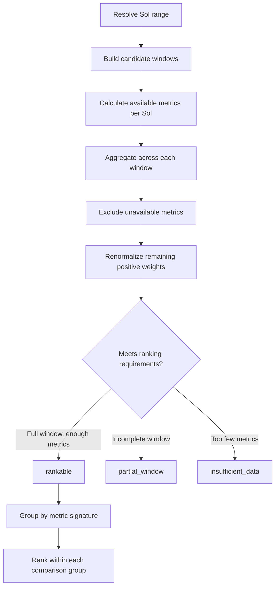
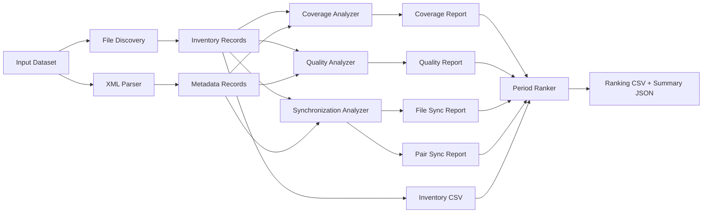

<div align="center">

# 🧪 Analyzer Technical Reference

### MEDA Data Research & Period Analyzer (MDRPA) · `backend/analyzers/`


-3B82F6?style=for-the-badge)


*This document describes what the analyzer source code does today. It does not define new scientific methodology or authorize changes to analyzer behavior.*

</div>

---

## 📑 Contents

| | | |
|---|---|---|
| [1. Purpose & Terminology](#1-purpose--terminology) | [8. Coverage Analyzer](#8--coverage-analyzer) | [15. Testing & Regression](#15-testing--regression-requirements) |
| [2. Development Status](#2-development-status) | [9. Quality Analyzer](#9--quality-analyzer) | [16. Interpretation Boundaries](#16-scientific-interpretation-boundaries) |
| [3. Reliability & Accuracy](#3-reliability-and-accuracy-assessment) | [10. Synchronization Analyzer](#10--synchronization-analyzer) | [17. Development Priorities](#17-remaining-development-priorities) |
| [4. Package Structure](#4-package-structure) | [11. Period Ranker](#11--period-ranker) | [18. Change Control](#18-maintenance-and-change-control) |
| [5. Shared Utilities](#5--shared-utilities) | [12. Dependency Flow](#12-dependency-flow) | [19. Related Docs](#19-related-documentation) |
| [6. File Discovery](#6--file-discovery) | [13. Integration Requirements](#13-interface-differences-and-integration-requirements) | [20. Summary](#20-assessment-summary) |
| [7. XML Metadata Parser](#7--xml-metadata-parser) | [14. Command-Line Interfaces](#14-command-line-interfaces) | [21. Governing Principle](#21-governing-principle) |

---

## 1. Purpose & Terminology

This is the technical reference for the scientific analysis modules in `backend/analyzers/`. For each analyzer it describes responsibility, public functions, inputs, outputs, behavior, status, limitations, and integration considerations.

MDRPA's long-term vision is a broader platform for NASA mission data. The **current** phase is:

> **NASA Perseverance Rover · Mars Environmental Dynamics Analyzer (MEDA) · Calibrated Data.**
> Derived and Partially Processed MEDA products are out of scope.

### 1.1 Status vocabulary

| Term | Meaning |
|---|---|
| ✅ **Implemented** | The function or module exists in the inspected source code. |
| 🧪 **Tested** | Passed specific tests. Does not imply complete validation. |
| 🏁 **Accepted** | Passed the project's required review and acceptance process. |
| 🔧 **In Progress** | Development or improvement is ongoing. |
| 🗓️ **Planned** | Intended but not yet implemented. |
| 📥 **Input Contract** | What a function expects to receive. |
| 📤 **Output Contract** | What a function returns or writes. |
| ⚠️ **Limitation** | A boundary that must be respected when interpreting results. |
| 🔌 **Integration Note** | A requirement for future pipeline integration. |

> [!IMPORTANT]
> A component must not be described as complete merely because its initial implementation exists.

---

## 2. Development Status

The analyzer layer is the scientific core of MDRPA: it examines calibrated MEDA products, extracts characteristics, produces indicators, and prepares inputs for candidate period evaluation.

| Component | State |
|---|---|
| Shared MEDA Utilities | ✅ Implemented · ongoing review and refinement |
| File Discovery | ✅ Implemented · ongoing testing and improvement |
| XML Metadata Parser | ✅ Implemented · ongoing validation and refinement |
| Coverage Analyzer | ✅ Implemented · ongoing scientific and performance review |
| Quality Analyzer | ✅ Implemented · ongoing development and scientific review |
| Synchronization Analyzer | ✅ Implemented · ongoing testing and refinement |
| Period Ranker | ✅ Implemented · ongoing methodology and integration review |

This table describes the implementation stage. It does not mean every input condition, scientific assumption, or integration scenario is validated.

### 2.1 Current capabilities

- Discover and inventory supported MEDA files.
- Extract metadata and field definitions from XML products.
- Examine CSV structure and temporal coverage.
- Investigate field-level numerical characteristics.
- Identify documented numerical boundaries.
- Examine candidate quality-related and uncertainty-related fields.
- Compare timestamps across MEDA products.
- Evaluate candidate Sol windows with available indicators.

### 2.2 Known limitations

The analyzer layer is **not** yet a finalized scientific engine. Further work is needed in:

| Area | Area |
|---|---|
| Scientific interpretation and validation | Special-value and special-constant handling |
| Official quality-flag interpretation (where documented) | Measurement uncertainty analysis |
| Physical plausibility assessment | Analyzer-to-analyzer consistency |
| Pipeline integration | Performance optimization |
| Regression testing on representative datasets | Report completeness and traceability |

Some areas have partial infrastructure; others are planned. The presence of a field, function, or report column is **not** proof that its scientific meaning or calculation has been validated.

---

## 3. Reliability and Accuracy Assessment

> [!NOTE]
> The figures below are an **engineering estimate** of development maturity. They are not a certification, a benchmark, or a statistically measured accuracy score.

### 3.1 Operational reliability: ~65% (preliminary)

Reflects the existence of the principal modules, availability of their main workflows, structured outputs, the current level of testing, and the remaining edge cases and validation work.

It is a subjective assessment. It does **not** mean 65% of executions are correct or that 35% are wrong.

### 3.2 Scientific accuracy: Not Yet Quantified

A single accuracy percentage cannot responsibly be given, because the analyzers produce different kinds of output and each needs its own validation method:

| Output | How it can be validated |
|---|---|
| File inventory | Against a manually verified file inventory |
| XML metadata extraction | Against authoritative XML content |
| Timestamp parsing | Against known time-coordinate examples |
| Coverage statistics | Against independently calculated results |
| Synchronization matching | Against controlled timestamp series |
| Ranking behavior | Against documented metric calculations and expected ordering |

This does not mean results are inaccurate. It means a comprehensive figure has not yet been established.

### 3.3 What establishing accuracy requires

1. Representative official calibrated MEDA products.
2. Authoritative XML metadata and instrument documentation.
3. Independently calculated expected results.
4. Controlled test cases for known edge conditions.
5. Comparison of analyzer outputs against reference results.
6. Documented discrepancies and their resolution.
7. Regression testing after scientific logic changes.
8. Repeated validation across products and Sol ranges.

### 3.4 Reliability vs. accuracy

| Assessment | Current state | Meaning |
|---|---|---|
| Operational Reliability | ≈ 65% | Preliminary estimate of development maturity |
| Scientific Accuracy | Not Yet Quantified | No comprehensive reference-based percentage |
| Integration Maturity | 🔧 In Progress | Workflows still need broader pipeline integration |
| Scientific Validation | 🔧 In Progress | More reference-based testing and review needed |

Technically stable execution does not guarantee scientific correctness, and a sound calculation in one analyzer does not make the whole application ready for research use.

---

## 4. Package Structure

```text
backend/
└── analyzers/
    ├── __init__.py
    ├── meda_common.py              shared time/field utilities
    ├── file_discovery.py           inventory
    ├── xml_parser.py               metadata extraction
    ├── coverage_analyzer.py        temporal & value coverage
    ├── quality_analyzer.py         field-level quality candidates & ranges
    ├── synchronization_analyzer.py cross-product timestamp matching
    └── period_ranker.py            candidate window comparison
```

The analyzers are independently callable modules. They do **not** yet share a standardized analyzer interface: some return records directly, while the Period Ranker consumes previously generated report files.

### At a glance

| Module | Consumes | Produces |
|---|---|---|
| `file_discovery` | Input directory | Inventory records → CSV |
| `xml_parser` | XML files | Metadata records → JSON |
| `coverage_analyzer` | Inventory + metadata | Coverage reports (CSV) + summary (JSON) |
| `quality_analyzer` | Inventory + metadata | Quality reports (CSV) + summary (JSON) |
| `synchronization_analyzer` | Inventory + metadata records | File + pair reports (CSV) + summary (JSON) |
| `period_ranker` | Five report CSVs | Ranking CSV + summary JSON |

---

## 5. 🧰 Shared Utilities

**Module:** `meda_common.py`

Provides time-axis recognition and parsing, XML field ordering, structural field-metadata validation, numeric field identification, time-column selection, and name normalization. It does not perform complete scientific validation.

### 5.1 Supported time kinds

| Kind | Handling | ⚠️ Limitation |
|---|---|---|
| **SCLK** | Parsed as a finite numeric coordinate | Not converted to UTC |
| **UTC** | Timezone-aware ISO-8601 normalized to UTC epoch seconds | Naive timestamps are not assumed to be UTC |
| **LMST** | Converted to a linear Mars-sol coordinate | Not a UTC conversion |
| **LTST** | Converted to a nominal Sol/local-clock coordinate | Not a precise elapsed SI-time scale |
| **ISO Naive** | Kept as a separate coordinate | Timezone remains unspecified |

Mean Mars solar day constant used: `SOL_SECONDS = 88775.244`. It is a **coordinate scale** for LMST and nominal LTST handling, not an Earth UTC conversion.

<details>
<summary><b>Main functions</b></summary>

| Function | Responsibility |
|---|---|
| `norm(value)` | Normalize names for comparison |
| `parse_sclk(text)` | Parse a numeric SCLK coordinate |
| `parse_lmst(text)` | Parse LMST into a linear Sol coordinate |
| `parse_ltst(text)` | Parse LTST into a nominal coordinate |
| `parse_iso(text, want_aware)` | Parse ISO-8601 preserving timezone-awareness rules |
| `column_time_kind(name)` | Identify supported time kinds from field names |
| `ordered_fields(fields)` | Order XML fields by field number, document order as fallback |
| `validate_field_metadata(fields)` | Report structural field-metadata warnings |
| `pick_time_column(fields, preference)` | Select a supported time field by preference list |
| `numeric_column_indexes(fields, skip)` | Identify XML-declared numeric columns, excluding time fields |

</details>

### 5.2 Behavior to know

- Non-finite numeric values are rejected by the shared numeric parser.
- Naive and timezone-aware ISO timestamps are handled separately.
- Missing or invalid XML field numbers do not automatically discard field definitions.
- Duplicate field names and numbers are reported structurally.
- Time-column discovery uses names and metadata; it does not prove the CSV values are valid.

> [!WARNING]
> 🔌 Every analyzer using these utilities must preserve the selected time-axis kind and report parse failures. A parsed coordinate is not a scientifically validated timestamp.

---

## 6. 📁 File Discovery

**Module:** `file_discovery.py`

Recursively inventories supported `.csv` and `.xml` files inside Sol directories.

**Records:** Sol folder and number · product code · extension · relative path · size · empty-file status · CSV/XML pairing · file and pair status · issues.

### 6.1 Functions

| Function | Signature | Description |
|---|---|---|
| `get_sol_number` | `get_sol_number(folder_name: str) -> int \| None` | Sol number from a folder name |
| `get_filename_sol` | `get_filename_sol(filename: str) -> int \| None` | Sol number from a MEDA filename |
| `get_product_code` | `get_product_code(filename: str) -> str \| None` | Product code following `CAL_` |
| `discover_files` | `discover_files(input_dir: Path) -> list[dict]` | Recursively discover and inventory files |
| `write_inventory` | `write_inventory(records: list[dict], output_file: Path) -> None` | Write inventory to CSV |

### 6.2 📥 Input

An existing directory containing recognized Sol folders, such as `SOL100`, `SOL_0100`, `SOL-100`.

### 6.3 📤 Output columns

| Column | Meaning |
|---|---|
| `sol_folder` | Source Sol folder name |
| `sol_number` | Extracted Sol number |
| `filename` | File name |
| `relative_path` | Path relative to input root |
| `extension` | File extension |
| `product_code` | Extracted product code |
| `file_size_bytes` | File size |
| `file_status` | File-level status |
| `is_empty` | Whether the file is empty |
| `matching_file` | Matching file name, if found |
| `matching_relative_path` | Matching relative path, if found |
| `pair_status` | CSV/XML pair status |
| `issues` | Recorded inventory issues |

### 6.4 Pairing rules

A CSV/XML pair requires **the same directory** and a **case-insensitive matching filename stem**. Files in different subdirectories are never paired just because names are similar. Nested Sol files are not assigned to an outer Sol directory.

> [!CAUTION]
> ⚠️ Discovery establishes inventory only. It does not establish successful XML parsing, valid CSV structure, completeness, quality, or scientific validity.

---

## 7. 📄 XML Metadata Parser

**Module:** `xml_parser.py`

Extracts documented metadata from MEDA XML files and prepares records for downstream analyzers: XML structure, product and table metadata, PDS4 field definitions, Sol and product identification, CSV matching, structural warnings, and the metadata inventory.

<details>
<summary><b>Main functions</b></summary>

| Function | Responsibility |
|---|---|
| `local_name(tag)` | Namespace-independent XML element name |
| `element_to_dict(element)` | Convert an XML element to a dictionary |
| `extract_field_metadata(root)` | Extract documented field definitions |
| `classify_candidate_fields(fields)` | Identify metadata-based field candidates |
| `extract_product_metadata(root)` | Product-level metadata |
| `extract_table_metadata(root)` | Table-level metadata |
| `parse_xml_file(xml_path, input_root=None, include_full_xml=False)` | Parse one XML file |
| `build_metadata_warning_summary(records)` | Summarize structural warnings |
| `discover_xml_files(input_dir)` | Discover XML files |
| `build_metadata_inventory(input_dir, include_full_xml=False)` | Build the full metadata inventory |
| `save_json(data, output_file)` | Save metadata as JSON |

</details>

### 7.1 📥 Main input

```python
parse_xml_file(
    xml_path: Path,
    input_root: Path | None = None,
    include_full_xml: bool = False,
) -> dict
```

| Parameter | Purpose |
|---|---|
| `xml_path` | XML file to parse |
| `input_root` | Optional root used to produce a relative source path |
| `include_full_xml` | Include the complete XML tree in the output |

### 7.2 📤 Metadata record

Carries parsing status and, where available: source path, Sol information, product code, product metadata, table metadata, field definitions, structural warnings, and parsing error information. The exact structure is defined by the implementation and **must be preserved** when integrating downstream modules.

### 7.3 Metadata inventory

`build_metadata_inventory` returns a dictionary of parsed records plus inventory-level information, saved as JSON via `save_json`. Coverage and Quality consume it as a dictionary (normally with a `records` collection); Synchronization takes a **list of records**. The integration layer adapts this without changing record contents.

### 7.4 Structural validation

Reported separately: missing field names, duplicate names, missing or invalid field numbers, duplicate numbers, missing data types. These describe **metadata structure**, not scientific validity or the meaning of quality flags.

> [!CAUTION]
> ⚠️ The parser extracts documented metadata. It must not invent meanings for undocumented fields or automatically repair source metadata.

---

## 8. ⏱️ Coverage Analyzer

**Module:** `coverage_analyzer.py`

Examines CSV coverage and structure using the inventory and XML metadata.

**Analyzes:** row counts · time-field selection · timestamp parsing · missing, invalid, duplicate, and out-of-order timestamps · time-coordinate span · median positive time step · large gaps · numeric, missing, and invalid value counts · column mapping status.

<details>
<summary><b>Main functions</b></summary>

| Function | Responsibility |
|---|---|
| `load_file_inventory(path)` | Load the file inventory |
| `load_metadata_inventory(path)` | Load metadata inventory |
| `build_metadata_index(metadata)` | Index metadata records for matching |
| `find_xml_record(csv_record, metadata_index)` | Find the corresponding XML record |
| `resolve_csv_path(input_dir, inventory_record)` | Resolve a CSV path |
| `build_column_mapping(header, fields, has_header)` | Map CSV columns to XML fields |
| `analyze_csv(csv_path, xml_record, axis_preference, gap_factor)` | Analyze one CSV |
| `analyze_coverage(input_dir, inventory_records, metadata, gap_factor)` | Analyze coverage across the inventory |
| `build_product_summary(reports, start_sol, end_sol)` | Summarize product coverage |
| `save_coverage_csv(reports, output_file)` | Save coverage reports |
| `save_summary_json(summary, output_file)` | Save coverage summary |

</details>

### 8.1 📥 Main interface

```python
analyze_coverage(
    input_dir: Path,
    inventory_records: list[dict],
    metadata: dict,
    gap_factor: float = 2.5,
) -> list[dict]
```

### 8.2 Gap detection

A gap is an adjacent positive time step exceeding:

```text
gap_factor × median positive time step
```

`gap_factor` must be finite and greater than 1. Gap statistics are diagnostics of the selected time coordinate and observed sampling, **not** exact sensor downtime or a defensible missing-duration estimate.

### 8.3 📤 Output

Per file: Sol · product code · source file info · row count · selected time field and kind · first/last parsed time · span · parsed/missing/invalid timestamp counts · duplicate and out-of-order counts · median step · gap count and largest gap · numeric, missing, and invalid value counts · measurement coverage status · column mapping status · notes. The exact schema is defined by the implementation.

> [!CAUTION]
> ⚠️ Rows in a file do not prove complete measurements. Parsed timestamps do not prove uptime. Numeric completeness does not prove validity. Gap statistics depend on the selected coordinate and sampling pattern.

---

## 9. 🧪 Quality Analyzer

**Module:** `quality_analyzer.py`

Examines XML-described fields and matching CSV values for quality-related, operational/context, and uncertainty candidates, plus documented numeric ranges. Candidate categories are kept separate.

<details>
<summary><b>Main functions</b></summary>

| Function | Responsibility |
|---|---|
| `load_inventory(path)` | Load file inventory |
| `load_metadata(path)` | Load XML metadata |
| `build_metadata_index(metadata)` | Index metadata records |
| `find_metadata_record(inventory_row, index)` | Find matching metadata |
| `find_csv_path(input_root, inventory_row)` | Resolve CSV source path |
| `field_is_quality_candidate(field)` | Explicit quality-keyword candidates |
| `field_is_operational_context_candidate(field)` | Possible operational/context flag candidates |
| `field_is_uncertainty_candidate(field)` | Measurement uncertainty candidates |
| `get_field_bounds(field)` | Extract documented numeric bounds |
| `select_field_categories(fields)` | Select fields for analysis |
| `build_column_mapping(first_row, fields, has_header)` | Map CSV columns to fields |
| `analyze_csv(csv_path, inventory_row, xml_record, metadata_status)` | Analyze selected fields in one CSV |
| `run_analysis(input_root, inventory, metadata)` | Run across inventory records |
| `write_report(path, rows)` | Write detailed report |
| `build_summary(rows)` | Build summary statistics |
| `save_summary(path, summary)` | Save summary JSON |

</details>

### 9.1 📥 Main interface

```python
run_analysis(
    input_root: Path,
    inventory: list[dict],
    metadata: dict,
) -> list[dict]
```

### 9.2 Candidate categories

| Category | Purpose |
|---|---|
| `quality_field_candidate` | Explicit quality-related field candidates |
| `operational_context_flag_candidate` | Possible operational or contextual flags |
| `measurement_uncertainty` | Fields identified as uncertainty candidates |
| `range_check` | Numeric values checked against documented XML bounds |

Keyword detection **identifies candidates**; it is not an authoritative scientific classification. Words like `flag`, `status`, or `state` alone do not establish a quality-field meaning.

### 9.3 Numeric range checks

Uses documented `valid_minimum` and `valid_maximum`. A value inside the bounds is not automatically valid, and a value outside must be interpreted per the applicable product documentation.

### 9.4 What the analyzer does **not** do

- ❌ Infer undocumented quality-flag meanings.
- ❌ Assume binary `1 = good` / `0 = bad`.
- ❌ Combine all candidate categories into one quality score.
- ❌ Calculate scientific uncertainty merely because an uncertainty field exists.
- ❌ Treat metadata warnings as measurement-quality failures.

Operational/context candidates and uncertainty reports remain distinguishable from quality-field candidates.

---

## 10. 🔗 Synchronization Analyzer

**Module:** `synchronization_analyzer.py`

Examines time-coordinate compatibility and timestamp matching between MEDA products, producing file-level and pair-level reports.

<details>
<summary><b>Main functions</b></summary>

| Function | Responsibility |
|---|---|
| `load_inventory(path)` | Load file inventory |
| `load_metadata(path)` | Load metadata records |
| `build_metadata_index(records)` | Index metadata records |
| `find_metadata_record(inventory_row, index)` | Find matching metadata |
| `resolve_csv_path(input_root, inventory_row)` | Resolve source CSV path |
| `build_column_mapping(first_row, fields, has_header)` | Map CSV columns to XML fields |
| `analyse_timestamp_file(csv_path, inventory_row, xml_record, axis_preference)` | Extract and analyze timestamps from one file |
| `match_one_to_one(first, second, tolerance)` | Match sorted timestamp occurrences one-to-one |
| `compare_timestamp_series(first, second, tolerance, kind_first, kind_second)` | Compare two series |
| `run_analysis(input_root, inventory, metadata_records, tolerance, axis_preference)` | Run file and pair analysis |
| `write_csv(path, rows, columns)` | Write report CSV |
| `build_summary(file_reports, pair_reports, tolerance)` | Build summary |
| `save_summary(path, summary)` | Save summary JSON |

</details>

### 10.1 📥 Main interface

```python
run_analysis(
    input_root: Path,
    inventory: list[dict],
    metadata_records: list[dict],
    tolerance: float,
    axis_preference=DEFAULT_AXIS_PREFERENCE,
) -> tuple[list[dict], list[dict]]
```

Returns **(file-level timestamp reports, pair-level synchronization reports)**. `tolerance` is the maximum absolute difference in the *selected time coordinate*.

### 10.2 Design rules

| Rule | Behavior |
|---|---|
| **Axis compatibility** | Products compare only when their selected time-axis kinds are compatible. Mismatches are reported as incompatible. No silent axis conversion. |
| **One-to-one matching** | Each timestamp occurrence participates in at most one match, so one occurrence is never reused against multiple observations. |
| **Duplicates** | Duplicate timestamp occurrences remain separate observations. |
| **Tolerance** | Applied in the selected coordinate. Not automatically SI seconds. |

### 10.3 📤 Output

File-level and pair-level analysis, selected time-axis info, parsing and analysis status, match counts, unmatched counts, match rates, match-difference statistics, overlap information where applicable, notes, and compatibility status.

> [!CAUTION]
> ⚠️ Synchronization results are diagnostics, **not quality scores**. A high match rate does not establish equal sampling schedules, equivalent measurements, sensor accuracy, continuous operation, or validity.

---

## 11. 🏁 Period Ranker

**Module:** `period_ranker.py`

Compares candidate Sol windows using reports from the preceding analyzers and produces **exploratory** scores and ranks. It does not certify a period as scientifically valid or suitable for a research question.

### 11.1 📥 Input architecture

Unlike the other analyzers, the ranker is **report-file-oriented**. Entry point: `run(args) -> dict`.

| Argument | Input |
|---|---|
| `args.inventory` | File inventory CSV |
| `args.coverage` | Coverage report CSV |
| `args.quality` | Quality report CSV |
| `args.sync_files` | Synchronization file report CSV |
| `args.sync_pairs` | Synchronization pair report CSV |

Writes the ranking CSV (`args.output`) and summary JSON (`args.summary`). Paths must be supplied explicitly during isolated run execution.

<details>
<summary><b>Main functions</b></summary>

| Function | Responsibility |
|---|---|
| `normalized_weights(weights)` | Normalize a weight dictionary |
| `read_csv(path)` | Read an analyzer report |
| `discover_sol_numbers(*report_rows)` | Discover available Sol numbers |
| `resolve_sol_range(requested_start, requested_end, discovered_sols)` | Resolve the selected Sol range |
| `build_windows(start_sol, end_sol, window_size)` | Create candidate windows |
| `analyse_inventory(rows, start_sol, end_sol)` | Aggregate inventory information |
| `analyse_coverage(rows)` | Aggregate coverage information |
| `analyse_quality(rows)` | Aggregate quality information |
| `analyse_sync_files(rows)` | Aggregate sync file information |
| `analyse_sync_pairs(rows)` | Aggregate sync pair information |
| `calculate_integrity(coverage_data, integrity_weights)` | Data-integrity indicator |
| `calculate_sol_metrics(...)` | Available per-Sol metrics |
| `aggregate_window(...)` | Aggregate metrics for a window |
| `rank_windows(rows)` | Rank comparable windows |
| `build_summary(...)` | Build ranking summary |
| `run(args)` | Execute the full ranking workflow |

</details>

### 11.2 Metrics and default weights

| Metric | Purpose | Default weight |
|---|---|:-:|
| **File Availability** | Availability of configured required products | `0.20` |
| **Data Integrity** | Timestamp and numeric-value completeness indicators | `0.45` |
| **Quality Indicators** | Availability of supported documented numerical-bound indicators | `0.15` |
| **Synchronization** | Available synchronization match-rate information | `0.20` |

Weights are configurable via command-line arguments. They are **exploratory, not scientifically calibrated constants**.

**Required products (default):** `ATS` · `PS` · `RDS` · `RHS` · `TIRS` · `WS`. `ENG` is optional by default. Override with `--required-products`.

**Data integrity** uses timestamp and numeric-value completeness with default internal weights Timestamps `1.0` and Values `1.0`. Unavailable components are never silently treated as zero quality.

### 11.3 How a window is scored



### 11.4 Ranking status

| Status | Meaning |
|---|---|
| `rankable` | Meets required metric availability and is a full window |
| `partial_window` | Incomplete relative to the configured window size |
| `insufficient_data` | Too few positively weighted metrics available |

Partial windows are listed but never ranked against full windows.

### 11.5 Comparison groups

Windows are ranked only against windows with the **same available positively weighted metric signature**. Ranks from different groups are not directly comparable. A single global best window is reported only when there is **one** group; otherwise the summary reports the best window **per group**.

### 11.6 📤 Output

<table>
<tr><th>Ranking CSV</th><th>Summary JSON</th></tr>
<tr><td valign="top">

Rank · comparison group · window start/end Sol · label · ranking status · partial-window flag · exploratory score · available metric count · metrics used · metric-specific scores and Sol counts · explanatory reasons

</td><td valign="top">

Ranking type · Sol range · window size · candidate and rankable counts · comparison groups · weights · required/optional products · minimum Sol fraction · minimum metric requirement · best candidate per group · Sol-level metrics · input report paths · limitations

</td></tr>
</table>

> [!WARNING]
> ⚠️ **Limitations:** scores are exploratory, not validation · weights are not calibrated · unavailable metrics are excluded and remaining positive weights renormalized · zero-weight metrics contribute to neither scores nor groups · different groups are not directly comparable · timestamp parsing is not uptime · numeric completeness is not validity · sync scores depend on sampling schedules and tolerance · product availability is not measurement completeness · candidate periods need further scientific review before research use.

---

## 12. Dependency Flow



> [!NOTE]
> This is the **intended** workflow. The modules are independently callable; a completed integrated pipeline must not be assumed.

---

## 13. Interface Differences and Integration Requirements

The analyzers do not expose one universal interface. These differences must be handled explicitly.

### 13.1 Metadata representation

| Analyzer | Metadata input |
|---|---|
| Coverage | Metadata **dictionary** |
| Quality | Metadata **dictionary** |
| Synchronization | **List** of metadata records |

The integration layer adapts at the boundary. Original metadata records stay unchanged.

### 13.2 Return types

| Analyzer | Main return |
|---|---|
| File Discovery | List of inventory dictionaries |
| XML Parser | Metadata record or metadata inventory dictionary |
| Coverage | List of coverage report dictionaries |
| Quality | List of quality report dictionaries |
| Synchronization | Tuple of file reports and pair reports |
| Period Ranker | Summary dictionary; also writes ranking CSV and summary JSON |

### 13.3 Further requirements

- 🔌 **File-based ranking:** the pipeline must generate and validate all required reports before invoking the ranker.
- 🔌 **Explicit paths:** CLI defaults may point to shared `input/` and `output/` locations. Run-based execution must pass explicit paths tied to the current Run ID so separate runs never share outputs unintentionally.
- 🔌 **No assumed unified API:** the modules do not implement a shared result object or pipeline contract. Any future adapter or contract needs separate design, approval, and testing.

---

## 14. Command-Line Interfaces

Each module has a standalone CLI. Options present in the inspected implementations:

| Module | Selected options |
|---|---|
| `file_discovery.py` | `--input` `--output` |
| `xml_parser.py` | `--input` `--output` `--include-full-xml` |
| `coverage_analyzer.py` | `--input` `--inventory` `--metadata` `--output` `--summary` `--start-sol` `--end-sol` `--gap-factor` |
| `quality_analyzer.py` | `--input` `--inventory` `--metadata` `--output` `--summary` |
| `synchronization_analyzer.py` | `--input` `--inventory` `--metadata` `--file-report` `--pair-report` `--summary` `--tolerance` `--time-axis` |
| `period_ranker.py` | Report input paths, output paths, Sol range, window size, metric thresholds, product selection, ranking weights |

Check exact defaults and supported values against the source. Run each module with `--help` before executing. No unified application command is documented because an integrated pipeline is not yet established.

---

## 15. Testing and Regression Requirements

Test each analyzer independently before and after integration changes.

| Module | Required test areas |
|---|---|
| **Shared utilities** | Time-axis parsing · timezone-awareness · invalid and non-finite values · XML field ordering · duplicate field detection · missing field metadata · time-column selection |
| **File Discovery** | Recognized/unrecognized Sol folders · nested Sol directories · supported/unsupported extensions · CSV/XML matching · same stems in different directories · empty files · missing input directories |
| **XML Parser** | Valid and malformed XML · missing field definitions · duplicate names/numbers · missing data types · relative source paths · optional full XML output |
| **Coverage** | Missing, invalid, duplicate, out-of-order timestamps · missing and invalid numeric values · different column mappings · gap detection · missing or invalid XML metadata |
| **Quality** | Quality keyword candidates · operational/context candidates · uncertainty candidates · documented bounds · missing field definitions · missing and invalid values · separation between categories |
| **Synchronization** | Compatible and incompatible axes · invalid timestamps · duplicate occurrences · one-to-one matching · zero and nonzero tolerance · different sampling schedules · missing metadata |
| **Period Ranker** | Required product configuration · missing metrics · weight normalization · minimum Sol fraction · minimum metric requirements · partial windows · multiple comparison groups · tie behavior · missing input reports · explicit and automatic Sol ranges |

> [!IMPORTANT]
> **Regression principle:** interface changes must not silently change scientific calculations or the meaning of existing report fields. Compare regression results against documented expectations and representative datasets. Passing tests does not establish complete scientific validation.

---

## 16. Scientific Interpretation Boundaries

The analyzers provide technical and exploratory evidence. Interpret outputs with these distinctions:

| ✅ Do not conflate | with |
|---|---|
| File existence | Data completeness |
| Data completeness | Measurement quality |
| Measurement quality | Scientific validity |
| XML metadata warnings | Measurement-quality failures |
| Documented numeric bounds | Comprehensive scientific validation |
| Timestamp matching | Equivalent measurements |
| Synchronization match rates | Quality scores |
| Candidate ranking | Certification of a research period |

MEDA observations are measurements **at the rover location and observation times**, not continuous spatial weather coverage across every geographical cell.

No undocumented quality-flag semantics or timestamp conversions may be introduced during analyzer integration.

---

## 17. Remaining Development Priorities

These are important work areas. Listing them does not mean they are implemented.

| Area | Work |
|---|---|
| **Scientific logic** | Review special constants and their classification · strengthen documented-bound handling · improve uncertainty analysis where metadata supports it · review physical plausibility checks · preserve distinctions between measurement values, metadata, and diagnostics |
| **Official quality info** | Flag meanings require authoritative documentation. No interpretation from field names or assumptions. |
| **Analyzer consistency** | Standardize error reporting where approved · consistent metadata handling · review output schemas · consistent handling of unavailable metrics · preserve backward compatibility |
| **Performance** | Profile representative datasets · find repeated metadata processing · reduce unnecessary file and XML operations · benchmark on equivalent inputs · confirm results are unchanged |
| **Scientific validation** | Expand representative inputs · build independently verifiable reference cases · compare with expected results · document known limitations · maintain regression tests |
| **Pipeline readiness** | Integrate through documented interfaces and explicit run-specific paths · preserve analyzer outputs and errors without changing their meaning |

---

## 18. Maintenance and Change Control

Changes follow the project Development Guide.

1. Inspect the current implementation.
2. Identify the exact function and interface affected.
3. Record the reason for the change.
4. Identify scientific and integration risks.
5. Obtain approval for the proposed scope.
6. Implement only the approved change.
7. Run relevant unit and regression tests.
8. Review output compatibility.
9. Update this document if public interface or behavior changes.
10. Obtain acceptance before closing the task.

Scientific logic changes require separate scientific review and approval. Ranking methodology or weight changes must not be introduced without explicit approval.

---

## 19. Related Documentation

| Document | Content |
|---|---|
| `README.md` | Project overview and roadmap |
| `docs/development_guide.md` | Development workflow and change control |
| `docs/architecture.md` | System architecture and component responsibilities |
| `docs/backend_integration_specification.md` | Backend integration contracts |
| `docs/scientific_methodology.md` | Scientific methodology and interpretation constraints |
| `docs/user_guide.md` | End-user instructions |

---

## 20. Assessment Summary

The analyzer layer has an established initial implementation across the principal stages of calibrated MEDA exploration and candidate period evaluation. It is **not** yet a finalized or fully validated scientific engine.

| | |
|---|---|
| Operational reliability | ≈ 65% · preliminary engineering assessment |
| Scientific accuracy | Not Yet Quantified · pending broader reference-based validation |
| Current focus | Scientific logic, consistency, performance, testing, and integration readiness |
| Supported scope | MEDA Calibrated Data only |

---

## 21. Governing Principle

> Analyzer documentation must describe actual source-code behavior, preserve interface accuracy, distinguish technical analysis from scientific interpretation, and clearly separate implemented functionality from validated scientific capability.