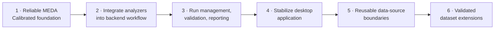
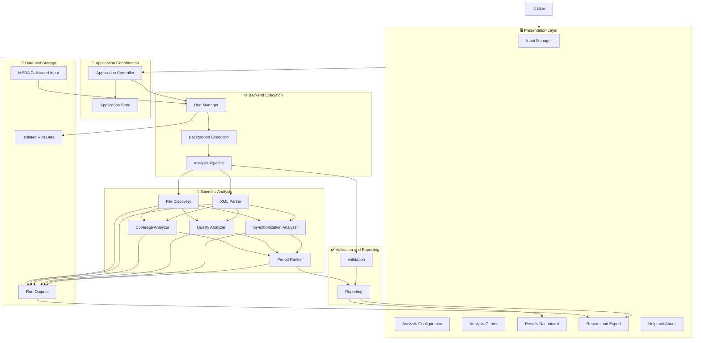
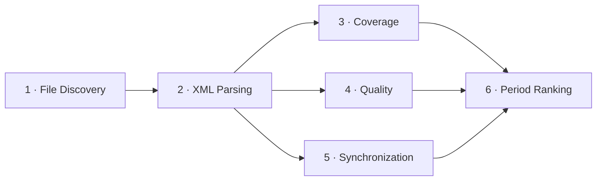
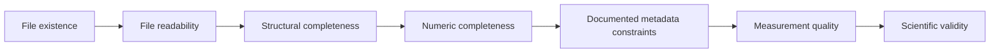
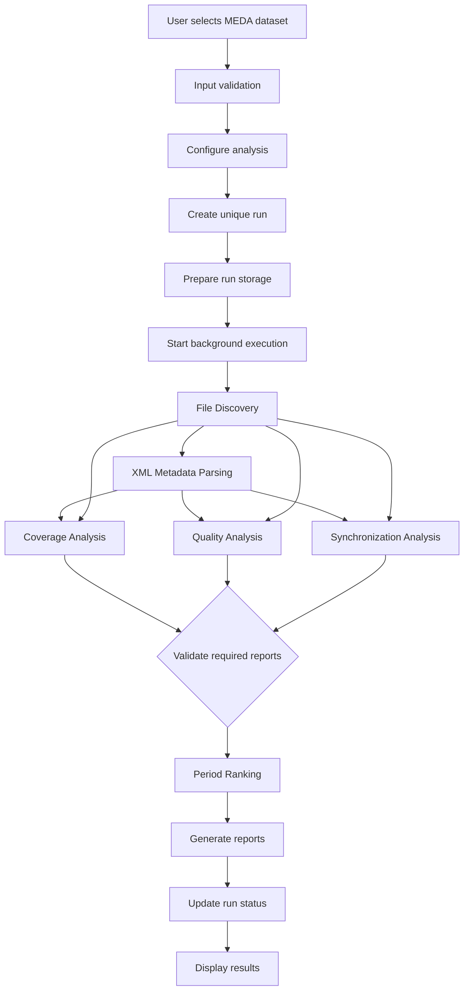
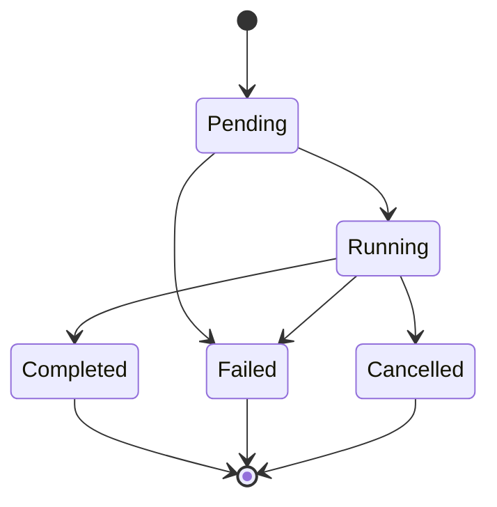
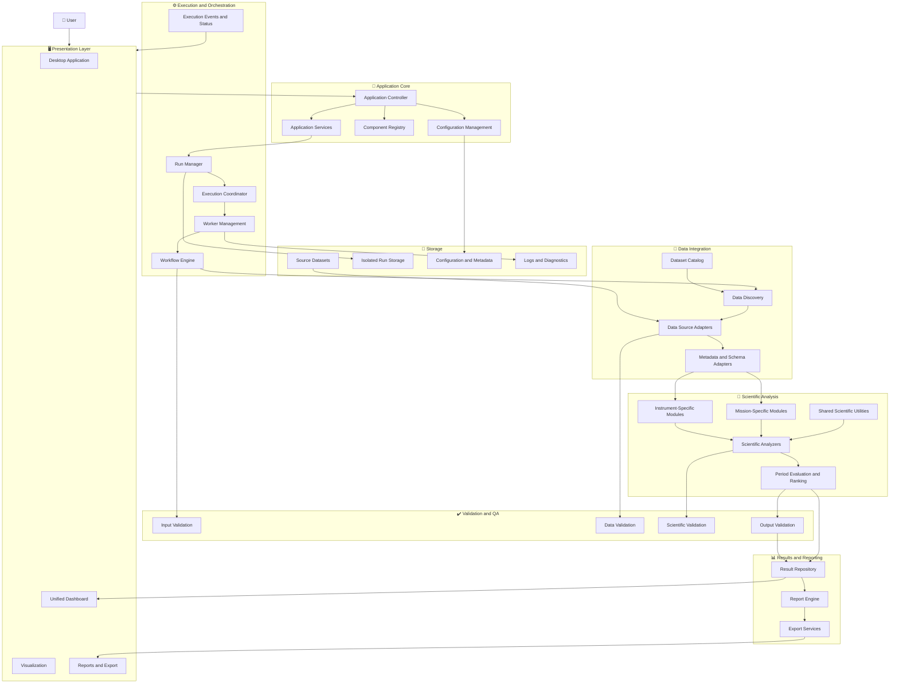
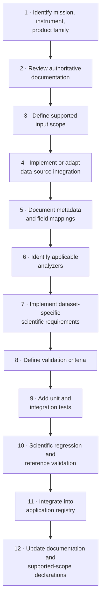

<div align="center">

# 🏛️ System Architecture

### MarsWalk Intelligence · MEDA Data Research & Period Analyzer (MDRPA)


*Two perspectives in one document: what exists and is being built **now**, and where the architecture is **headed**. Never confuse the two.*

</div>

---

## 📑 Contents

| Part | Sections |
|---|---|
| **I · Context & Direction** | [1 Purpose](#1-purpose) · [2 Scope & Direction](#2-project-scope-and-architectural-direction) |
| **II · Current-State Architecture** | [3 Model](#3-current-architectural-model) · [4 Presentation](#4--presentation-layer) · [5 Application](#5--application-coordination-layer) · [6 Backend Execution](#6--backend-execution-layer) · [7 Scientific Analysis](#7--scientific-analysis-layer) · [8 Validation & Reporting](#8--validation-and-reporting-layer) · [9 Data & Storage](#9--data-and-storage-layer) · [10 Data Flow](#10-data-flow) · [11 Run Lifecycle](#11-run-lifecycle) · [12 Communication](#12-component-communication-rules) · [13 Errors](#13-error-handling-and-recovery) · [14 Technology](#14-technology) · [15 Testing](#15-testing-architecture) · [16 Security](#16-security-and-data-integrity) · [17 Implementation Status](#17-current-implementation-status) |
| **III · Target Architecture** | [18 Overview](#18-target-architecture-overview) · [19 High-Level View](#19-target-high-level-architecture) · [20 Layers](#20-target-layers) · [21 Data Integration](#21-target-data-integration-strategy) · [22 Analyzers](#22-target-analyzer-architecture) · [23 Ranking](#23-target-period-evaluation-and-ranking) · [24 Reproducibility](#24-target-run-management-and-reproducibility) · [25 Performance](#25-target-performance-and-scalability) · [26 Extensibility](#26-target-extensibility-and-component-registration) · [27 Technology](#27-target-technology-direction) · [28 Testing](#28-target-testing-and-acceptance) · [29 Governance](#29-target-security-and-data-governance) |
| **IV · Governance** | [30 Current vs Target](#30-current-state-vs-target-architecture) · [31 Change Control](#31-architectural-change-control) · [32 Evolution Principles](#32-architectural-evolution-principles) · [33 Related Docs](#33-related-documentation) · [34 Governing Principles](#34-governing-architectural-principles) |

---

# Part I · Architecture Context and Direction

## 1. Purpose

This document defines the system architecture of MDRPA: current software structure, responsibilities, component boundaries, data flow, execution model, storage organization, and long-term direction.

MDRPA is a modular scientific research and analysis application for inspecting, evaluating, comparing, and ranking candidate observation periods. Its implementation scope is deliberately narrow:

> **Current scope: NASA Perseverance MEDA Calibrated Data.**
> Other missions, instruments, and datasets belong to the future direction and are **not** part of the supported scope.

### 1.1 Two perspectives

| | 📍 Current-State Architecture | 🎯 Target Architecture |
|---|---|---|
| **Describes** | Structure and capabilities for the current phase | Intended long-term engineering state |
| **Statement type** | What exists, what is verified | An objective, **not** a claim of implementation |
| **Provides** | Layered MEDA-focused design | Multi-mission, extensible, reproducible platform |

### 1.2 Status vocabulary

| Term | Meaning |
|---|---|
| ✅ **Implemented** | Confirmed to exist in the repository |
| 🧪 **Tested** | Passed its applicable tests |
| 🏁 **Accepted** | Reviewed and accepted into the current baseline |
| 🔧 **In Progress** | Being developed or integrated |
| 🗓️ **Planned** | Approved or intended for a future stage |
| 💡 **Proposed** | Possible direction that still needs evaluation and approval |

The Target Architecture is designed to offer: a modular scientific platform, multi-mission and multi-instrument support, extensible product processing, reusable components, controlled execution, reproducible workflows, traceable results, reliable desktop operation, and extensible visualization and reporting.

---

## 2. Project Scope and Architectural Direction

### 2.1 Long-term vision

MDRPA aims to become a general-purpose NASA scientific data research and period analysis platform, able to accommodate new missions, instruments, formats, and product structures **without a complete redesign**. The common environment should eventually:

1. Discover and organize supported datasets.
2. Inspect product metadata and data structures.
3. Evaluate availability and temporal coverage.
4. Assess quality and documented quality indicators.
5. Evaluate synchronization and temporal consistency.
6. Apply instrument-appropriate scientific validation.
7. Compare candidate observation periods.
8. Produce traceable reports.
9. Support reproducible research.

The goal is a maintainable platform, not a pile of unrelated mission-specific scripts.

### 2.2 Current scope boundary

| ✅ In scope | ❌ Out of scope (unless introduced by an approved change) |
|---|---|
| NASA Perseverance **MEDA Calibrated Data** | Derived MEDA products |
| | Partially Processed MEDA products |
| | Other Perseverance instrument datasets |
| | Other Mars or NASA mission datasets |
| | Arbitrary scientific data formats |

### 2.3 Evolution strategy



> [!IMPORTANT]
> Future extensibility must never compromise the correctness, reproducibility, or maintainability of the current MEDA implementation.

---

# Part II · Current-State Architecture

## 3. Current Architectural Model

A modular **six-layer** design:

| # | Layer | Location | Role |
|:-:|---|---|---|
| 1 | 🖥️ Presentation | `gui/` | Desktop interface |
| 2 | 🧭 Application Coordination | `application/` | Connects user actions to backend |
| 3 | ⚙️ Backend Execution | `backend/` | Pipeline, runs, workers |
| 4 | 🧪 Scientific Analysis | `backend/analyzers/` | Analyzers |
| 5 | ✔️ Validation & Reporting | `backend/validation/`, `backend/reporting/` | Checks and reports |
| 6 | 💾 Data & Storage | `input/`, `user_data/` | Source data and run data |

> [!NOTE]
> These layers describe the **intended separation of responsibilities**. Their presence here does not establish that every layer or connection is implemented.

### 3.1 Overview



> [!NOTE]
> This is the current **logical** architecture and intended relationships. It is not proof that all components are integrated or operational.

---

## 4. 🖥️ Presentation Layer

**Location:** `gui/`

Provides the desktop interface: screens, user input, navigation, analysis configuration, execution progress and status, results, report viewing/export, and help.

> [!WARNING]
> The GUI must **not** contain independent implementations of scientific calculations.

### 4.1 GUI modules

| Module | Responsibility |
|---|---|
| `gui/main_window/` | Main window and navigation |
| `gui/input_manager/` | Input dataset selection and management |
| `gui/analysis/` | Analysis configuration and execution interface |
| `gui/dashboard/` | Results visualization and summaries |
| `gui/reports/` | Report viewing and export |
| `gui/dialogs/` | Dialogs and user prompts |
| `gui/styles/` | Appearance and styling |
| `gui/tutorial/` | First-launch tutorial and help |

These paths describe intended organization; their existence does not establish completeness.

### 4.2 Design requirements

- Built with **PySide6**, in a formal **Classic Windows** desktop style.
- Long-running operations run **outside the main GUI thread**.
- Communicates with backend services through **defined interfaces**.
- Displays **actual** execution status, never invented progress.
- Communicates errors clearly.
- Never modifies scientific results.
- Distinguishes **unavailable** results from **zero-valued** results.

---

## 5. 🧭 Application Coordination Layer

**Location:** `application/`

Connects user actions to backend services: startup/shutdown, application-level state, GUI-to-backend wiring, input and analysis request coordination, configuration, and communication between presentation and execution.

It must not duplicate scientific analyzer logic. Exact controller and service interfaces remain subject to implementation and review.

---

## 6. ⚙️ Backend Execution Layer

**Location:** `backend/`

| Component | Location | Responsibility |
|---|---|---|
| **Pipeline** | `backend/pipeline/` | Coordinate stages and dependencies |
| **Run Manager** | `backend/run_manager/` | Create and manage isolated runs |
| **Workers** | `backend/workers/` | Run long operations in the background |
| **Validation** | `backend/validation/` | Validate inputs, artifacts, workflow requirements |
| **Reporting** | `backend/reporting/` | Organize report generation and export |

These are architectural responsibilities. Their implementation status must be verified independently.

### 6.1 Analysis pipeline



Quality and Synchronization may run independently once inventory and metadata exist. **Ranking waits** until its required reports are generated and validated.

The pipeline must:

- Pass **explicit** input and output paths.
- Respect stage dependencies.
- Validate required artifacts before dependent stages run.
- Preserve analyzer outputs and their meanings.
- Record stage status and errors.
- Stop or mark dependent stages when required inputs are unavailable.

> [!IMPORTANT]
> The pipeline **coordinates** existing analysis functions. It must not duplicate their scientific calculations.

### 6.2 Run Manager

- Generates unique **Run IDs** and isolated run directories.
- Records run configuration and metadata, and tracks execution status.
- Prevents output collisions.
- Supports run history and result browsing.
- Preserves completed **and failed** run records.

Two analyses of the same Sol range still get different Run IDs.

### 6.3 Background execution

Uses suitable PySide6 threading facilities (e.g. `QThread`) to keep the interface responsive.

| Responsibility |
|---|
| Start backend work outside the GUI thread |
| Report progress via signals |
| Communicate completion and failure |
| Support safe cancellation where implemented |
| Manage worker lifecycle |
| Prevent unsafe concurrent access to the same run paths |

Threading must not alter scientific calculations or produce inconsistent run states.

---

## 7. 🧪 Scientific Analysis Layer

**Location:** `backend/analyzers/`

| Module | Responsibility |
|---|---|
| `meda_common.py` | Shared time parsing and metadata utilities |
| `file_discovery.py` | Discover and inventory CSV and XML files |
| `xml_parser.py` | Parse XML metadata |
| `coverage_analyzer.py` | Product and Sol coverage |
| `quality_analyzer.py` | Quality candidates, operational/context fields, uncertainty, documented range checks |
| `synchronization_analyzer.py` | Timestamp synchronization between products |
| `period_ranker.py` | Compare and rank candidate observation periods |

### 7.1 Rules

- Each analyzer keeps its defined responsibility.
- Shared utilities are **not** independent analysis stages.
- Integration must preserve existing scientific behavior.
- Paths must be explicit during pipeline execution.
- **Unavailable information must never silently become zero.**
- Outputs retain their documented meaning.
- Scientific logic changes need separate review and approval.
- Metadata is never automatically interpreted as measurement values.
- Scientific assumptions are documented, not silently introduced.

### 7.2 Independence

Analyzers stay independently testable and never depend on GUI components. Where interface adaptation is needed, keep adapters **separate** from scientific calculations whenever practical.

---

## 8. ✔️ Validation and Reporting Layer

### 8.1 Validation

Checks that inputs, configurations, artifacts, and workflow dependencies satisfy defined requirements. It must keep these distinct:



> [!WARNING]
> These are **not interchangeable**. Technical validation must never claim scientific validity unless the relevant criteria are documented and satisfied.

### 8.2 Reporting

Organizes outputs into readable, traceable reports: summaries, artifact organization, export support, links to the source run, disclosure of unavailable metrics and limitations, and ranking presented **without overstating its scientific meaning**. Every report identifies the run and configuration that produced it.

---

## 9. 💾 Data and Storage Layer

| Location | Purpose | Rule |
|---|---|---|
| `input/` | Downloaded or selected source datasets | Never modified by analysis unless an explicitly approved process requires it |
| `user_data/` | Application-managed user data | Kept outside install and source directories |

Current supported input: MEDA Calibrated Data.

### 9.1 Isolated run layout (proposed)

```text
user_data/
└── runs/
    ├── range_100_150_run_001/
    │   ├── input/
    │   ├── output/
    │   ├── config.json
    │   ├── run_metadata.json
    │   └── logs/
    └── range_100_150_run_002/
        ├── input/
        ├── output/
        ├── config.json
        ├── run_metadata.json
        └── logs/
```

This is a **proposed logical layout**; final contracts must be implemented and verified by the Run Manager. Each run preserves a unique Run ID, its own configuration, execution metadata, input references or managed copies, generated reports, and logs/status. **A run never overwrites another run's artifacts.**

---

## 10. Data Flow



Ranking never runs when required reports are missing or invalid. A failed stage is recorded accurately, and dependent stages are never reported successful when their inputs were not produced.

---

## 11. Run Lifecycle



| State | Required? |
|---|---|
| Pending · Running · Completed · Failed | ✅ Minimum set the system must distinguish |
| Cancelled | Optional, when safe cancellation is implemented |

Exact states and transitions must be implemented consistently by the Run Manager and execution services. A run is **never** marked completed before all required stages and output checks finish.

---

## 12. Component Communication Rules

| From → To | Rule |
|---|---|
| **GUI → Application** | Sends user requests, receives state and execution updates. Never manipulates analyzer internals. |
| **Application → Backend** | Submits **validated** requests with required configuration and input references. |
| **Backend → Analyzers** | Explicit parameters and run-specific paths. Inspect existing analyzer interfaces before integrating. |
| **Backend → GUI** | Updates through controlled mechanisms. GUI never reads output files while a stage is still writing them. |

---

## 13. Error Handling and Recovery

**Scenarios to handle:** missing input dataset · unsupported or malformed files · XML parsing errors · invalid configuration · missing stage artifacts · analyzer failure · output writing failure · worker interruption · run directory collision.

**Error handling must:**

- Record the affected run and stage.
- Preserve diagnostic information.
- Never report failed operations as successful.
- Prevent accidental mixing of outputs.
- Keep previously completed runs available.
- Never replace missing results with fabricated values.

Recovery behavior must be explicitly designed and tested per supported failure scenario.

---

## 14. Technology

| Technology | Intended use |
|---|---|
| **Python** | Main language |
| **PySide6** | Desktop GUI |
| **PyQtGraph** | Interactive scientific visualization |
| **Matplotlib** | Static or specialized plotting |
| **NumPy** | Numerical operations |
| **Pandas** | Tabular data processing |
| **PyYAML** | YAML configuration where required |
| **python-dateutil** | Date/time utilities |
| **lxml** | XML processing |
| **PyInstaller** | Windows packaging |
| **QSettings** | Persistent preferences |

A dependency in `requirements.txt` does not mean every planned feature using it is implemented.

---

## 15. Testing Architecture

| Level | Purpose |
|---|---|
| 🧩 Unit | Individual analyzer and service behavior |
| 🔗 Integration | Communication and data flow between components |
| 🔄 Pipeline | Stage order, dependencies, failure handling |
| 🔒 Run Isolation | Unique IDs and independent storage |
| 🖱️ GUI | Navigation, interactions, result presentation |
| 📉 Regression | Detect unintended changes |
| 📦 Packaging | Windows build and startup |

Scientific regression tests verify that integration does not silently change analyzer results. **A passing software test does not establish scientific validity.**

---

## 16. Security and Data Integrity

The application must keep user data separate from source code · avoid unintended modification of source datasets · validate paths before file operations · prevent overwriting existing run data · avoid exposing sensitive local paths in exported reports · handle malformed inputs safely · preserve artifact traceability.

Any future external data transfer or network-dependent feature needs an explicitly defined security and data-handling policy.

---

## 17. Current Implementation Status

### 17.1 Existing scientific components

The repository contains analyzer sources in `backend/analyzers/`: shared utilities, discovery, XML parsing, coverage, quality, synchronization, and period ranking. Their presence does not establish that every analyzer is fully validated or scientifically accepted.

### 17.2 Planned or incomplete

| Area | Status |
|---|---|
| Backend pipeline coordination | 🔧 Needs implementation, integration, or verification |
| Run Manager | 🔧 〃 |
| Background execution workers | 🔧 〃 |
| Application coordination | 🔧 〃 |
| GUI functionality | 🔧 〃 |
| Reporting integration | 🔧 〃 |
| Validation integration | 🔧 〃 |
| End-to-end workflow | 🔧 〃 |
| Windows packaging | 🗓️ Planned |

> [!CAUTION]
> A directory or placeholder file is **not** evidence of completed functionality.

### 17.3 Scope restriction

Remain focused on MEDA Calibrated Data. Support for other NASA datasets is **not** assumed until integration, interpretation, validation, testing, and documentation are complete.

---

# Part III · Target Architecture

## 18. Target Architecture Overview

Defines the intended long-term structure so MDRPA can grow beyond MEDA while keeping a stable core and clearly separated scientific modules. Design: **Modular · Layered · Extensible**.

| Combines |
|---|
| A stable application core |
| A reusable execution framework |
| Data-source-specific integration modules |
| Instrument-specific scientific analysis modules |
| Independent validation services |
| Unified run management |
| Standardized reporting and result presentation |

It must support expansion without forcing all scientific analyzers to share identical assumptions or rules.

---

## 19. Target High-Level Architecture



> [!NOTE]
> Intended **future** architecture. Not a representation of current implementation status.

---

## 20. Target Layers

### 20.1 🖥️ Presentation

A unified interface for supported missions and datasets: dataset, mission, instrument, and product selection · analysis configuration · execution monitoring · results exploration · interactive visualization · report generation/export · run history and comparison · settings and help.

It stays independent of mission-specific scientific calculations and **adapts to each dataset's capabilities** rather than assuming every instrument exposes identical measurements or quality indicators.

### 20.2 🧭 Application Core

Stable application-level services: lifecycle, configuration, component registration and discovery, request coordination, dataset and capability selection, service communication, state, and centralized error handling. **No** mission-specific scientific algorithms.

### 20.3 ⚙️ Execution and Orchestration

Coordinates complete workflows: creating and tracking runs · scheduling stages · resolving dependencies · managing workers · progress and events · safe cancellation · failure handling · reproducibility · controlled execution of multiple independent runs. The framework is reusable across dataset types; scientific calculations stay inside scientific components.

### 20.4 🔌 Data Integration

One of the most important future extensions: it **separates source-data handling from scientific analysis**. Instead of every analyzer depending on one directory structure or naming convention, controlled integration boundaries:

- Identify supported data sources and discover available products.
- Read source-specific file structures and extract source metadata.
- Map metadata to documented internal representations.
- Identify supported formats; report unsupported or incomplete products.
- Give analyzers validated input references.

> [!IMPORTANT]
> The integration layer must **not erase scientific distinctions** between instruments or products. Normalize only where a valid shared representation exists.

### 20.5 🧪 Scientific Analysis

Reusable utilities plus dataset-specific modules, organized by clear responsibility: shared utilities · mission-specific · instrument-specific · product-specific · quality and uncertainty · temporal and synchronization · coverage · period evaluation and ranking.

Module boundaries come from **actual scientific requirements**, not software uniformity. A shared interface does not mean different instruments use identical scientific methods.

### 20.6 ✔️ Validation and QA

Multiple independent levels, each with explicit criteria and documented outcomes:

| 1 | 2 | 3 | 4 |
|---|---|---|---|
| Input | File & structural | Metadata | Data integrity |
| **5** | **6** | **7** | **8** |
| Scientific | Analyzer output | Workflow | Report |

Technical acceptance and scientific acceptance remain **separate**.

### 20.7 📊 Results and Reporting

Unified result organization · dataset-specific interpretation · run comparison · candidate period comparison · report generation · export · traceability · limitation disclosure. A unified structure must not conceal differences in scientific meaning or confidence between datasets.

### 20.8 💾 Storage

Source dataset references · managed input copies where required · run configurations and metadata · analyzer outputs · intermediate artifacts · logs and diagnostics · reports · result indexes · run history. Supports traceability, run isolation, and reliable recovery. Final technology and persistence model are chosen from real performance, scalability, and operational needs.

---

## 21. Target Data Integration Strategy

A new dataset should not require rewriting the application core or modifying unrelated analyzers.

### 21.1 Data source adapters

Each source or product family may need a dedicated adapter that understands file organization, formats, and metadata structure: source identification · file discovery · metadata extraction · structure interpretation · compatibility checks · conversion into documented internal representations.

### 21.2 Dataset and product definitions

Explicit definitions, based on authoritative documentation and verified source data, may describe:

| | | |
|---|---|---|
| Mission | Instrument | Product family |
| Data-product type | Supported file formats | Required metadata |
| Measurement fields | Timestamp conventions | Known quality metadata |
| Applicable analyzers | Known limitations | |

### 21.3 Internal data contracts

Documented where shared representations are scientifically appropriate: dataset identity · product identity · source file references · time information · field metadata · measurement values · units · quality information · uncertainty information · processing provenance. They preserve original source information where needed and **never force incompatible structures into misleading common forms**.

### 21.4 Adding a new dataset



> [!CAUTION]
> A dataset is **not** supported merely because its files can be discovered or opened.

---

## 22. Target Analyzer Architecture

Supports reuse without sacrificing scientific independence.

```text
backend/
└── analyzers/
    ├── common/
    │   ├── time/
    │   ├── metadata/
    │   ├── statistics/
    │   └── validation/
    ├── missions/
    │   ├── mars/
    │   └── ...
    ├── instruments/
    │   ├── meda/
    │   │   ├── discovery/
    │   │   ├── coverage/
    │   │   ├── quality/
    │   │   ├── synchronization/
    │   │   └── ranking/
    │   └── ...
    └── evaluation/
        ├── period_evaluation/
        └── ranking/
```

> [!NOTE]
> A **conceptual** target structure, not a requirement to reorganize the current repository now.

| Component type | Holds | Must not |
|---|---|---|
| **Shared utilities** | Genuinely reusable code: time conversion, general metadata helpers, validation primitives, statistics, report formatting | Contain hidden mission-specific scientific assumptions |
| **Mission-specific** | Requirements tied to a mission or its data organization | |
| **Instrument-specific** | Scientific logic and constraints of the instrument: quality criteria, calibration interpretation, measurement validation, uncertainty treatment, temporal evaluation, physical plausibility | Hide differences between instruments |
| **Product-specific** | Handling for different processing levels and meanings | Treat a calibrated product as equivalent to a derived or partially processed one |

Each supported product family needs documented input requirements and interpretation rules.

---

## 23. Target Period Evaluation and Ranking

Remains a distinct architectural responsibility. Different instruments or use cases may have different evaluation profiles, but ranking must **not** be reduced to an arbitrary universal formula.

| Should support |
|---|
| Explicit evaluation criteria and documented metric definitions |
| Configurable, versioned evaluation profiles where appropriate |
| Missing-metric handling and metric availability tracking |
| Transparent weighting where scientifically justified |
| Traceable ranking decisions |
| Comparison of candidate observation periods |
| Clear communication of limitations and uncertainty |

A common ranking framework is reused **only where the underlying metrics have compatible meanings**. Different instruments are never ranked under incompatible assumptions just to produce a unified score. Rankings stay evidence-based comparative outputs, not scientific certification.

---

## 24. Target Run Management and Reproducibility

The Run Manager becomes the central authority for execution identity and lifecycle. Each run preserves enough to reproduce or audit the analysis:

| | | |
|---|---|---|
| Unique Run ID | Dataset identity | Mission & instrument identity |
| Product family | Input references | Input inventory |
| Analysis configuration | Analyzer versions | Application version |
| Evaluation profile version | Execution timestamps | Stage status |
| Generated artifacts | Validation results | Logs and diagnostics |
| Final run status | | |

The exact metadata contract must still be defined and implemented. Where feasible, record **input fingerprints or checksums** to detect source-data changes.

Reproducibility is not one guarantee. Distinguish:

1. Reproducing the same **configuration**.
2. Reproducing the same **software environment**.
3. Reproducing the same **source inputs**.
4. Reproducing **scientifically equivalent results**.

---

## 25. Target Performance and Scalability

Possible improvements: more efficient metadata extraction · avoiding repeated preparation of static metadata · controlled memory usage · efficient tabular processing · parallel execution of independent stages where safe · incremental processing where scientifically appropriate · better I/O management · explicit resource management · performance monitoring and benchmarking.

> [!WARNING]
> Optimization must preserve scientific correctness and be evaluated with repeatable benchmarks and regression tests. Parallel execution must not introduce data races, output collisions, or nondeterministic scientific results.

---

## 26. Target Extensibility and Component Registration

A registration mechanism may let supported components be discovered and integrated through documented interfaces.

**Registrable types:** Data Source Adapters · Dataset Definitions · Metadata Adapters · Scientific Analyzers · Validation Modules · Evaluation Profiles · Report Generators · Visualization Providers.

It must not become an unrestricted plugin execution system without an explicit security and compatibility design. Each component declares its responsibilities, supported inputs, outputs, dependencies, and compatibility requirements.

---

## 27. Target Technology Direction

Decisions follow verified requirements, not technology for its own sake.

| Area | Direction |
|---|---|
| Desktop interface | Modular PySide6 application |
| Scientific processing | Reusable, independently testable Python components |
| Data integration | Explicit source and product adapters |
| Execution | Controlled orchestration and worker management |
| Configuration | Versioned, validated configuration contracts |
| Storage | Reliable run-oriented persistence |
| Visualization | Consistent, dataset-aware services |
| Reporting | Reusable generation and export services |
| Testing | Automated unit, integration, regression, system testing |
| Packaging | Reproducible Windows distribution |
| Documentation | Versioned architecture, interface, scientific docs |

Any major technology change requires architectural review.

---

## 28. Target Testing and Acceptance

<table>
<tr><th>🧰 Software testing</th><th>🔬 Scientific testing</th></tr>
<tr><td valign="top">

- Unit
- Integration
- Pipeline
- Run isolation
- GUI
- Regression
- Performance
- Packaging
- Recovery and failure

</td><td valign="top">

- Reference dataset comparison
- Authoritative documentation checks
- Independent calculation verification
- Known-case validation
- Boundary-condition testing
- Missing-data behavior
- Special-value interpretation checks
- Uncertainty behavior (where applicable)
- Physical plausibility (where justified)
- Scientific review of assumptions and thresholds

</td></tr>
</table>

**Dataset acceptance** considers: source compatibility · metadata interpretation · measurement interpretation · quality handling · scientific validation · reproducibility · regression coverage · documentation completeness.

> [!IMPORTANT]
> Successful software execution alone is insufficient for dataset acceptance.

---

## 29. Target Security and Data Governance

Explicit controls for: source-data integrity · user-data isolation · input validation · safe file operations · run access and ownership where applicable · configuration integrity · artifact traceability · external data acquisition · network-dependent operations · exported report handling.

Remote services, collaborative features, or external integrations need **separate** security and governance specifications and are not assumed part of the current desktop implementation.

---

# Part IV · Governance and Evolution

## 30. Current-State vs Target Architecture

| Area | 📍 Current state | 🎯 Target state |
|---|---|---|
| Project scope | MEDA Calibrated Data only | Multiple supported NASA datasets |
| Data integration | MEDA-oriented input handling | Reusable data-source and product adapters |
| Scientific analysis | Existing MEDA analyzer modules | Shared utilities + mission-, instrument-, product-specific analyzers |
| Application structure | Modular layered design under development | Fully integrated modular architecture |
| Execution | Analyzers exist; orchestration needs integration and verification | Controlled workflow orchestration |
| Run management | Needs implementation and verification | Centralized, reproducible |
| GUI | Development-stage interface | Fully integrated desktop experience |
| Validation | Existing analyzer checks, planned workflow validation | Multi-level technical and scientific validation |
| Ranking | Current MEDA period-ranking implementation | Extensible, scientifically compatible evaluation profiles |
| Reporting | Needs integration and verification | Unified, traceable services |
| Storage | Development-stage run storage design | Reliable run-oriented storage and result management |
| Extensibility | Focused on current MEDA needs | Controlled integration of additional datasets |
| Testing | Existing tests, ongoing verification | Comprehensive software and scientific validation |
| Packaging | Needs implementation and verification | Reproducible, stable distribution |

> [!NOTE]
> Describes direction. Not a substitute for checking the actual implementation status of individual components.

---

## 31. Architectural Change Control

A significant architectural change must:

1. Have a clearly defined objective.
2. Identify affected components and interfaces.
3. Distinguish current requirements from future extensibility requirements.
4. Preserve separation of responsibilities.
5. Identify scientific and data-integrity risks.
6. Be reviewed before implementation.
7. Be tested at the appropriate level.
8. Be reflected in this document after approval.

Scientific logic changes need separate scientific review and approval. Shared-interface changes must consider their effect on existing MEDA functionality. Future expansion must not add unnecessary abstractions before a real requirement justifies them.

---

## 32. Architectural Evolution Principles

| # | Principle | Meaning |
|:-:|---|---|
| 1 | **Stabilize before expanding** | A reliable MEDA Calibrated foundation comes before wider scope. |
| 2 | **Separate science from application logic** | Scientific calculations stay independent of GUI and coordination code. |
| 3 | **Prefer explicit interfaces** | Documented input/output contracts between components. |
| 4 | **Preserve scientific differences** | A common architecture does not imply identical scientific assumptions. |
| 5 | **Maintain backward compatibility** | Changes to analyzer behavior and output contracts are reviewed and tested. |
| 6 | **Make results traceable** | Every result traces to source data, configuration, software version, and run. |
| 7 | **Engineering quality ≠ scientific validity** | A stable, tested application is not automatically scientifically validated; each needs its own evidence. |
| 8 | **Expand through verified capabilities** | New datasets and analyzers arrive only after requirements, interfaces, assumptions, and validation criteria are documented. |

---

## 33. Related Documentation

| Document | Content |
|---|---|
| `README.md` | Project overview and development roadmap |
| `docs/development_guide.md` | Development workflow and change-control rules |
| `docs/analyzer_documentation.md` | Analyzer interfaces and technical behavior |
| `docs/backend_integration_specification.md` | Backend integration contracts |
| `docs/scientific_methodology.md` | Scientific methodology and interpretation constraints |
| `docs/user_guide.md` | End-user instructions |

Each document keeps its own responsibility and avoids duplicating another's full contents.

---

## 34. Governing Architectural Principles

> **Current-State Principle.** MDRPA must maintain a reliable and scientifically responsible analysis foundation for NASA Perseverance MEDA Calibrated Data before expanding its supported scope.

> **Target Architecture Principle.** MDRPA should evolve into a modular, extensible, reproducible NASA scientific data research platform that can integrate multiple missions, instruments, and data-product families through controlled architectural boundaries.

> **Separation of Responsibilities.** The GUI presents the workflow, the application core coordinates user requests, the backend manages execution, the data integration layer prepares supported inputs, and the scientific analyzers perform their defined analyses.

> **Scientific Integrity.** No architectural abstraction, shared interface, ranking mechanism, or automation process may conceal scientific differences, replace documented scientific criteria, or present unvalidated results as scientifically established.

The long-term success of MDRPA depends on achieving **both** engineering reliability and scientifically defensible analysis, while keeping a clear distinction between implemented capabilities and future architectural objectives.