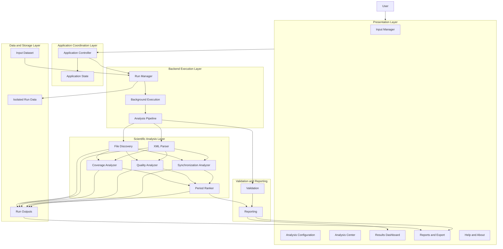
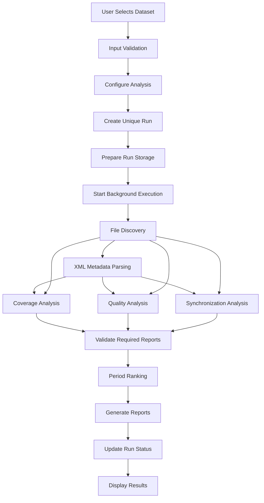
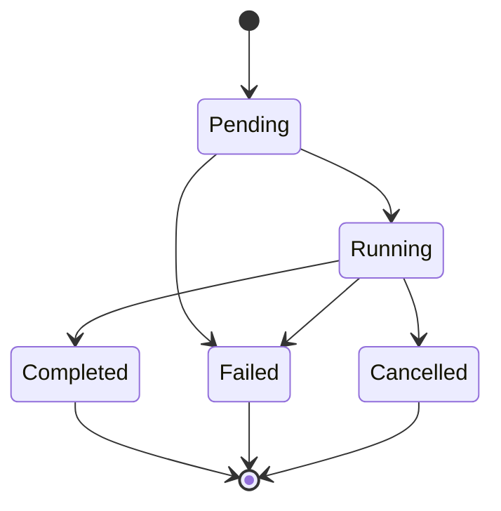

# System Architecture

## MEDA Data Research & Period Analyzer (MDRPA)

## 1. Purpose

This document describes the system architecture of **MEDA Data Research & Period Analyzer (MDRPA)**.

It defines the major software layers, component responsibilities, data flow, execution model, storage organization, and communication boundaries.

The architecture is designed to support a modular, maintainable, reproducible, and scientifically responsible desktop research application for exploring and comparing candidate observation periods in NASA Perseverance MEDA datasets.

This document distinguishes between:

- **Implemented Components:** Components confirmed to exist in the repository.
- **Planned Components:** Architectural components that are part of the intended system but still require implementation or integration.
- **Architectural Requirements:** Rules that future implementation must satisfy.

The presence of a directory or placeholder file does not mean its functionality is implemented.

## 2. Architectural Goals

MDRPA follows these architectural goals:

1. Separate scientific analysis from graphical presentation.
2. Preserve existing analyzer behavior during integration.
3. Organize analysis execution through a controlled backend pipeline.
4. Isolate every analysis run and its generated data.
5. Execute long-running operations without freezing the GUI.
6. Preserve traceability between input data, configuration, execution, and results.
7. Support validation and testing at component and system levels.
8. Keep scientific assumptions and interpretation explicit.
9. Allow individual components to be maintained and tested independently.
10. Support future Windows desktop packaging.

## 3. High-Level Architecture

The intended system is organized into the following logical layers:

1. Presentation Layer.
2. Application Coordination Layer.
3. Backend Execution Layer.
4. Scientific Analysis Layer.
5. Validation and Reporting Layer.
6. Data and Storage Layer.

### 3.1 Architecture Overview



This diagram represents the intended architecture. It is not a claim that all connections or components are currently implemented.

## 4. Presentation Layer

**Location:** `gui/`

The Presentation Layer provides the desktop interface through which users interact with MDRPA.

It is responsible for:

- Displaying application screens.
- Collecting user input.
- Managing navigation.
- Presenting analysis configuration.
- Displaying execution progress and status.
- Presenting analytical results.
- Providing report viewing and export controls.
- Displaying help and application information.

The GUI must not contain independent implementations of scientific calculations.

### 4.1 Main GUI Modules

| Module | Responsibility |
|---|---|
| `gui/main_window/` | Main application window and navigation |
| `gui/input_manager/` | Input dataset selection and management |
| `gui/analysis/` | Analysis configuration and execution interface |
| `gui/dashboard/` | Results visualization and summaries |
| `gui/reports/` | Report viewing and export interface |
| `gui/dialogs/` | Dialogs and user prompts |
| `gui/styles/` | Application appearance and styling |
| `gui/tutorial/` | First-launch tutorial and help content |

These directories define the intended GUI organization. Their presence does not establish that their functionality is complete.

### 4.2 GUI Design Requirements

- The application uses PySide6.
- The visual direction is a formal Classic Windows desktop style.
- Long-running operations must execute outside the main GUI thread.
- GUI modules must communicate with backend services through defined interfaces.
- The GUI must display actual execution status rather than inventing progress.
- Errors must be communicated clearly without exposing misleading success states.

## 5. Application Coordination Layer

**Location:** `application/`

The Application Coordination Layer connects user actions to backend services.

Its intended responsibilities include:

- Application startup and shutdown coordination.
- Managing application-level state.
- Connecting GUI actions to backend operations.
- Coordinating input selection and analysis requests.
- Handling application configuration.
- Managing communication between presentation and execution layers.

This layer must not duplicate scientific analyzer logic.

The exact controller and service interfaces remain subject to implementation and review.

## 6. Backend Execution Layer

**Location:** `backend/`

The Backend Execution Layer manages analysis operations and coordinates the scientific analysis modules.

Its intended components include:

| Component | Location | Responsibility |
|---|---|---|
| Pipeline | `backend/pipeline/` | Coordinate analysis stages and dependencies |
| Run Manager | `backend/run_manager/` | Create and manage isolated analysis runs |
| Workers | `backend/workers/` | Execute long-running operations in the background |
| Validation | `backend/validation/` | Validate execution inputs, artifacts, and workflow requirements |
| Reporting | `backend/reporting/` | Organize report generation and export support |

These are architectural responsibilities. Their implementation status must be verified independently.

### 6.1 Analysis Pipeline

The Analysis Pipeline is responsible for coordinating the scientific workflow.

Its intended execution order is:

1. File Discovery.
2. XML Metadata Parsing.
3. Coverage Analysis.
4. Quality Analysis.
5. Synchronization Analysis.
6. Period Ranking.

Quality Analysis and Synchronization Analysis may execute independently after the required inventory and metadata have been prepared.

Period Ranking must wait until its required reports have been generated and validated.

The pipeline must:

- Pass explicit input and output paths.
- Respect dependencies between stages.
- Validate required artifacts before dependent stages execute.
- Preserve analyzer outputs and their meanings.
- Record stage status and errors.
- Stop or mark dependent stages appropriately when required inputs are unavailable.

The pipeline coordinates existing analysis functions. It must not duplicate their scientific calculations.

### 6.2 Run Manager

The Run Manager provides independent identity and storage for each analysis execution.

Its responsibilities include:

- Generating unique Run IDs.
- Creating isolated run directories.
- Recording run configuration and metadata.
- Tracking execution status.
- Preventing accidental output collisions.
- Supporting run history and result browsing.
- Preserving completed and failed run records.

Two analyses of the same Sol range must still have different Run IDs.

### 6.3 Background Execution

Background execution prevents lengthy analysis operations from blocking the desktop interface.

The intended implementation uses appropriate PySide6 threading facilities, such as `QThread`, where suitable.

Responsibilities include:

- Starting backend work outside the GUI thread.
- Reporting progress through signals.
- Communicating completion and failure.
- Supporting safe cancellation where implemented.
- Managing worker lifecycle.
- Preventing unsafe concurrent access to the same run paths.

Threading must not alter scientific calculations or produce inconsistent run states.

## 7. Scientific Analysis Layer

**Location:** `backend/analyzers/`

This layer contains the scientific and data-analysis modules.

The current repository includes the following analyzer modules:

| Module | Responsibility |
|---|---|
| `meda_common.py` | Shared time parsing and metadata utilities |
| `file_discovery.py` | Discover and inventory supported CSV and XML files |
| `xml_parser.py` | Parse XML metadata |
| `coverage_analyzer.py` | Analyze product and Sol coverage |
| `quality_analyzer.py` | Analyze quality-related candidates, operational/context fields, uncertainty, and documented range checks |
| `synchronization_analyzer.py` | Analyze timestamp synchronization between products |
| `period_ranker.py` | Compare and rank candidate observation periods |

### 7.1 Scientific Layer Rules

- Each analyzer retains its defined responsibility.
- Shared utilities must not be treated as independent analysis stages.
- Integration must preserve existing scientific behavior.
- Input and output paths must be explicit during pipeline execution.
- Missing or unavailable information must not silently become zero.
- Analyzer outputs must retain their documented meaning.
- Scientific logic changes require separate review and approval.

### 7.2 Analyzer Independence

Analyzers should remain independently testable.

The pipeline may coordinate them, but it must not make them dependent on GUI components.

Where interface adaptation is required, adapters should be kept separate from scientific calculations whenever practical.

## 8. Validation and Reporting Layer

### 8.1 Validation

Validation is responsible for checking whether required inputs, configurations, execution artifacts, and workflow dependencies satisfy defined requirements.

Validation must distinguish between:

- File existence.
- File readability.
- Structural completeness.
- Numeric completeness.
- Documented metadata constraints.
- Measurement quality.
- Scientific validity.

These concepts are not interchangeable.

Technical validation must not claim scientific validity unless the relevant scientific criteria are documented and satisfied.

### 8.2 Reporting

Reporting organizes analytical outputs into readable and traceable reports.

Its responsibilities may include:

- Preparing report summaries.
- Organizing generated artifacts.
- Supporting report export.
- Preserving links between reports and their source run.
- Communicating unavailable metrics and limitations.
- Presenting ranking results without overstating their scientific meaning.

Reports must identify the run and configuration that produced them.

## 9. Data and Storage Layer

The Data and Storage Layer manages source datasets and user-generated analysis records.

### 9.1 Source Input Data

The `input/` directory is intended for downloaded or selected source datasets.

Source data must not be modified by analysis operations unless an explicitly approved process requires it.

### 9.2 User Data

User-generated data should remain outside the application installation and source-code directories.

The `user_data/` directory is reserved for application-managed user data in the development structure.

### 9.3 Isolated Run Organization

The intended run organization is:

```text
user_data/
└── runs/
    ├── range_100_150_run_001/
    │   ├── input/
    │   ├── output/
    │   ├── config.json
    │   ├── run_metadata.json
    │   └── logs/
    │
    └── range_100_150_run_002/
        ├── input/
        ├── output/
        ├── config.json
        ├── run_metadata.json
        └── logs/
```

This is a proposed logical layout. The final directory and file contracts must be implemented and verified by the Run Manager.

Each run must preserve:

- A unique Run ID.
- Its own configuration.
- Its execution metadata.
- Its own input references or managed input copies.
- Its generated reports.
- Its logs and status information.

A run must not overwrite another run's artifacts.

## 10. Data Flow

The intended end-to-end workflow is:



The workflow must preserve stage dependencies and must not execute ranking when required reports are missing or invalid.

A failed stage must be recorded accurately. Dependent stages must not be reported as successful when their required inputs were not produced.

## 11. Run Lifecycle

Every analysis run follows a controlled lifecycle.



The exact supported states and transitions must be implemented consistently by the Run Manager and execution services.

At minimum, the system must distinguish:

- Pending.
- Running.
- Completed.
- Failed.

Cancellation may be supported as an additional state when safe cancellation is implemented.

The system must not mark a run as completed before all required stages and output checks have finished.

## 12. Component Communication Rules

Communication between architectural layers must follow defined interfaces.

### 12.1 GUI to Application Layer

The GUI sends user requests and receives application state and execution updates.

It must not directly manipulate analyzer internals.

### 12.2 Application Layer to Backend

The application layer submits validated analysis requests to backend services.

Requests should contain the required configuration and input references.

### 12.3 Backend to Analyzers

The backend invokes analyzer functions using explicit parameters and run-specific paths.

Existing analyzer interfaces must be inspected before integration.

### 12.4 Backend to GUI

Execution updates and results are returned through controlled communication mechanisms.

GUI components must not read incomplete output files while a stage is writing them.

## 13. Error Handling and Recovery

The architecture must support clear error reporting at each layer.

Examples include:

- Missing input dataset.
- Unsupported or malformed files.
- XML parsing errors.
- Invalid analysis configuration.
- Missing required stage artifacts.
- Analyzer execution failure.
- Output writing failure.
- Worker interruption.
- Run directory collision.

Error handling must:

- Record the affected run and stage.
- Preserve relevant diagnostic information.
- Avoid reporting failed operations as successful.
- Prevent accidental mixing of outputs.
- Keep previously completed runs available.
- Avoid silently replacing missing results with fabricated values.

Recovery behavior must be explicitly designed and tested for each supported failure scenario.

## 14. Technology Architecture

The planned technology stack includes:

| Technology | Intended Use |
|---|---|
| Python | Main programming language |
| PySide6 | Desktop GUI |
| PyQtGraph | Interactive scientific visualization |
| Matplotlib | Static or specialized plotting where appropriate |
| NumPy | Numerical operations |
| Pandas | Tabular data processing |
| PyYAML | YAML configuration support where required |
| python-dateutil | Date and time utilities |
| lxml | XML processing |
| PyInstaller | Windows application packaging |
| QSettings | Persistent application preferences |

The presence of a dependency in `requirements.txt` does not mean every planned feature using it has been implemented.

## 15. Testing Architecture

Testing must cover individual components and their interactions.

The intended test structure is:

| Test Level | Purpose |
|---|---|
| Unit Tests | Verify individual analyzer and service behavior |
| Integration Tests | Verify communication and data flow between components |
| Pipeline Tests | Verify stage order, dependencies, and failure handling |
| Run Isolation Tests | Verify unique IDs and independent storage |
| GUI Tests | Verify navigation, user interactions, and result presentation |
| Regression Tests | Detect unintended changes to existing behavior |
| Packaging Tests | Verify the Windows application build and startup |

Scientific regression tests must verify that integration does not silently change existing analyzer results.

A successful software test does not automatically establish scientific validity.

## 16. Security and Data Integrity

The application must:

- Keep user data separate from source code.
- Avoid unintended modification of source datasets.
- Validate paths before file operations.
- Prevent accidental overwriting of existing run data.
- Avoid exposing sensitive local paths unnecessarily in exported reports.
- Handle malformed inputs safely.
- Preserve traceability of generated artifacts.

Any future external data transfer or network-dependent feature must have an explicitly defined security and data-handling policy.

## 17. Current Implementation Status

The architecture must be understood in the context of the current repository state.

### 17.1 Existing Components

The repository contains implemented analyzer source files under:

`backend/analyzers/`

These include the shared utility, discovery, XML parsing, coverage, quality, synchronization, and period ranking modules.

### 17.2 Planned or Incomplete Components

The following areas require implementation, integration, or verification:

- Backend pipeline coordination.
- Run Manager.
- Background execution workers.
- Application coordination.
- GUI functionality.
- Reporting integration.
- Validation integration.
- End-to-end workflow.
- Windows packaging.

A directory or placeholder file is not evidence of completed functionality.

The implementation status must be rechecked against the repository before future architectural changes.

## 18. Architecture Change Control

Any significant architectural change must:

1. Have a defined objective.
2. Identify affected components and interfaces.
3. Preserve separation of responsibilities.
4. Identify scientific and data-integrity risks.
5. Be reviewed before implementation.
6. Be tested at the appropriate level.
7. Be reflected in this document after approval.

Changes to scientific logic require separate scientific review and approval.

## 19. Related Documentation

This document should be read alongside:

- `README.md` — Project overview and development roadmap.
- `docs/development_guide.md` — Development workflow and change-control rules.
- `docs/analyzer_documentation.md` — Analyzer interfaces and technical behavior.
- `docs/backend_integration_specification.md` — Backend integration contracts.
- `docs/scientific_methodology.md` — Scientific methodology and interpretation constraints.
- `docs/user_guide.md` — End-user instructions.

Each document must retain its own responsibility and avoid duplicating the full contents of another.

## 20. Governing Architectural Principle

**The GUI presents the workflow, the application layer coordinates user requests, the backend manages execution, and the scientific analyzers perform the analysis.**

Every component must remain within its defined responsibility, and every analysis run must remain isolated, traceable, and scientifically interpretable.