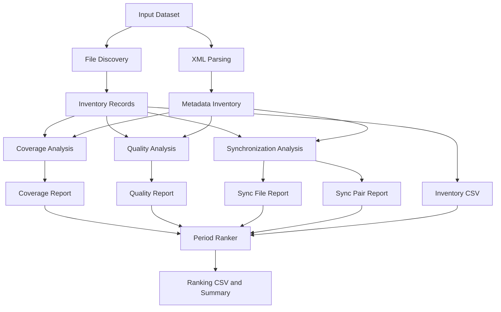

# Backend Integration Specification

**Project:** MEDA Data Research & Period Analyzer (MDRPA)  
**Document:** Backend Integration Specification  
**Version:** 1.2 — Revised  
**Target Branch:** `main`

---

## 1. Purpose

This document defines the integration architecture and proposed contracts between the existing MEDA scientific analyzers and the MDRPA desktop application.

The primary objective is to integrate the existing analyzers into a controlled backend workflow while preserving their scientific calculations, data interpretation, and established behavior.

The GUI must remain independent of scientific analysis logic.

This specification distinguishes between:

- **Current Source Interface:** Functions and behavior confirmed in the existing analyzer source code.
- **Proposed Integration Contract:** Interfaces and responsibilities required for future integration.
- **Implementation Status:** Whether a component is implemented, incomplete, or still planned.

A proposed contract must never be treated as an already implemented feature.

## 2. Integration Principles

1. Preserve existing scientific logic.
2. Do not modify scientific calculations merely to support GUI integration.
3. Keep every analysis run isolated.
4. Pass explicit input and output paths to analyzers.
5. Keep GUI execution separate from backend execution.
6. Do not treat missing information as zero or as a successful measurement.
7. Preserve analyzer reports and their original meaning.
8. Record configuration and execution metadata for reproducibility.
9. Keep integration adapters separate from scientific analysis logic where practical.
10. Preserve existing standalone CLI behavior where possible.
11. Validate intermediate artifacts before dependent stages execute.
12. Distinguish warnings from errors and unavailable results.

## 3. Current Backend Components

The existing scientific analyzer modules are located in:

`backend/analyzers/`

| Module | Responsibility |
|---|---|
| `meda_common.py` | Shared time parsing and metadata utilities |
| `file_discovery.py` | Discover and inventory CSV/XML files |
| `xml_parser.py` | Extract XML metadata |
| `coverage_analyzer.py` | Analyze product and Sol coverage |
| `quality_analyzer.py` | Analyze quality candidates, operational/context fields, uncertainty, and documented ranges |
| `synchronization_analyzer.py` | Compare timestamp series between products |
| `period_ranker.py` | Compare and rank candidate periods |

`meda_common.py` is a shared utility module, not an independent pipeline stage.

The existence of backend directories such as `pipeline/`, `run_manager/`, `workers/`, `validation/`, and `reporting/` does not establish that their intended functionality is implemented.

Their implementation must be verified independently.

## 4. Intended Pipeline Execution Order

The intended workflow is:

1. File Discovery.
2. XML Parsing.
3. Coverage Analysis.
4. Quality Analysis.
5. Synchronization Analysis.
6. Period Ranking.

Coverage, Quality, and Synchronization Analysis depend on the prepared inventory and metadata.

Quality Analysis and Synchronization Analysis may execute independently after their shared prerequisites are available.

Period Ranking must execute only after all required reports have been generated and validated.

The future pipeline coordinator will manage dependencies and execution order. It must not duplicate scientific calculations already implemented in the analyzers.

### 4.1 Dependency Overview



This diagram describes the intended integration workflow, not a claim that the complete pipeline is currently implemented.

## 5. Analyzer Interface Contracts

### 5.1 File Discovery

**Module:** `backend/analyzers/file_discovery.py`

**Current Source Interface:**

```python
discover_files(input_dir: Path) -> list[dict]

write_inventory(records, output_file)
```

**Current Responsibilities:**

- Discover supported CSV and XML files.
- Identify Sol folders and product codes.
- Record file information.
- Identify CSV/XML relationships.
- Write inventory records through the existing writer function.

**Proposed Integration Contract:**

- Receive an explicit input directory.
- Receive an explicit inventory output path.
- Preserve the existing discovery records.
- Expose execution status and artifact references through an integration adapter.

**Expected Artifact:**

`file_inventory.csv`

The structured stage result is a proposed adapter responsibility. It must not be assumed to be the current return value of `discover_files`.

### 5.2 XML Parser

**Module:** `backend/analyzers/xml_parser.py`

**Current Source Interface:**

```python
parse_xml_file(
    xml_path,
    input_root=None,
    include_full_xml=False,
) -> dict

build_metadata_inventory(
    input_dir,
    include_full_xml=False,
) -> dict

save_json(data, output_file)
```

**Current Responsibilities:**

- Parse XML metadata.
- Extract product, table, and field metadata.
- Record parsing errors and structural metadata warnings.
- Preserve field information, including positional information where required.
- Build a metadata inventory.

**Proposed Integration Contract:**

- Receive an explicit input directory.
- Receive an explicit metadata output path.
- Preserve the existing `include_full_xml` option.
- Preserve the existing metadata structure.
- Expose parsing status and artifact references through an integration adapter.

**Expected Artifact:**

`metadata_inventory.json`

The metadata inventory must retain its existing structure unless a separately reviewed interface change is approved.

### 5.3 Coverage Analyzer

**Module:** `backend/analyzers/coverage_analyzer.py`

**Current Source Interface:**

```python
analyze_coverage(
    input_dir,
    inventory_records,
    metadata,
    gap_factor=2.5,
) -> list[dict]
```

**Current Responsibilities:**

- Analyze product and Sol coverage.
- Examine timestamp parsing and coverage characteristics.
- Identify missing, invalid, duplicate, and out-of-order timestamps.
- Calculate time-step and gap diagnostics.
- Examine numeric value completeness.
- Use inventory records and XML metadata.

**Proposed Integration Contract:**

- Pass explicit input and output paths through the integration layer.
- Preserve configurable gap detection.
- Preserve the current analysis function and scientific behavior.
- Write the returned records to a run-specific report.
- Prepare a structured stage result.

**Expected Artifacts:**

- `coverage_report.csv`
- `coverage_summary.json`

The summary artifact is an integration output to be implemented or verified. It must not be assumed to be returned directly by `analyze_coverage`.

### 5.4 Quality Analyzer

**Module:** `backend/analyzers/quality_analyzer.py`

**Current Source Interface:**

```python
run_analysis(
    input_root,
    inventory,
    metadata,
) -> list[dict]
```

**Current Responsibilities:**

- Identify explicit quality-related field candidates.
- Identify operational/context field candidates.
- Identify measurement uncertainty candidates.
- Apply documented numeric range checks where applicable.

**Proposed Integration Contract:**

- Pass explicit input and output paths through the integration layer.
- Preserve current field classification.
- Preserve documented range-checking behavior.
- Write the returned records to a run-specific report.
- Prepare a structured stage result and summary.

**Expected Artifacts:**

- `quality_field_report.csv`
- `quality_summary.json`

The summary output and structured stage result are integration responsibilities unless confirmed in the current implementation.

**Scientific Restrictions:**

- Quality candidates, operational/context candidates, and uncertainty fields must remain separate categories.
- Do not create an undocumented universal Quality Score.
- Do not interpret Quality Flags without authoritative definitions.
- Do not treat metadata warnings as measurement-quality failures.

### 5.5 Synchronization Analyzer

**Module:** `backend/analyzers/synchronization_analyzer.py`

**Current Source Interface:**

```python
run_analysis(
    input_root,
    inventory,
    metadata_records,
    tolerance,
    axis_preference=DEFAULT_AXIS_PREFERENCE,
) -> tuple[list[dict], list[dict]]
```

**Current Responsibilities:**

- Analyze timestamps in individual product files.
- Compare timestamp series between products.
- Produce file-level and pair-level reports.
- Apply configured tolerance and time-axis preference.
- Preserve duplicate timestamp occurrence behavior.

**Proposed Integration Contract:**

- Pass explicit input and output paths through the integration layer.
- Configure tolerance and time-axis preference.
- Preserve both returned report collections.
- Prepare a structured stage result and summary.

**Expected Artifacts:**

- `synchronization_file_report.csv`
- `synchronization_pair_report.csv`
- `synchronization_summary.json`

The summary output and structured stage result are proposed integration responsibilities unless confirmed in the current implementation.

**Scientific Restrictions:**

- Matching must preserve one-to-one occurrence behavior.
- Duplicate timestamps must not be silently discarded.
- Tolerance must be interpreted in the selected coordinate, not automatically as SI seconds.
- Different products may have different sampling schedules.
- Synchronization match rates are diagnostics, not quality scores.
- Incompatible time-axis kinds must not be silently converted to force comparison.

### 5.6 Period Ranker

**Module:** `backend/analyzers/period_ranker.py`

**Current Source Interface:**

```python
run(args) -> dict
```

The current ranker is report-file-oriented. It reads report files and writes ranking outputs using paths and options supplied through its arguments.

**Current Input Reports:**

- File inventory report.
- Coverage report.
- Quality report.
- Synchronization file report.
- Synchronization pair report.

**Current Output Reports:**

- Ranking CSV.
- Ranking summary JSON.

**Configuration includes:**

- Start Sol.
- End Sol.
- Window size.
- Minimum Sol fraction.
- Minimum metrics.
- Required products.
- Metric weights.
- Integrity weights.

**Proposed Integration Contract:**

- Supply explicit paths for every input report.
- Supply explicit ranking and summary output paths.
- Preserve the current argument-based execution model where practical.
- Expose ranking rows and summary information through the integration layer.
- Preserve existing ranking rules and unavailable-metric handling.

**Default Metric Weights:**

| Metric | Default Weight |
|---|---:|
| File Availability | 0.20 |
| Data Integrity | 0.45 |
| Quality Indicators | 0.15 |
| Synchronization | 0.20 |

These weights are configurable exploratory comparison settings, not scientifically calibrated constants.

Unavailable metrics must not be fabricated or silently treated as zero.

Existing weight normalization behavior must be preserved.

The ranker must not lower `min_metrics` merely to force a ranking result.

Partial windows must remain excluded from ranking according to the existing ranking rules.

## 6. Metadata Representation at the Pipeline Boundary

The analyzers do not all consume metadata in the same representation.

**Current expectations:**

| Analyzer | Metadata Input |
|---|---|
| Coverage Analyzer | Metadata dictionary |
| Quality Analyzer | Metadata dictionary |
| Synchronization Analyzer | List of metadata records |

The pipeline must handle this difference explicitly.

**Proposed integration approach:**

1. XML Parser generates the existing metadata inventory.
2. The pipeline retains the original metadata structure.
3. An integration adapter extracts the required records for Synchronization Analyzer.
4. Coverage and Quality receive the dictionary representation they currently expect.
5. No scientific information is discarded or reinterpreted during conversion.

This normalization belongs at the pipeline boundary, not inside scientific calculations.

The adapter must be tested to confirm that record contents and field ordering are preserved.

## 7. Integration Adapter Contract

A future adapter layer may provide a consistent execution interface around the existing analyzers.

Its responsibilities may include:

- Preparing analyzer-specific arguments.
- Supplying explicit run-specific paths.
- Adapting metadata representation.
- Invoking existing analyzer functions.
- Writing expected artifacts.
- Capturing execution status.
- Returning structured stage results.

A proposed stage result may contain:

| Field | Purpose |
|---|---|
| `stage_name` | Analyzer or pipeline stage |
| `status` | Execution status |
| `started_at` | Stage start timestamp |
| `finished_at` | Stage finish timestamp |
| `input_paths` | Run-specific input references |
| `output_paths` | Generated artifact references |
| `warnings` | Non-fatal issues |
| `errors` | Failure information |
| `summary` | Optional stage summary |

This is a proposed integration structure, not an existing analyzer return schema.

Adapters must not modify scientific calculations or reinterpret analyzer outputs.

## 8. Run Directory Contract

Every analysis execution must receive a unique Run ID.

**Recommended structure:**

```text
user_data/
└── runs/
    └── range_100_150_run_001/
        ├── input/
        ├── output/
        │   ├── file_inventory.csv
        │   ├── metadata_inventory.json
        │   ├── coverage_report.csv
        │   ├── coverage_summary.json
        │   ├── quality_field_report.csv
        │   ├── quality_summary.json
        │   ├── synchronization_file_report.csv
        │   ├── synchronization_pair_report.csv
        │   ├── synchronization_summary.json
        │   ├── period_ranking.csv
        │   └── period_ranking_summary.json
        ├── config.json
        ├── run_metadata.json
        └── logs/
```

A second execution of the same Sol range must receive a different Run ID.

**Rules:**

- Never overwrite another run's output.
- Never use a shared output directory for different runs.
- Store the run configuration.
- Record timestamps, status, and application version.
- Keep user data outside the application installation directory.
- Keep run-specific inputs and outputs isolated.
- Preserve completed stage artifacts if a later stage fails.

The exact input storage strategy must be finalized during Run Manager design.

## 9. Pipeline Responsibilities

The future pipeline coordinator will:

1. Validate the run configuration.
2. Create and register a unique Run ID.
3. Prepare isolated input and output directories.
4. Execute analyzers in dependency order.
5. Adapt inputs to existing analyzer interfaces.
6. Validate required intermediate outputs.
7. Record stage status and errors.
8. Stop dependent stages when required inputs are unavailable or invalid.
9. Preserve completed stage outputs when a later stage fails.
10. Generate final run metadata.
11. Return a structured execution result to the application.

The pipeline must not contain GUI rendering logic.

Structured stage results are a proposed integration interface. They must not require changes to scientific algorithms.

## 10. Error Handling and Stage Status

Each integration stage should expose:

- Stage name.
- Execution status.
- Start and finish timestamps.
- Input references.
- Output references.
- Warning information.
- Error information.

**Suggested statuses:**

| Status | Meaning |
|---|---|
| `pending` | Stage has not started |
| `running` | Stage is executing |
| `completed` | Stage completed successfully |
| `completed_with_warnings` | Stage completed with non-fatal warnings |
| `failed` | Stage execution failed |
| `cancelled` | Stage was cancelled |
| `skipped` | Stage was not executed because its prerequisites were unavailable or execution was stopped |

A failed stage must not be reported as successful.

A dependent stage must not run when its required input is missing or invalid.

Warnings must remain distinguishable from errors.

Unavailable metrics must remain distinguishable from measured zero values.

Errors must be recorded in run metadata and made available to the application layer.

## 11. Background Execution

The GUI must not execute long-running analysis directly on its main thread.

**Planned architecture:**

- PySide6 worker object.
- QThread-based execution where appropriate.
- Progress signals.
- Stage completion signals.
- Error signals.
- Safe cancellation support.
- Safe worker cleanup.

The pipeline should report progress without depending on GUI widgets.

Progress information must reflect actual stage execution. The application must not invent completion percentages or report success before the backend confirms it.

Cancellation must not leave a run incorrectly marked as completed.

Concurrent runs must not share writable output paths.

## 12. Scientific Integrity Requirements

Integration must preserve the following constraints:

1. File availability is not equivalent to data completeness.
2. Data completeness is not equivalent to measurement quality.
3. Numeric completeness is not scientific validity.
4. XML `valid_minimum` and `valid_maximum` are documented numeric range checks, not universal scientific validity tests.
5. Quality Flags must not be interpreted without authoritative definitions.
6. Operational/context flags and measurement uncertainty must remain distinct.
7. Metadata warnings must not be classified automatically as measurement-quality failures.
8. Mission-specific timestamps must not be converted to UTC without documented authority.
9. LMST and LTST must not be treated as interchangeable time coordinates.
10. Synchronization match rates are diagnostics, not quality scores.
11. Duplicate timestamp occurrences must be preserved according to current analyzer behavior.
12. Partial windows must remain excluded from ranking where current ranking rules require exclusion.
13. Ranking remains exploratory comparative evidence, not scientific certification.
14. MEDA observations represent measurements at the rover location and observation times, not continuous spatial coverage across every geographical cell.

Integration adapters must preserve these constraints without adding undocumented interpretations.

## 13. Required Integration Work

The following work is planned and requires its own approved implementation tasks:

- Add explicit path handling to integration interfaces where needed.
- Separate reusable analysis functions from CLI entry points where necessary.
- Introduce integration adapters for standardized stage results.
- Normalize metadata representation at the pipeline boundary.
- Add output validation.
- Add run-specific configuration and metadata handling.
- Add structured progress and error reporting.
- Preserve existing CLI behavior where practical.
- Add integration tests comparing pipeline results with trusted standalone analyzer outputs.

No scientific algorithm should be changed as part of these interface adaptations.

Before changing any analyzer, its current interface and behavior must be documented and tested.

## 14. Testing Requirements

Before accepting backend integration:

### 14.1 Analyzer Compatibility

- Test each analyzer independently.
- Verify existing function signatures.
- Verify expected input representations.
- Verify return types and report schemas.
- Verify that adapters preserve analyzer outputs.

### 14.2 Input and Failure Handling

- Test missing input files.
- Test invalid input directories.
- Test malformed XML.
- Test missing metadata records.
- Test unresolved CSV paths.
- Test missing required intermediate artifacts.
- Test output writing failures.
- Verify that failed stages do not trigger dependent stages.

### 14.3 Scientific and Temporal Behavior

- Test duplicate timestamp occurrences.
- Test different product sampling schedules.
- Test compatible and incompatible time axes.
- Test configured tolerance behavior.
- Test partial Sol windows.
- Test unavailable ranking metrics.
- Verify that scientific report contents remain consistent with trusted standalone execution.

### 14.4 Run Isolation

- Test two runs using the same Sol range.
- Verify unique Run IDs.
- Verify that run outputs never mix.
- Verify that one run cannot overwrite another.
- Verify that failed runs retain accurate status and available artifacts.

Tests must distinguish expected warnings from actual failures.

## 15. Acceptance Criteria

Backend integration will be considered accepted only when:

- All required analyzers execute through the integrated pipeline.
- Each run uses isolated paths.
- Existing analyzer interfaces are preserved or changed through explicitly reviewed adapters.
- All required outputs are validated.
- Errors and warnings are recorded accurately.
- Background execution does not freeze the GUI.
- Existing scientific behavior is preserved.
- Integrated results match trusted standalone results within the expected behavior of each analyzer.
- Run isolation tests pass.
- Required integration tests pass.
- Documentation accurately describes the implemented interfaces and remaining limitations.

Implementation completion alone does not establish acceptance.

## 16. Current Status

**Document status:** Revised specification — awaiting user review.

**Analyzer source review:** Existing analyzer interfaces have been reviewed for documentation and integration planning.

**Pipeline implementation:** Must be verified independently; this document does not claim a completed integrated pipeline.

**Run Manager implementation:** Must be verified independently.

**Background execution:** Planned integration capability; completion must be verified.

**Integration testing:** Required before acceptance.

**Scientific logic changes:** Not authorized by this specification.

The next implementation tasks must be separately scoped, inspected, reviewed, and approved according to `docs/development_guide.md`.

No analyzer implementation or scientific change is authorized merely by approving this document.

---

## 17. Related Documentation

- `README.md` — Project overview and roadmap.
- `docs/development_guide.md` — Development workflow and change control.
- `docs/architecture.md` — System architecture and component responsibilities.
- `docs/analyzer_documentation.md` — Analyzer interfaces and technical behavior.
- `docs/scientific_methodology.md` — Scientific methodology and interpretation constraints.
- `docs/user_guide.md` — End-user instructions.

Each document must retain its own responsibility and avoid unnecessary duplication.

## 18. Governing Principle

**Integrate the existing scientific analyzers without changing their scientific meaning. Keep execution isolated, interfaces explicit, and every result traceable to its source run and configuration.**