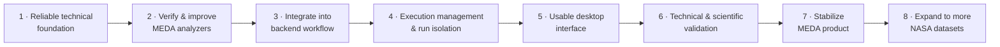
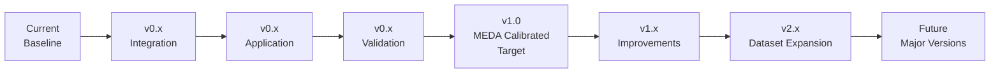
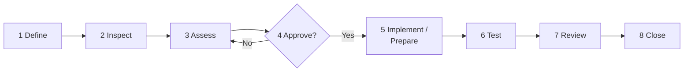
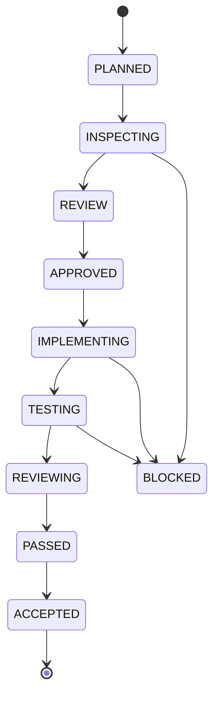
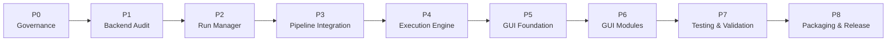

# 🛠️ Development Guide

### MarsWalk Intelligence · MEDA Data Research & Period Analyzer (MDRPA)

> ### No assumptions · No unapproved changes · No skipped tests · No phase or version transitions without acceptance.

---

## 📑 Contents

| Part | Sections |
|---|---|
| **I · Identity & Direction** | [1 Purpose](#1-purpose) · [2 Identity & Source of Truth](#2-project-identity-and-source-of-truth) · [3 Vision & Scope](#3-project-vision-and-current-scope) |
| **II · Target Product** | [4 Product Vision](#4-target-product-vision) · [5 Scientific Rigor](#5-scientific-rigor-and-scientific-validity) |
| **III · Version Roadmap** | [6 Versioning Strategy](#6-versioning-strategy) |
| **IV · Governance** | [7 Task Lifecycle](#7-mandatory-task-lifecycle) · [8 Scope & Change Control](#8-task-scope-and-change-control) · [9 File & Docs Rules](#9-file-and-documentation-rules) |
| **V · Engineering Standards** | [10 Architecture](#10-architecture-and-separation-of-responsibilities) · [11 Scientific Integrity](#11-scientific-integrity-rules) · [12 Run Isolation](#12-run-isolation-and-data-protection) · [13 Testing](#13-testing-requirements) |
| **VI · Acceptance Governance** | [14 Task Status](#14-task-status-definitions) · [15 Version Acceptance](#15-version-acceptance-criteria) · [16 Git](#16-git-and-repository-responsibilities) · [17 Task Report](#17-required-task-report) · [18 Phase Transitions](#18-phase-transition-rules) · [19 Traceability](#19-change-history-and-traceability) |
| **VII · Long-Term Vision** | [20 Beyond MEDA](#20-beyond-meda-calibrated-data) · [21 Vision Statement](#21-long-term-vision-statement) · [22 Governing Principle](#22-governing-development-principle) |

---

## ⚡ The Rules at a Glance

| # | Rule | Where |
|:-:|---|:-:|
| 1 | Inspect existing files before creating or changing anything | [§2.2](#22-source-of-truth) · [§9](#9-file-and-documentation-rules) |
| 2 | Follow the 8-stage task lifecycle. No stage is skipped. | [§7](#7-mandatory-task-lifecycle) |
| 3 | Stay inside the approved scope. Record extras as follow-up tasks. | [§8](#8-task-scope-and-change-control) |
| 4 | Never guess scientific meaning. Cite authoritative sources. | [§11](#11-scientific-integrity-rules) |
| 5 | Scientific changes are not ordinary refactors. | [§11.1](#111-scientific-change-review) |
| 6 | Never report a test as passed unless it was executed. | [§13](#13-testing-requirements) |
| 7 | Never mark a task `ACCEPTED` without explicit user confirmation. | [§14](#14-task-status-definitions) |
| 8 | Never present planned work as implemented. | [§9](#9-file-and-documentation-rules) |

---

# Part I · Project Identity and Development Direction

## 1. Purpose

Defines the mandatory development workflow, engineering standards, review procedures, version progression, and acceptance criteria for MDRPA.

Development must remain: **Controlled · Traceable · Reproducible · Maintainable · Technically reliable · Scientifically responsible · Consistent with the long-term vision.**

The guide does two things:

1. Establishes the rules that govern day-to-day development.
2. Defines the intended evolution of MDRPA from its current stage toward the Target Version.

All development activities must follow the applicable rules in this guide.

## 2. Project Identity and Source of Truth

### 2.1 Official identity

| | |
|---|---|
| **Project name** | MarsWalk Intelligence – MEDA Data Research & Period Analyzer |
| **Abbreviation** | MDRPA |
| **Repository** | `https://github.com/AASH010/MEDA-Data-Research-Period-Analyzer-MDRPA` |
| **Target branch** | `main` |

The name and abbreviation must stay consistent across the repository and its documentation.

### 2.2 Source of truth

- The official GitHub repository is the reference for the committed project state.
- The target branch is `main`, unless an explicitly approved task says otherwise.
- The latest commit is identified **before** repository-related work begins.
- Local files are **not** assumed to match GitHub.
- Existing files, interfaces, and documentation are inspected before creating replacements or new modules.
- No file is created, deleted, renamed, or substantially modified without an explicitly scoped and approved task.

## 3. Project Vision and Current Scope

### 3.1 Long-term vision

MDRPA is intended to become a comprehensive research and analysis platform for supported NASA datasets, where users can inspect, evaluate, compare, and rank candidate observation periods across missions, instruments, and products. It should support different data structures and processing levels through a modular architecture **without forcing incompatible datasets to share identical scientific assumptions**.

> The goal is not an application that merely opens more data files. It is a scientifically rigorous research tool that helps users understand the availability, integrity, quality, temporal characteristics, and analytical suitability of observation periods.

### 3.2 Current scope

| ✅ In scope | ❌ Not in scope (unless introduced by an approved change) |
|---|---|
| NASA Perseverance **MEDA Calibrated Data** | Derived MEDA products · Partially Processed MEDA products · Other Perseverance instruments · Other Mars or NASA missions · Arbitrary scientific data formats |

All current implementation, assumptions, validation requirements, and acceptance criteria are evaluated against this scope.

### 3.3 Development philosophy

> [!IMPORTANT]
> The project must not sacrifice scientific correctness or maintainability to accelerate feature development.

---

# Part II · Target Product and User Experience

## 4. Target Product Vision

The Target Version balances **ease of use**, **analytical depth**, and **scientific rigor**. It should be approachable for a quick overview and detailed enough for deep investigation. The target is not a minimal interface that hides information; it organizes complex scientific information clearly.

### 4.1 Ease of use

Clear navigation · understandable terminology · consistent screen organization · guided dataset selection · clear analysis configuration · visible execution status · meaningful error messages · accessible results summaries · logical access to detailed reports. Users should understand the main workflow without understanding the internal architecture.

### 4.2 Analytical depth

Ease of use never comes at the expense of detail. Where applicable, the application exposes:

| | | |
|---|---|---|
| File availability | Data coverage | Missing and invalid values |
| Data integrity indicators | Quality-related indicators | Metadata information |
| Temporal synchronization | Measurement uncertainty | Physical plausibility checks |
| Evaluation metrics | Period ranking evidence | Known limitations |
| Validation status | | |

Metric availability depends on the dataset, documentation, and implemented methods.

> [!WARNING]
> The application must **not display unavailable metrics as if they had been calculated.**

### 4.3 Progressive information presentation

| Level | Name | Content |
|:-:|---|---|
| **1** | Overview | Dataset, run, execution status, main findings |
| **2** | Analytical Details | Metrics, coverage, quality indicators, synchronization, ranking evidence |
| **3** | Scientific Evidence | Methods, criteria, metadata interpretation, assumptions, limitations, validation references |
| **4** | Technical Diagnostics | Logs, analyzer outputs, input references, warnings, diagnostics |

Detailed information stays reachable without overwhelming the main interface.

### 4.4 Scientific transparency

The application explains what results mean and what they do **not** mean. Users should be able to tell:

- Which source data produced a result, and which analyzer generated it.
- Which metrics were evaluated and which criteria applied.
- Which information was **unavailable**.
- Which assumptions and limitations affect interpretation.
- Whether technical validation has passed, and whether scientific validation has been established.

> [!CAUTION]
> A ranking score is not a scientific guarantee. A technically successful analysis is not proof of scientific validity.

### 4.5 Target experience principle

> **A user-friendly scientific interface that combines clear navigation, rich analytical detail, transparent evidence, and scientifically responsible interpretation.**

---

## 5. Scientific Rigor and Scientific Validity

MDRPA must not simply generate numbers. It preserves the **meaning, limitations, and scientific context** of the data.

### 5.1 Scientific rigor

Disciplined application of documented methods, transparent assumptions, appropriate validation, and reproducible practices:

- Scientific assumptions are explicit and criteria documented.
- Interpretation follows authoritative references.
- Missing information is handled transparently.
- Measurement and metadata distinctions are preserved.
- Calculations can be reviewed and tested.
- Results are reproducible to the extent inputs and environment allow.
- Changes to scientific logic receive review.

### 5.2 Scientific validity

Whether a method or result is scientifically justified and supported by evidence: authoritative documentation · verified measurement definitions · independent reference calculations · appropriate validation datasets · documented criteria · reviewed assumptions and thresholds · reproducible outcomes.

> [!IMPORTANT]
> Scientific validity is never claimed solely because the software runs without errors or passes ordinary tests.

### 5.3 Two separate dimensions

| Dimension | Main concern |
|---|---|
| ⚙️ **Engineering Quality** | Correct implementation, stability, maintainability, performance, reproducibility |
| 🔬 **Scientific Quality** | Correct interpretation, documented methods, appropriate validation, scientific defensibility |

Both are required. A technically stable application with unsupported conclusions is not acceptable, and meaningful calculations must be delivered through a dependable, maintainable system.

---

# Part III · Version Roadmap

## 6. Versioning Strategy

The roadmap communicates intended evolution **without implying planned functionality already exists**. Version numbers reflect actual development and release decisions. Milestones are intended directions, not guaranteed dates.

### 6.1 Version stages

| Version / Stage | Objective | Intended outcome |
|---|---|---|
| **Current Development Baseline** | Establish and improve the MEDA analyzer foundation | Reliable analyzer functionality for the current scope |
| **v0.x · Integration** | Integrate analyzers, execution services, run management | Controlled end-to-end backend workflow |
| **v0.x · Application** | Build the desktop interface and connect it to the backend | Usable application workflow |
| **v0.x · Validation** | Expand testing, technical validation, scientific verification | Stronger evidence of correctness and reliability |
| **v1.0 · MEDA Calibrated Target** | Complete and stabilize the supported application | Stable, documented, scientifically defensible first major product |
| **v1.x · Post-Target** | Improve usability, performance, reporting, functionality | Continued refinement |
| **v2.x · Dataset Expansion** | Add NASA data sources through controlled integration | Expanded dataset compatibility |
| **Future Major Versions** | Evolve toward a broader research platform | Modular multi-dataset environment |

Version assignments may change as the roadmap becomes more detailed. **No version is declared complete until its acceptance requirements are satisfied.**

### 6.2 Current development baseline

Focus: scientific analyzer foundation for MEDA Calibrated Data. Priorities: analyzer independence · better data interpretation · data integrity · analysis performance · reliable input/output contracts · documented scientific limitations · testing of existing and modified behavior · preparing analyzers for backend integration. *This stage is not a complete desktop product.*

### 6.3 Integration development

Connects existing analyzers through a controlled backend workflow: pipeline coordination · Run Manager · isolated run storage · background execution · status tracking · input/output validation · error handling · dependency management · traceable execution records. *Goal: a reliable backend foundation before full application integration.*

### 6.4 Application development

Delivers the desktop experience: main window · dataset input management · analysis configuration · execution controls · progress monitoring · results dashboard · detailed analytical views · reporting and export · settings and help. *The interface uses real backend results and never simulates completed functionality.*

### 6.5 Validation development

Unit and integration testing · end-to-end workflow testing · regression testing · performance benchmarking · error and recovery testing · scientific reference validation · verification of metadata interpretation · verification of quality-related criteria · validation of ranking behavior · documentation review. *Completion requires documented evidence, not merely the presence of test files.*

### 6.6 v1.0 · MEDA Calibrated Data Target

A stable, usable desktop application for NASA Perseverance MEDA Calibrated Data.

| Acceptance objectives |
|---|
| Reliable supported-data discovery · Correct metadata interpretation · Dependable analyzer execution |
| Controlled backend orchestration · Isolated, traceable runs · Clear and informative interface |
| Detailed analytical results · Transparent ranking methodology · Appropriate technical validation |
| Documented assumptions and limitations · Reproducible execution records · Reliable report generation |
| Verified Windows packaging | 

> [!NOTE]
> Scientific validity claims are limited to the methods and criteria **actually validated**. v1.0 does not imply support for every MEDA product category or every NASA dataset.

### 6.7 Post-v1.0 improvements

Better visualization · improved report presentation · more performance optimization · improved run comparison · expanded diagnostics · better usability · additional validated MEDA capabilities. These preserve the stability of the accepted baseline.

### 6.8 Future dataset expansion

New datasets need dedicated integration and validation, each with its own scope definition, data interpretation, scientific requirements, and acceptance criteria. Expansion must not weaken the standards set for MEDA.

---

# Part IV · Development Governance

## 7. Mandatory Task Lifecycle

| # | Stage | What happens |
|:-:|---|---|
| 1 | **Define** | Specify objective, scope, expected outputs, exclusions |
| 2 | **Inspect** | Examine relevant files, interfaces, dependencies, documentation, current repository state |
| 3 | **Assess** | Report findings, risks, constraints, proposed approach |
| 4 | **Approve** | Obtain **explicit user approval** before implementing or preparing an authorized replacement |
| 5 | **Implement / Prepare** | Prepare only the approved changes |
| 6 | **Test** | Run relevant tests; report exact commands and results |
| 7 | **Review** | Examine changes, side effects, consistency with requirements |
| 8 | **Close** | Record outcome, remaining issues, next authorized task |

> [!IMPORTANT]
> **No stage may be skipped.** If an unexpected issue changes the scope, work stops until the issue is inspected and the revised scope approved.
> For documentation-only tasks, testing may be consistency checks and review instead of software execution. The task report states why.

## 8. Task Scope and Change Control

Every task defines:

| | | |
|---|---|---|
| Task ID | Project phase | Target version / milestone |
| Objective | Files and components in scope | Expected changes |
| **Explicit exclusions** | Required tests or review procedures | Acceptance criteria |

Changes stay within the approved scope. Unrelated cleanup, refactoring, renaming, dependency changes, and architectural modifications are not permitted unless separately approved. A discovered improvement is recorded as a **proposed follow-up task**, never silently added.

### 8.1 Controlled file-by-file workflow

When a phase involves multiple existing files:

- Follow the approved file order.
- Complete **one file at a time** unless a related group is explicitly approved.
- Inspect the current file before preparing its replacement.
- Populated files get a **complete revised version**; empty files get complete ready-to-use content.
- Wait for the user's review, upload, and confirmation before the next file.
- Never assume a file was uploaded merely because its replacement was provided.

## 9. File and Documentation Rules

| Do | Don't |
|---|---|
| Inspect existing files before creating new ones | Create duplicate modules or overlapping documentation |
| Reuse the existing structure and naming conventions | Delete or rename files without an explicit decision |
| Give each document one clear responsibility | Document planned functionality as implemented |
| Keep documentation consistent with the actual implementation | Change the official project name or abbreviation |
| Update docs when an approved change affects documented behavior | Let the version roadmap drift from the approved roadmap |

Documentation distinguishes **implemented, tested, accepted, planned, and unavailable** functionality.

---

# Part V · Engineering Standards

## 10. Architecture and Separation of Responsibilities

The project separates: scientific analysis modules · data discovery and integration · backend orchestration · run management and execution · background workers · GUI · reporting and export · validation and testing.

- The GUI never reimplements scientific logic.
- Backend modules never depend on GUI rendering components.
- Integration changes preserve documented analyzer behavior unless a separate scientific change was reviewed and approved.

### 10.1 Backend and GUI separation

- Scientific calculations belong in the backend.
- GUI modules handle interaction and presentation.
- Communication uses defined interfaces.
- Long-running operations never block the GUI thread.
- GUI changes never silently alter scientific calculations.
- The GUI displays actual execution states and results.
- Presentation logic never changes the meaning of backend outputs.

### 10.2 Future extensibility

The architecture supports future data-source and instrument-specific extensions, but abstractions must solve **actual** problems; shared interfaces must preserve scientific differences; new integrations must not modify unrelated analyzers; MEDA functionality stays independently testable; future datasets follow dedicated acceptance requirements.

## 11. Scientific Integrity Rules

Interpretation is based on authoritative documentation and verified implementation behavior.

### 11.1 Distinctions that must be preserved

| ✅ Not the same | as |
|---|---|
| File availability | Data completeness |
| Data completeness | Measurement quality |
| Measurement quality | Scientific validity |
| Metadata warnings | Measurement quality issues |
| Numeric range checks | Comprehensive scientific validation |
| Synchronization match rates | Quality scores *(they are diagnostics)* |
| Temporal overlap | Identical sampling |
| Candidate rankings | Scientific certification *(they are exploratory)* |

### 11.2 Must never be assumed

- ❌ Binary quality flags mean `1 = good` and `0 = bad`.
- ❌ A numeric value is valid simply because it is parseable.
- ❌ A matching timestamp proves equivalence between products.
- ❌ MEDA observations provide continuous spatial coverage across every geographical grid cell.
- ❌ A higher ranking score establishes scientific suitability.

Quality flags are not interpreted without their **official definitions**. Mission-specific timestamps are not converted to another time system **without an authoritative reference**. No assumptions, thresholds, weights, or ranking rules change without explicit review and approval.

### 11.3 Scientific change review

> [!IMPORTANT]
> A scientific change is **not** an ordinary code refactor.

Any change affecting scientific interpretation identifies:

1. The scientific problem being addressed.
2. The authoritative reference or justification.
3. The affected analyzers and outputs.
4. The expected change in interpretation.
5. Potential effects on existing results.
6. Required reference and regression tests.
7. Remaining scientific limitations.

## 12. Run Isolation and Data Protection

Every analysis execution has an independent identity and isolated storage.

- Every run gets a **unique Run ID**, and repeated analyses of the same Sol range create **distinct** runs.
- Inputs, configurations, metadata, logs, and outputs are **never mixed** between runs.
- Existing run data is never overwritten unintentionally, and a run never silently reuses another run's output directory.
- User-generated data stays separate from application source files.
- Failed or interrupted runs keep an **accurate** status.
- Run paths and identifiers are validated before execution.

Isolation is enforced by the Run Manager and verified through tests.

## 13. Testing Requirements

> [!IMPORTANT]
> Implementation alone does not establish task completion.

Tests match the scope and may include: unit · integration · regression · input/output validation · error handling · data isolation · scientific consistency · GUI behavior · background execution · packaging · performance benchmarks.

**Every test report identifies:**

| Exact command or procedure | Test environment (where relevant) | Expected result |
|---|---|---|
| **Actual result** | **Pass / fail status** | **Known limitations** |

A test is **never** reported as passed if it was not executed. Unavailable tests and unverified behavior are identified explicitly.

### 13.1 Scientific tests

Use representative data and documented expectations wherever possible. A technically successful execution does not establish scientific correctness, and results distinguish software behavior from scientific interpretation.

### 13.2 Regression protection

Changes to existing analyzers are evaluated against relevant previous behavior. Intentional scientific changes are documented and their effect on previous outputs reviewed. **Performance improvements are rejected if they silently change scientific results.**

---

# Part VI · Version and Acceptance Governance

## 14. Task Status Definitions

| Status | Meaning |
|---|---|
| `PLANNED` | Defined but not started |
| `INSPECTING` | Existing state is being examined |
| `REVIEW` | Findings and proposed changes await review |
| `APPROVED` | Scope and approach are authorized |
| `IMPLEMENTING` | Approved changes are being prepared |
| `TESTING` | Required tests are being executed |
| `REVIEWING` | Changes and test evidence are being reviewed |
| `PASSED` | Required tests and technical checks passed |
| `ACCEPTED` | Final outcome **explicitly accepted** |
| `BLOCKED` | Cannot continue because of an unresolved issue |

> [!WARNING]
> A task is **never** marked `ACCEPTED` merely because implementation is complete or tests passed. Acceptance requires **explicit user confirmation**.

## 15. Version Acceptance Criteria

Each major version has defined acceptance requirements. Completion requires evidence that functionality is **implemented, tested, reviewed, and documented**.

### 15.1 Version status definitions

| Status | Meaning |
|---|---|
| Planned | Objective defined |
| In Development | Implementation ongoing |
| Feature Complete | Approved feature scope implemented |
| Testing | Required verification ongoing |
| Release Candidate | Release requirements appear satisfied; final verification underway |
| Released | Formally prepared and published |
| Accepted | Explicit project acceptance received |

A version is never called released or accepted merely because its main features appear to work.

### 15.2 v1.0 acceptance

<table>
<tr><th>⚙️ Engineering</th><th>🖥️ User Experience</th><th>🔬 Scientific Rigor</th></tr>
<tr><td valign="top">

- Stable application operation
- Reliable backend execution
- Controlled run management
- Correct input and output handling
- Appropriate error handling
- Regression protection
- Maintainable architecture

</td><td valign="top">

- Clear navigation
- Understandable workflows
- Informative result presentation
- Access to detailed analytical information
- Clear distinction between warnings, errors, unavailable metrics, and valid results

</td><td valign="top">

- Documented assumptions
- Appropriate interpretation of source metadata
- Verified analyzer behavior
- Documented evaluation criteria
- Appropriate reference validation
- Transparent limitations
- No unsupported scientific claims

</td></tr>
<tr><th>🔁 Reproducibility</th><th colspan="2">📦 Delivery</th></tr>
<tr><td valign="top">

- Traceable source inputs
- Run-specific configuration
- Recorded software and analyzer versions where applicable
- Preserved execution records
- Verifiable output organization

</td><td valign="top" colspan="2">

- Complete relevant documentation
- Verified application packaging
- Appropriate release testing
- Explicit release and acceptance decisions

</td></tr>
</table>

The final v1.0 scope stays limited to the officially accepted **MEDA Calibrated Data** capabilities.

## 16. Git and Repository Responsibilities

| Rule |
|---|
| The official target branch is `main`. |
| The latest repository commit is checked before repository-related tasks. |
| Changes are prepared against the **inspected** repository state. |
| **The user performs local file modifications and Git operations.** |
| The assistant may inspect repository content and provide complete replacement files or proposed changes. |
| The assistant **never claims** local files were modified, commits created, or changes pushed unless actually performed and verified. |
| No unapproved direct repository changes. |
| The final review identifies the exact files and changes involved. |
| The user confirms when changes have been uploaded to the official repository. |

### 16.1 Verifying an uploaded change

1. Confirm the intended file and branch.
2. Inspect the published version when repository access is available.
3. Check that the uploaded content matches the approved version.
4. Record any differences or unresolved issues.
5. Obtain acceptance before moving to the next authorized task.

## 17. Required Task Report

Every completed or blocked task has a concise report:

| | | |
|---|---|---|
| Task ID | Project phase | Target version / milestone |
| Objective | Repository and target branch | Inspected commit (if applicable) |
| Files inspected | Files changed or proposed | Changes made or proposed |
| Tests or review procedures | Test results | Known limitations |
| Remaining issues | **Final status** | **Next authorized task** |

The report distinguishes changes **prepared for the user** from changes **verified as uploaded to GitHub**.

## 18. Phase Transition Rules

A phase advances only when:

1. Its required tasks are complete.
2. Required tests and reviews have passed.
3. Outstanding limitations are documented.
4. Required documentation is updated.
5. The user has **explicitly accepted** the phase outcome.

No later phase begins merely because the previous phase's implementation appears finished.

> [!NOTE]
> Phases and versions are related but separate: a **phase** describes project work; a **version** describes an accepted product milestone.

## 19. Change History and Traceability

Development decisions are traceable to their approved tasks. Significant architectural, scientific, interface, and workflow decisions are documented in the appropriate project document, which distinguishes **approved decisions · implemented · tested · accepted · planned functionality · known limitations**. When a decision changes, the relevant documentation is updated through an approved task.

---

# Part VII · Long-Term Project Vision

## 20. Beyond MEDA Calibrated Data

The first major target is a stable application for **MEDA Calibrated Data**. The long-term vision extends further: a broader NASA research platform supporting more data types, instruments, and missions through a controlled, extensible architecture. This is a **future objective**, not current functionality.

### 20.1 Potential future data support

Additional MEDA product categories · other Perseverance instruments · other Mars mission datasets · additional NASA missions · different measurement products · different data formats and metadata structures. Each new category undergoes its own technical and scientific assessment before being declared supported.

### 20.2 Potential platform capabilities

Reusable data-source integration · mission- and instrument-aware processing · product-specific analysis · unified run management · reproducible workflows · detailed visualization · cross-period comparison · scientifically appropriate evaluation · traceable reporting · extensible scientific validation. A common environment should make datasets easier to work with **without hiding their scientific differences**.

### 20.3 Expansion principles

1. Preserve the stability of the accepted MEDA implementation.
2. Add datasets through documented integration boundaries.
3. Maintain instrument-specific scientific logic.
4. Avoid unsupported universal scoring assumptions.
5. Require appropriate technical and scientific validation.
6. Preserve source-data traceability.
7. Document compatibility and limitations.
8. Expand only through approved development tasks.

## 21. Long-Term Vision Statement

> **MDRPA aims to evolve from a focused MEDA Calibrated Data analysis application into a comprehensive, modular, and scientifically rigorous NASA data research platform.**

It should combine an intuitive user experience with detailed analysis, transparent evaluation methods, reproducible workflows, and defensible results. Its purpose is not merely to process more datasets, but to provide a dependable environment where users can understand, inspect, evaluate, and compare observation periods across supported NASA data products. The MEDA implementation establishes the engineering and scientific foundation for that growth.

---

## 22. Governing Development Principle

### No assumptions · No unapproved changes · No skipped tests · No phase or version transitions without acceptance.

MDRPA progresses through controlled, reviewable, traceable, and scientifically responsible development. Every milestone moves the project closer to its Target Architecture and Target User Experience **without presenting planned capabilities as implemented achievements**. The ultimate objective is a technically reliable, user-friendly, analytically detailed, and scientifically defensible research application.