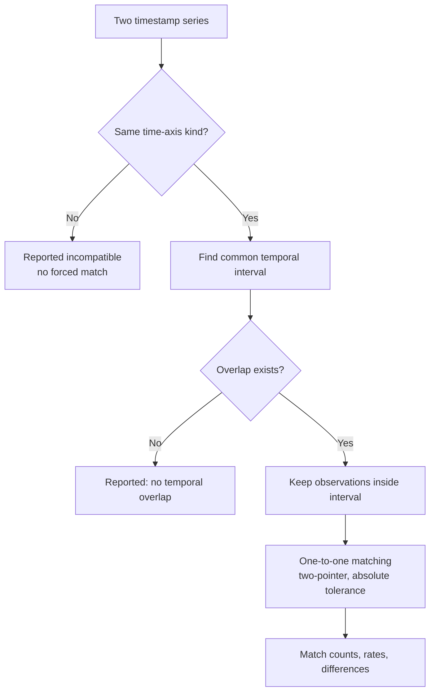
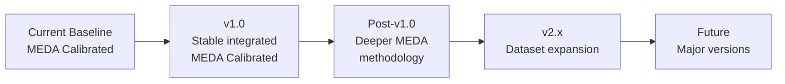

# 🔬 Scientific Methodology

### MarsWalk Intelligence · MEDA Data Research & Period Analyzer (MDRPA)

> **MDRPA provides exploratory evidence. It does not certify scientific validity.**

---

## 📑 Contents

| | |
|---|---|
| [1 Purpose & Scope](#1-purpose-and-scientific-scope) | [11 Spatial Context](#11-spatial-and-observation-context) |
| [2 Methodology Boundaries](#2-project-scope-and-methodology-boundaries) | [12 Rigor & Validity](#12-scientific-rigor-and-scientific-validity) |
| [3 Data & Metadata](#3-data-and-metadata-principles) | [13 Reporting Rules](#13-interpretation-and-reporting-rules) |
| [4 Availability & Coverage](#4-data-availability-and-coverage) | [14 Limitations](#14-scientific-limitations) |
| [5 Time-Axis](#5-time-axis-methodology) | [15 Future Development](#15-future-methodological-development) |
| [6 Data Integrity](#6-data-integrity-indicators) | [16 Change Control](#16-methodology-change-control) |
| [7 Quality & Uncertainty](#7-quality-related-metadata-and-measurement-uncertainty) | [17 Version Evolution](#17-version-and-scope-evolution) |
| [8 Synchronization](#8-temporal-synchronization) | [18 Related Docs](#18-related-documentation) |
| [9 Candidate Periods](#9-candidate-period-construction) | [19 Governing Principle](#19-governing-scientific-principle) |
| [10 Ranking](#10-exploratory-ranking-methodology) | |

---

## 🧭 Methodology at a Glance

| Dimension | Describes | Does **not** establish |
|---|---|---|
| 📁 **File availability** | Which files exist | Completeness or validity |
| ⏱️ **Coverage** | Structure of available records | Sensor uptime or performance |
| 🧮 **Data integrity** | Parsing and completeness | Physical correctness |
| 🧪 **Quality-related metadata** | Candidate fields, documented bounds | Official flag meaning, scientific quality |
| 🔗 **Synchronization** | Timestamp matching between products | Equivalent measurements |
| 🏁 **Ranking** | Comparative exploratory score | Scientific certification |

---

## 1. Purpose and Scientific Scope

This document defines the scientific, analytical, and methodological principles governing how MDRPA examines NASA Perseverance **MEDA** data. MDRPA explores, inspects, evaluates, and compares candidate observation periods using available measurements and metadata.

> **Immediate scope: NASA Perseverance MEDA Calibrated Data.** The first major objective is a stable, integrated **v1.0** for this scope. Future support for other NASA datasets is a long-term direction and does not change the current scope.

The methodology examines these dimensions, which must stay **distinguishable** throughout: data availability · measurement and timestamp completeness · structural metadata integrity · documented quality-related information · measurement uncertainty information · documented numerical bounds · temporal synchronization · exploratory candidate-period ranking.

### 1.1 Scientific purpose

The application provides exploratory evidence for research planning, dataset inspection, candidate-period comparison, and further investigation. It does **not** independently:

| ❌ | |
|---|---|
| Certify scientific validity | Establish instrument health |
| Establish measurement accuracy or precision | Determine whether a period is representative of a phenomenon |
| Establish suitability for a hypothesis | Replace NASA, MEDA, or PDS documentation |
| Replace review by qualified researchers | |

### 1.2 Methodological principles

| # | Principle |
|:-:|---|
| 1 | Preserve the distinction between raw observations and derived analytical indicators. |
| 2 | Interpret measurements using documented product metadata. |
| 3 | Never assign scientific meaning from field names or numerical patterns alone. |
| 4 | Preserve missing, invalid, and special-value classifications. |
| 5 | Never silently convert incompatible time coordinates. |
| 6 | Keep unavailable metrics distinguishable from zero-valued metrics. |
| 7 | Preserve analytical traceability and reproducibility. |
| 8 | Distinguish engineering quality from scientific validity. |
| 9 | Require documented justification for changes to scientific interpretation. |
| 10 | Never present exploratory rankings as scientific certification. |

---

## 2. Project Scope and Methodology Boundaries

### 2.1 Current data scope

Applies to **NASA Perseverance MEDA Calibrated Data**. It must not imply that every MEDA product, processing level, or measurement category is already supported.

### 2.2 Excluded categories

**Derived** and **Partially Processed** MEDA products, plus other NASA missions, instruments, and datasets, are outside the current scope unless introduced through a separately reviewed expansion. Each needs its own data-source definitions, metadata interpretation, validation rules, and methodology.

### 2.3 Implementation vs. methodology status

| Status | Meaning |
|---|---|
| ✅ **Implemented** | Exists in the current codebase |
| 🧪 **Tested** | Passed its defined tests |
| 🏁 **Accepted** | Reviewed and accepted for the applicable scope |
| 🔧 **In Progress** | Implementation or validation ongoing |
| 🗓️ **Planned** | On the roadmap, not yet implemented |
| 💡 **Proposed** | Suggested but not formally adopted |
| ⏸️ **Deferred** | Intentionally postponed |

> [!WARNING]
> A proposed or planned methodology is never presented as an existing capability. **Passing software tests does not by itself establish scientific validity.**

### 2.4 v1.0 methodological objective

An integrated, sufficiently validated workflow providing: reliable source-data interpretation within documented constraints · consistent metadata extraction · transparent measurement and timestamp diagnostics · documented treatment of special values · explicit time-axis handling · traceable synchronization · transparent candidate-period ranking · clear reporting of unavailable information and limitations · reproducible results.

This requires implementation, testing, methodological review, and scientific validation. It must not be inferred from the existence of individual analyzers.

---

## 3. Data and Metadata Principles

### 3.1 CSV measurement data

CSV files hold the observation records. Interpretation depends on the corresponding XML field definitions. The application must **not assume** that:

- Every CSV has a header row.
- CSV column order always matches XML field order.
- Every product has the same sampling schedule or field structure.
- Every available file contains complete measurements.
- Every numeric value is a scientifically valid observation.
- Every missing or non-numeric value has the same scientific meaning.

### 3.2 XML metadata

Extracted: product identification · Sol and source-file information · table layout · field names and numbers · data types · descriptions and units · documented numerical bounds · special constants · candidate time and quality-related field names.

Extraction does not establish the scientific meaning of every field. Metadata keeps its **original documented meaning** and is never converted into an unsupported interpretation.

### 3.3 Metadata as an interpretation source

XML is a primary source for product structure and documented properties, but:

- A field name is not sufficient evidence of scientific meaning.
- A description must be read in its documented context.
- A numerical bound is not automatically a universal physical validity threshold.
- A special constant keeps its documented classification.
- A candidate classification is not an authoritative scientific classification.

### 3.4 CSV-to-XML column mapping

Measurement analysis depends on safely mapping CSV columns to XML fields. Supported situations:

| # | Mapping situation |
|:-:|---|
| 1 | Exact header matching |
| 2 | Reordered unique headers |
| 3 | Strict positional mapping for validated duplicate XML field names |
| 4 | Narrowly validated WS field-name aliases |
| 5 | Positional mapping when XML explicitly declares that no header exists |

> [!IMPORTANT]
> **Ambiguous mappings are never used for measurement calculations.** Known exceptions are handled through narrowly validated rules, not general assumptions or automatic modification of source metadata. Mapping decisions and status stay available for diagnostics.

### 3.5 Special constants

Special constants are documented metadata values that may represent categories other than ordinary measurements. They are distinct from ordinary missing and invalid values.

| Classification | Counter behavior |
|---|---|
| `missing_constant` | Contributes to the **Missing** counter |
| `invalid_constant` | Contributes to the **Invalid** counter |
| `error_constant` | Own independent classification and counter |
| `saturated_constant` | Own independent classification and counter |
| `unknown_constant` | Own independent classification and counter |
| `not_applicable_constant` | Own independent classification and counter |

**Rules:**

1. A value matching **multiple** special-constant categories is treated as an **ambiguous** special-constant classification.
2. A value matching **no** special constant may go through ordinary numeric-value validation.
3. Special constants are never indiscriminately merged into one Missing or Invalid category.
4. Their documented metadata remains available for interpretation.

### 3.6 Array metadata

Array-valued XML fields may carry structural and descriptive information. Within the current scope, array metadata is **extracted and retained as metadata only**. Array values are not treated as ordinary measurement inputs to the Quality or Coverage analyzers, and array special-constant evaluation is out of scope until separately implemented and validated. Metadata extraction is not measurement evaluation.

---

## 4. Data Availability and Coverage

### 4.1 File availability

Whether expected product files exist in the examined Sol range. The inventory records Sol number, product code, filename, extension, size, and CSV/XML pairing. **It is an inventory indicator, not a measurement-quality verdict.**

### 4.2 Measurement coverage

Examines CSV contents using XML metadata. Reported: row count · selected time field and time-axis kind · parsed, missing, invalid, duplicate, and out-of-order timestamps · temporal span · median positive adjacent step · detected gaps · numeric, missing, and invalid values · column-mapping status.

Coverage is a **descriptive** assessment of available records, not a measure of sensor performance or scientific validity.

### 4.3 Timestamp gap detection

$$
T_{\text{gap}} = F \times \operatorname{median}(\text{positive adjacent steps})
$$

- $F$ is the configured `gap_factor`.
- Default: `2.5`. Must be finite and greater than 1.
- A positive adjacent step greater than $T_{\text{gap}}$ counts as a detected gap.

> [!CAUTION]
> This is a **relative** method. It does not establish why a gap occurred, prove the instrument stopped, establish the expected sampling schedule, or give a defensible missing-duration estimate. Coordinate differences are not necessarily physical SI seconds for every time axis. The summed detected gaps are **not** a scientifically established missing duration.

### 4.4 Coverage interpretation

| High coverage does **not** establish | Low coverage does **not** establish |
|---|---|
| Continuous instrument operation | Instrument malfunction |
| Measurement accuracy | |
| Scientific completeness | |
| Environmental representativeness | |

Expected sampling behavior and product-specific observation schedules must be considered first.

---

## 5. Time-Axis Methodology

### 5.1 General rule

Time values are interpreted according to their documented or identifiable kind. **Incompatible coordinates are never silently combined.**

| Kind | Current treatment |
|---|---|
| **SCLK** | Finite numeric spacecraft-clock coordinate |
| **UTC** | Timezone-aware ISO-8601 normalized to UTC epoch seconds |
| **LMST** | Linear Mars-sol coordinate |
| **LTST** | Nominal Sol/local-clock coordinate |
| **ISO naive** | Timezone-unspecified ISO coordinate |

Successful parsing does not prove the scientific correctness of the original timestamp.

### 5.2 Per-kind rules

<table>
<tr><th>Kind</th><th>Rule</th><th>Never</th></tr>
<tr><td><b>SCLK</b></td><td>Parsed as a finite numeric coordinate. Not converted to UTC.</td><td>Treated as UTC because it fits in a float. Any future conversion needs an authoritative method.</td></tr>
<tr><td><b>UTC</b></td><td>Accepted only with timezone info; normalized to UTC epoch seconds.</td><td>Assumed for timezone-naive timestamps.</td></tr>
<tr><td><b>LMST</b></td><td>Linear Mars-sol coordinate using the scale below. Suited to ordering and interval analysis within its limits.</td><td>Converted to UTC.</td></tr>
<tr><td><b>LTST</b></td><td>Nominal Sol/local-clock coordinate. True solar time does not advance uniformly versus elapsed SI time.</td><td>Treated as a precise elapsed-time scale, read as physical seconds, or converted to UTC without an authoritative method.</td></tr>
</table>

LMST scale used by the implementation (a coordinate scale, **not** a UTC conversion):

$$
1\ \text{Sol} = 88775.244\ \text{Earth seconds}
$$

### 5.3 Axis selection

Default preference order: **SCLK → UTC → LMST → LTST → ISO naive.** This is a *software selection preference*, not a scientific ranking of time systems. The selected field and kind stay visible in reports. Changing the default requires review because it affects coverage and synchronization results.

### 5.4 Axis compatibility

Comparing time series requires compatible coordinates. Different axis kinds are not automatically equivalent, and unsupported conversions are never introduced through implicit assumptions. Future conversion capability requires:

1. An authoritative conversion source.
2. Documented assumptions.
3. Defined precision and validity limits.
4. Independent validation.
5. Regression testing.

---

## 6. Data Integrity Indicators

Two numerical dimensions describing parsing and completeness. They do **not** independently prove measurement correctness.

### 6.1 Timestamp integrity

$$
I_t = \frac{N_{\text{parsed}}}{N_{\text{parsed}} + N_{\text{missing}} + N_{\text{invalid}}} \times 100
$$

Describes timestamp parsing completeness. It does not establish sensor uptime or scientific correctness.

### 6.2 Numeric value integrity

$$
I_v = \frac{N_{\text{numeric}}}{N_{\text{numeric}} + N_{\text{missing}} + N_{\text{invalid}}} \times 100
$$

Counts are the numeric measurement values examined by the coverage analyzer. Describes numeric completeness and successful parsing, not physical correctness.

### 6.3 Combined integrity

| Component | Default weight |
|---|:-:|
| Timestamp integrity | `1.0` |
| Numeric-value integrity | `1.0` |

If a component is unavailable it is **not fabricated as zero**; remaining available positive weights are normalized. These are descriptive software metrics, not a validated scientific measure.

### 6.3.1 Interpretation boundary

Data integrity describes the examined records. It is **not** a complete assessment of instrument reliability, sensor calibration, physical accuracy, scientific validity, or measurement uncertainty. Those need additional evidence and validation.

---

## 7. Quality-Related Metadata and Measurement Uncertainty

### 7.1 Candidate-based identification

The Quality Analyzer uses field names and descriptions to identify **candidate** categories:

| Category | Notes |
|---|---|
| `quality_field_candidate` | Quality-related name or description |
| `operational_context_flag_candidate` | Operating modes, deployment state, mechanisms, heaters, motors, instrument context |
| `measurement_uncertainty` | Wording suggests uncertainty information |
| `range_check` | Values checked against documented XML bounds |

These come from metadata and keyword rules. They are candidates for examination, **not authoritative classifications**. A field may belong to more than one category when it meets multiple independent rules.

### 7.2 Quality flags

The meaning of a flag is **never inferred from its name**. Specifically, never assume:

- ❌ Binary values mean good/bad.
- ❌ `1` always means valid, or `0` always means invalid.
- ❌ A generic status field represents measurement quality.

Authoritative product documentation is required first. Official Quality Flag interpretation is **not implemented** merely because a field was identified as a candidate; any future interpretation must be documented, reviewed, and validated against authoritative sources.

### 7.3 Operational and context fields

Reported separately from quality candidates. An operational state is **not** a measurement-quality verdict.

### 7.4 Measurement uncertainty

The analyzer identifies fields whose wording suggests uncertainty. It does **not** independently calculate uncertainty, interpret conventions, combine uncertainty fields into a universal score, or decide scientific acceptability. Uncertainty keeps its documented meaning and units; the presence of such a field does not mean uncertainty has been evaluated.

### 7.5 Documented numeric bounds

Where `valid_minimum` / `valid_maximum` exist in XML, values are counted as **below the declared minimum** or **above the declared maximum**.

> [!NOTE]
> A value outside a declared range is **flagged for review**, not classified as scientifically invalid. A value inside the range is not automatically valid.

### 7.6 Special values in quality analysis

Special constants keep their documented classifications and are never treated as ordinary numeric measurements or collapsed into a generic missing category. Special-value classification is separate from numeric range evaluation, and a special constant's existence is not a measurement-quality verdict.

### 7.7 Engineering vs. scientific quality

| ⚙️ Engineering Quality | 🔬 Scientific Quality |
|---|---|
| File availability · structural integrity · column mapping · parsing completeness · timestamp handling · numeric-value classification · processing consistency · reproducibility | Suitability and interpretability for a particular research purpose |
| | May require: authoritative flag interpretation · instrument documentation · calibration knowledge · uncertainty analysis · physical plausibility · scientific context · independent validation |

Engineering indicators are never presented as a complete scientific-quality assessment. Scientific Quality remains a broader objective needing documented methodology and validation.

---

## 8. Temporal Synchronization

### 8.1 Purpose

Describes how closely timestamps from different MEDA products correspond within a common interval. It does **not** establish that measurements are scientifically equivalent or that instruments share sampling behavior.

### 8.2 How it works

- **Compatible axes:** both products must use the same kind. No automatic conversion; incompatible axes are reported as such.
- **Common interval:** the overlapping coordinate range; only observations inside it are matched.
- **One-to-one matching:** each occurrence participates in at most one match; duplicates stay separate observations; no silent reuse. Uses a two-pointer method on sorted values.

### 8.3 Indicators reported

Observation counts in the common interval (per series) · matched occurrences · unmatched observations (per series) · match rate for each series · match rate relative to the sparser series · mean and maximum absolute match difference · common interval information.

$$
R_s = \frac{N_{\text{matched}}}{\min(N_1, N_2)} \times 100
$$

$N_1$ and $N_2$ are observation counts in the common interval.

### 8.4 Tolerance

Applied in the **selected coordinate**. Not automatically physical SI seconds, particularly for SCLK, LMST, LTST, and timezone-naive coordinates. The configured tolerance is recorded and considered when interpreting results.

### 8.5 Sampling-schedule limitations

Different products may sample differently.

| Low match rate | High match rate |
|---|---|
| Does not establish malfunction or poor quality | Does not prove scientific equivalence |

Interpret rates in the context of sampling schedules, common coverage, selected axis, tolerance, observation counts, and product-specific behavior. **Synchronization is a diagnostic dimension, not a universal quality score.**

---

## 9. Candidate Period Construction

The Period Ranker divides the selected Sol range into **candidate windows** (default size: **10 Sols**). Window construction and range selection are **software configuration choices**, not a scientifically optimal duration. Each window uses available per-Sol metrics and is classified:

| Class | Treatment |
|---|---|
| Full window | Eligible |
| Partial window | Listed for transparency; **not ranked** against full windows |
| Insufficient available metrics | Not ranked |
| Rankable | Ranked within its comparison group |

Windows are for comparative exploration. Different window sizes can produce different rankings, and any change to the default size or construction method needs review of its effect on existing results.

---

## 10. Exploratory Ranking Methodology

### 10.1 Dimensions and default weights

| Metric | Default weight |
|---|:-:|
| File Availability | `0.20` |
| Data Integrity | `0.45` |
| Quality Indicators | `0.15` |
| Synchronization | `0.20` |

> [!WARNING]
> Weights are configurable software parameters. They are **not scientifically calibrated constants** and must not be presented as validated importance factors.

### 10.2 The four metrics

| Metric | Basis | Limits |
|---|---|---|
| **File Availability** | Configured required products. Default: `ATS` `PS` `RDS` `RHS` `TIRS` `WS`. `ENG` optional by default. | Describes presence of products, not completeness or validity of measurements. |
| **Data Integrity** | Timestamp and numeric-value completeness indicators (§6). | Successful parsing is not proof of measurement validity. |
| **Quality Indicators** | **Only** values checked against documented XML numerical bounds. Not derived from undocumented flag meanings. | May be unavailable. Unavailable is never zero and never evidence that every measurement is valid. |
| **Synchronization** | Available pair-level sparser-series match rates. | Affected by sampling schedules, overlap, time axis, tolerance. Not a universal quality measure. |

### 10.3 Unavailable metrics and weight normalization

A metric is available for a window only when its available Sol count meets the configured **minimum Sol fraction**. Unavailable metrics are excluded; remaining positive weights are renormalized. **A missing metric is not a score of zero.** The minimum metric requirement is never reduced merely to force a ranking.

### 10.4 Comparison groups

Windows are ranked only against windows with the **same available positively weighted metric signature**. Ranks from different groups are not directly comparable. A single global best is reported only when there is **one** group; otherwise best candidates are presented separately per group.

### 10.5 Meaning of the score

A weighted combination of available metric scores. It is an exploratory comparison indicator and does **not** represent scientific certainty, instrument health, accuracy, precision, environmental representativeness, mission-level validation, or fitness for a hypothesis. Candidate periods need further scientific review before research use.

### 10.6 Ranking stability

A result depends on: available source files · selected Sol range · window configuration · available metric dimensions · configured weights · time-axis selection · synchronization tolerance · required product configuration · minimum metric availability. It must always be interpreted **in relation to its configuration and inputs**. A configuration change may reorder candidates without any change in the underlying environment. Stability and sensitivity should be evaluated in future validation work.

---

## 11. Spatial and Observation Context

MEDA measurements are taken **at the rover location** and at the times in the records. Measurements during a Sol do not establish continuous spatial weather coverage across a geographical area. File availability, temporal coverage, and synchronization must not be presented as proof of spatially continuous observations. Any future spatial analysis needs an explicitly documented methodology and appropriate supporting data.

---

## 12. Scientific Rigor and Scientific Validity

### 12.1 Scientific rigor

A governing requirement: behavior, interpretation, and conclusions are supported by documented methods, traceable inputs, explicit assumptions, and appropriate validation. It requires clear metric definitions · documented formulas and thresholds · explicit time-axis interpretation · traceable metadata interpretation · transparent treatment of unavailable data · reproducible processing · documented limitations · appropriate regression testing · review of assumptions before methodological changes.

### 12.2 Scientific validity

Whether a method or conclusion is justified for its purpose. It needs more than successful execution or internal consistency. Depending on the capability: authoritative NASA/PDS documentation · instrument references · independent reference datasets · known test cases · documented physical or temporal constraints · comparison against established methods · expert review. **Never claimed without appropriate evidence.**

### 12.3 Two validation tracks

| ⚙️ Engineering Validation | 🔬 Scientific Validation |
|---|---|
| *Does the software behave as designed?* | *Are the interpretation and conclusions justified?* |
| Unit tests · integration tests · regression tests · input/output validation · data-mapping tests · performance tests · reproducibility checks · error-handling tests | Verification against authoritative documentation · validation of time-system assumptions · review of measurement and special-value interpretation · validation of uncertainty methodology · review of plausibility criteria · comparison with independent references |

Engineering tests may show an implementation follows its algorithm. They do **not** show the algorithm is a scientifically valid interpretation.

### 12.4 Claims and evidence

Scientific claims are proportional to available evidence. The application distinguishes:

1. Directly observed data
2. Results calculated from observed data
3. Metadata-derived classifications
4. Configurable analytical assumptions
5. Exploratory interpretations
6. Scientifically validated conclusions

It never elevates a candidate classification or exploratory score into a scientific conclusion without supporting evidence.

---

## 13. Interpretation and Reporting Rules

Reports and GUI summaries preserve the distinction between: **observed values · missing values · invalid or unparseable values · special-constant classifications · structural metadata warnings · candidate field classifications · documented range-check findings · unavailable metrics · exploratory scores.**

Unavailable metrics are never hidden or silently replaced with zero. Warnings and limitations stay visible where they affect interpretation. Enough run configuration and source-report information is kept to trace a ranking to its inputs.

### 13.1 Progressive presentation

| Level | View | Content |
|:-:|---|---|
| 1 | **Overview** | Concise view of the result |
| 2 | **Analytical Details** | Metrics and calculations contributing to the result |
| 3 | **Scientific Evidence** | Metadata, assumptions, documented evidence |
| 4 | **Technical Diagnostics** | Processing details, warnings, source-level traceability |

The simplified overview never removes or contradicts important limitations, and detailed evidence stays accessible.

### 13.2 Ranking presentation

Rankings are described as **exploratory comparisons**, never with labels implying scientific certification or confirmed instrument health. Multiple comparison groups remain distinct. Unavailable metrics and configuration differences should be understandable to users.

### 13.3 Traceability

A result traces to: source data files · relevant XML metadata · selected Sol range · analyzer configuration · time-axis selection · ranking configuration · applicable warnings · software and methodology version.

---

## 14. Scientific Limitations

| # | Limitation |
|:-:|---|
| 1 | Keyword-based field classification does not establish authoritative scientific meaning. |
| 2 | Numeric parsing does not establish physical correctness. |
| 3 | XML-declared bounds do not establish universal scientific validity. |
| 4 | Timestamp parsing does not establish sensor uptime. |
| 5 | Timestamp gap detection does not establish missing measurement duration. |
| 6 | Different product sampling schedules affect synchronization results. |
| 7 | Time-axis coordinates have different interpretation constraints. |
| 8 | Ranking weights are configurable and not scientifically calibrated. |
| 9 | Candidate-window rankings depend on the available metric set. |
| 10 | Partial windows are not directly ranked against full windows. |
| 11 | Product availability does not establish measurement completeness. |
| 12 | Special constants must retain their distinct documented classifications. |
| 13 | Array metadata extraction does not establish array measurement evaluation. |
| 14 | Candidate quality-field identification does not establish official Quality Flag interpretation. |
| 15 | The ranking does not independently establish scientific suitability. |
| 16 | Engineering validation does not replace scientific validation. |
| 17 | The ranking does not certify a period for scientific use. |

These remain part of the project's documentation and user-facing interpretation.

---

## 15. Future Methodological Development

> [!NOTE]
> These are potential directions. None is an implemented capability unless its implementation and validation have been independently confirmed.

### 15.1 Special constants review

Further review may improve consistency across analyzers. Any extension preserves the distinction between special-value categories and ordinary missing/invalid values. Array special-constant evaluation needs separate scope definition and validation.

### 15.2 Official Quality Flags interpretation

Possible once product documentation and scientific conventions are reviewed. It must define: applicable product and field · authoritative flag documentation · meaning of each supported value · handling of unknown or undocumented values · expected effect on reports and ranking · validation cases. Until accepted, candidate identification is **never** represented as official interpretation.

### 15.3 Measurement uncertainty analysis

May go beyond identifying uncertainty fields, but needs documented conventions, units, propagation rules where applicable, and scientific validation. **No universal uncertainty score** without a defensible methodology.

### 15.4 Range and physical plausibility

Must distinguish, and not combine without documented justification:

| XML-declared numerical bounds | Instrument-specific operational constraints | Scientifically established physical limits | Exploratory anomaly indicators |
|---|---|---|---|

### 15.5 Period Ranker integration

Any new metric needs: a clear scientific or engineering definition · documented input requirements · explicit availability rules · defined interpretation limits · a justified scoring method · regression tests · an evaluation of its effect on existing rankings. **Weights and methodology are never changed merely to produce a preferred ordering.**

### 15.6 Coverage–quality consistency

Comparisons between coverage indicators and quality findings must distinguish correlation, descriptive association, and causal interpretation. A relationship between two indicators does not establish that one caused the other.

---

## 16. Methodology Change Control

Any change to scientific or analytical methodology is separately reviewed. A proposal identifies:

| | |
|---|---|
| Affected analyzer or shared utility | Current and proposed behavior |
| Scientific reason | Authoritative documentation or evidence |
| Expected effect on existing reports | Required regression tests |
| Required scientific validation | Changes to metric interpretation or ranking |
| Whether it affects the current scope or a future expansion | |

Scientific interpretation changes are **never introduced as incidental GUI or integration work**. Where an authoritative MEDA or PDS source is required, it is identified and reviewed **before** implementing the interpretation.

### 16.1 Ranking methodology protection

These require explicit methodological review:

| Ranking dimensions | Metric weights | Metric formulas |
|---|---|---|
| Availability rules | Comparison-group rules | Candidate-window construction |
| Time-axis selection | Synchronization tolerance | Required product configuration |

A code change that affects ranking output is treated as potentially methodology-affecting, and existing ranking behavior is protected by regression testing.

### 16.2 Scientific assumption protection

No assumption is introduced or changed without documented justification: thresholds · physical limits · sampling assumptions · time conversion assumptions · quality-flag meanings · uncertainty conventions · special-value interpretations. **Without supporting evidence, the application preserves the limitation rather than inventing an interpretation.**

### 16.3 Acceptance requirements

A methodological change is accepted only after its applicable requirements are met: implementation review · unit and integration tests · regression testing · documentation updates · scientific-source review · scientific validation where applicable · review of changes to existing results. Acceptance is recorded according to actual evidence.

---

## 17. Version and Scope Evolution

| Stage | Methodological content |
|---|---|
| **Current baseline** | Existing capabilities and limitations; preserve the distinction between implemented behavior and planned scientific improvements |
| **v1.0 · MEDA Calibrated** | Defined interpretation rules · consistent metadata handling · documented coverage analysis · explicit time-axis treatment · transparent integrity indicators · documented quality-analysis limitations · traceable synchronization · transparent exploratory ranking · reproducible reporting · appropriate engineering and scientific validation. Acceptance state of each capability comes from evidence. |
| **Post-v1.0** | Possible deeper quality interpretation, uncertainty analysis, plausibility checks, ranking validation. Each evaluated individually; not assumed part of v1.0 unless formally accepted. |
| **v2.x · Dataset expansion** | Additional data-source definitions · product-specific metadata interpretation · source-specific validation rules · extended analytical contracts · additional methodologies · new validation datasets. **MEDA-specific rules are never assumed universal.** |
| **Future major versions** | Broader NASA research platform preserving: explicit source identification · documented interpretation · scientific transparency · reproducibility · methodological traceability · evidence-based validation. No release date or capability is committed by appearing here. |

---

## 18. Related Documentation

| Document | Content |
|---|---|
| `README.md` | Project overview, objectives, current scope |
| `docs/development_guide.md` | Development workflow, roadmap, change control |
| `docs/architecture.md` | Current-state and target architecture |
| `docs/analyzer_documentation.md` | Analyzer interfaces and technical behavior |
| `docs/backend_integration_specification.md` | Backend integration contracts |
| `docs/user_guide.md` | End-user instructions |

These documents stay consistent on implementation status, target scope, and future direction.

---

## 19. Governing Scientific Principle

> **MDRPA provides exploratory evidence for examining and comparing NASA Perseverance MEDA Calibrated Data observation periods.** It preserves the distinction between data availability, completeness, structural integrity, documented metadata, special-value classifications, measurement uncertainty, temporal synchronization, engineering quality, and scientific validity.

> **The first target is a stable, integrated v1.0 for MEDA Calibrated Data.** Expansion toward additional NASA datasets is a long-term direction and must introduce its own documented and validated methodology.

> **No exploratory score, ranking, metadata classification, or successful software test may be presented as scientific certification** without the appropriate supporting scientific evidence and validation.