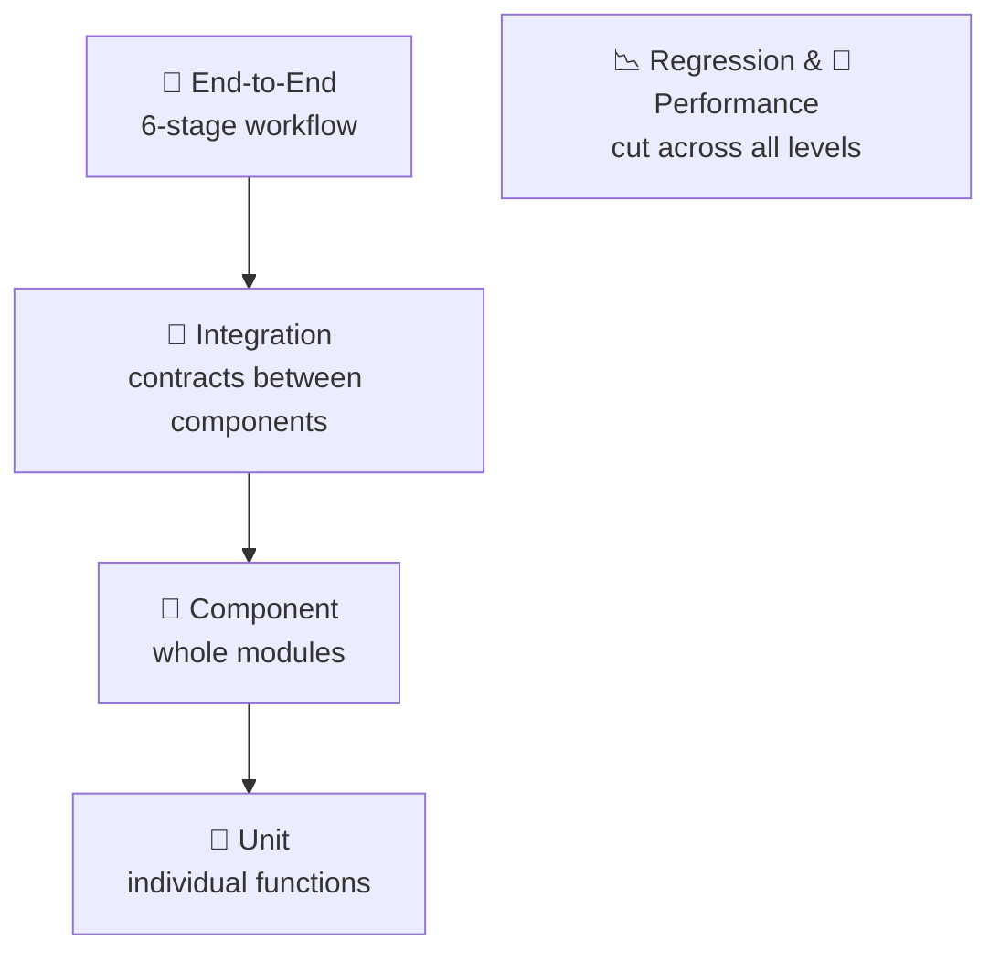
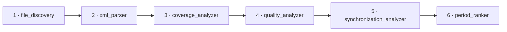
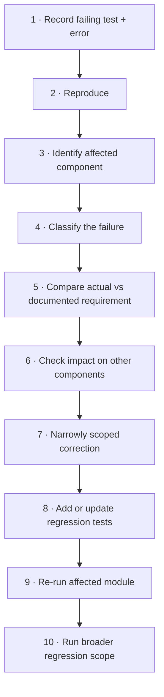

<div align="center">

# 🧪 Testing Guide

### MarsWalk Intelligence · MEDA Data Research & Period Analyzer (MDRPA)


> **Passing tests proves the tested cases passed. It does not certify scientific correctness.**

</div>

---

## 📑 Contents

| | | |
|---|---|---|
| [1 Purpose](#1-purpose) | [9 Pipeline Integration](#9-pipeline-integration-testing) | [17 Failure Investigation](#17-failure-classification-and-investigation) |
| [2 Scope](#2-testing-scope) | [10 Run Isolation](#10-run-isolation-and-reproducibility-testing) | [18 Regression Policy](#18-regression-testing-policy) |
| [3 Principles](#3-testing-principles) | [11 GUI Testing](#11-application-and-gui-testing) | [19 Reporting](#19-test-results-and-reporting) |
| [4 Testing Levels](#4-testing-levels) | [12 Engineering Validation](#12-engineering-validation) | [20 Acceptance](#20-acceptance-criteria) |
| [5 Test Suite Structure](#5-current-test-suite-structure) | [13 Scientific Validation](#13-scientific-validation) | [21 Future Testing](#21-future-testing-development) |
| [6 Analyzer Requirements](#6-core-analyzer-testing-requirements) | [14 Performance](#14-performance-testing) | [22 Governance](#22-testing-governance-and-change-control) |
| [7 Special Constants](#7-special-constants-testing-requirements) | [15 Environment](#15-test-execution-environment) | [23 Related Docs](#23-related-documentation) |
| [8 Time-Axis](#8-time-axis-testing-requirements) | [16 Commands](#16-test-execution-commands) | [24 Governing Principle](#24-governing-testing-principle) |

---

## ⚡ Quick Start

```bash
# 1 · Set up (inside an activated virtual environment)
python -m pip install -r requirements-dev.txt
python -m pytest --version

# 2 · Run everything
python -m pytest

# 3 · Run the integrated pipeline test
python -m pytest tests/test_pipeline_integration.py

# 4 · Debug a failure quickly
python -m pytest -x            # stop at first failure
python -m pytest --lf          # re-run last failures
```

Full command reference: [Section 16](#16-test-execution-commands).

---

## 1. Purpose

Defines the testing strategy, validation levels, execution procedures, and acceptance principles for MDRPA. Testing verifies that the application:

| ✅ Verifies |
|---|
| Processes supported MEDA Calibrated Data correctly within its documented scope |
| Preserves data and metadata integrity |
| Produces consistent analytical outputs |
| Handles invalid, missing, ambiguous, and incomplete inputs safely |
| Maintains correct analyzer and pipeline integration |
| Preserves reproducibility and run isolation |
| Presents results without unsupported scientific claims |
| Stays stable as new capabilities are introduced |

> [!IMPORTANT]
> Testing is a mandatory part of the lifecycle. A functionality is **never** accepted merely because its implementation is complete or the application runs without errors.

---

## 2. Testing Scope

| ✅ In scope | ❌ Out of scope (unless introduced by an approved expansion) |
|---|---|
| NASA Perseverance **MEDA Calibrated Data** | Derived and Partially Processed MEDA products · other NASA missions, instruments, datasets |

Future datasets need separate test datasets, source-specific validation rules, and scientific test criteria.

### 2.1 v1.0 testing objectives

| # | Objective | # | Objective |
|:-:|---|:-:|---|
| 1 | Core analyzer behavior | 8 | Candidate-period ranking |
| 2 | Data and metadata interpretation | 9 | Complete pipeline execution |
| 3 | Special-value classification | 10 | Run isolation and reproducibility |
| 4 | Time-axis handling | 11 | Application and GUI integration |
| 5 | Coverage calculations | 12 | Reporting and output consistency |
| 6 | Quality-related analysis | 13 | Performance and resource behavior |
| 7 | Synchronization calculations | 14 | Analytical limitations remain visible |

> [!NOTE]
> These are the **target** validation scope, not proof that every item is complete.

---

## 3. Testing Principles

| # | Principle | Meaning |
|:-:|---|---|
| 3.1 | **Correctness before performance** | Optimizations preserve expected output unless a separately reviewed methodological change is intended. |
| 3.2 | **Determinism** | Controlled inputs and deterministic expectations. No dependence on uncontrolled external data, network, or services unless that dependency is the test. |
| 3.3 | **Input validation** | Cover both valid **and invalid** inputs. |
| 3.4 | **Data integrity protection** | See the "must never silently" list below. |
| 3.5 | **Regression protection** | Every accepted bug fix or behavior change gets appropriate regression coverage. |
| 3.6 | **Traceability** | Results trace to code version, test case, fixtures, configuration, expected vs. actual, failure details. |
| 3.7 | **Evidence-based acceptance** | A pass is evidence for the tested cases only, not for every possible input or for scientific validity. |

**3.3 · Invalid inputs to cover:** missing files · empty files · invalid CSV structures · invalid XML metadata · missing metadata fields · ambiguous column mappings · invalid numerical values · unsupported time-axis types · invalid configuration parameters · incomplete analytical reports.

**3.4 · Tests must verify the application never silently:**

- ❌ Modifies source measurements.
- ❌ Replaces unavailable metrics with zero.
- ❌ Treats all special constants as Missing.
- ❌ Treats all non-numeric values as equivalent.
- ❌ Forces ambiguous CSV-to-XML mappings.
- ❌ Combines incompatible time coordinates.
- ❌ Discards important metadata warnings.

---

## 4. Testing Levels



| Level | Verifies | Notes |
|---|---|---|
| 🔬 **Unit** | Input validation · output values · error handling · boundary conditions · numerical calculations · data classification · path resolution · metadata interpretation · configuration handling | Avoid unnecessary dependencies on other components |
| 🧩 **Component** | A complete module through its supported interfaces: File Discovery · XML Parser · Coverage · Quality · Synchronization · Period Ranker · Run Manager · Pipeline · GUI controllers and views | |
| 🔗 **Integration** | Input/output contracts · metadata propagation · report schema compatibility · configuration propagation · error propagation · run lifecycle · analyzer execution order · output artifact generation | Modules can pass their own tests yet produce incompatible outputs when connected |
| 🔄 **End-to-end** | The complete workflow (see below) | |
| 📉 **Regression** | Protects previously accepted behavior | Required for changes to calculations, metadata extraction, special constants, mapping, time axes, synchronization, ranking, pipeline, schemas, run isolation, GUI. Scope is proportional to the affected components. |
| 🚀 **Performance** | Efficiency and resource behavior | See [Section 14](#14-performance-testing) |

### 4.1 End-to-end workflow



An end-to-end test verifies the workflow: accepts the intended input configuration · discovers supported source files · extracts XML metadata · produces coverage, quality, synchronization, and ranking outputs · completes the run with an appropriate status · preserves the expected output structure.

---

## 5. Current Test Suite Structure

The repository has a dedicated `tests/` directory covering backend processing, application behavior, GUI components, pipeline integration, and run management.

### 5.1 🔬 Core analyzer tests

| Module | Area |
|---|---|
| `test_file_discovery.py` | File discovery, inventory generation, path handling |
| `test_xml_parser.py` | XML parsing and metadata extraction |
| `test_coverage_analyzer.py` | CSV analysis, coverage, timestamps, column mapping |
| `test_quality_analyzer.py` | Quality-related metadata, special constants, documented bounds |
| `test_synchronization_analyzer.py` | Timestamp matching and synchronization |
| `test_period_ranker.py` | Metric aggregation, candidate windows, ranking |
| `test_meda_common.py` | Shared utilities and common data handling |

### 5.2 🔗 Pipeline and integration tests

| Module | Area |
|---|---|
| `test_pipeline.py` | Pipeline execution behavior |
| `test_pipeline_integration.py` | Integrated execution on a fixed dataset |
| `test_pipeline_events.py` | Pipeline events |
| `test_pipeline_cancellation.py` | Pipeline cancellation |
| `test_analysis_execution_integration.py` | Application-level analysis execution |
| `test_analysis_pipeline_cancellation.py` | Analysis pipeline cancellation |

### 5.3 🔒 Run management and reproducibility tests

| Module | Area |
|---|---|
| `test_run_manager.py` | Run lifecycle |
| `test_run_metadata.py` | Run metadata |
| `test_run_logger.py` | Run logging |
| `test_run_isolation.py` | Separation of independent runs |

<details>
<summary><b>5.4 🖥️ Application and GUI tests</b> (15 modules)</summary>

| Module | Area |
|---|---|
| `test_application_composition.py` | Component composition |
| `test_application_foundation.py` | Application foundation |
| `test_application_shutdown.py` | Shutdown behavior |
| `test_gui_bootstrap.py` | GUI initialization |
| `test_gui_integration.py` | GUI integration |
| `test_navigation.py` | Navigation |
| `test_analysis_center_view.py` | Analysis Center view |
| `test_analysis_configuration_view.py` | Analysis configuration |
| `test_analysis_controller.py` | Analysis controller |
| `test_analysis_worker.py` | Analysis worker |
| `test_worker_signals.py` | Worker signals |
| `test_input_manager.py` | Input management |
| `test_input_shortcut.py` | Input shortcuts |
| `test_first_launch_tutorial.py` | First-launch tutorial |
| `test_help_about_credits_dialog.py` | Help and information dialogs |

</details>

<details>
<summary><b>5.5 📊 Dashboard and reporting tests</b> (10 modules)</summary>

| Module | Area |
|---|---|
| `test_dashboard_view.py` | Dashboard view |
| `test_dashboard_integration.py` | Dashboard integration |
| `test_overview_view.py` | Overview presentation |
| `test_coverage_dashboard.py` | Coverage dashboard |
| `test_quality_dashboard.py` | Quality dashboard |
| `test_synchronization_dashboard.py` | Synchronization dashboard |
| `test_ranking_dashboard.py` | Ranking dashboard |
| `test_comparison_dashboard.py` | Comparison dashboard |
| `test_reports_view.py` | Report presentation |
| `test_export_view.py` | Export behavior |

</details>

### 5.6 Test fixtures

Located in `tests/fixtures/`. The pipeline integration suite references `tests/fixtures/pipeline_dataset/`, a fixed dataset used to verify the integrated workflow and expected artifacts.

> [!WARNING]
> Fixtures stay controlled and **are not modified casually to make a failing test pass.** Any intentional fixture change is reviewed for its effect on expected test behavior.

---

## 6. Core Analyzer Testing Requirements

### 6.1 📁 File Discovery
Supported file identification · Sol extraction · product-code extraction · CSV and XML inventory · file pairing · missing files · unexpected files · duplicate or ambiguous file identities · invalid paths · nested directories · path normalization · platform-specific path handling. Behavior stays consistent with the supported MEDA Calibrated Data input structure.

### 6.2 📄 XML Parser
Valid, invalid, and missing XML · missing required metadata · empty field definitions · data type, field-name, field-number, unit, and description extraction · documented numerical bounds · special constants · header declarations · metadata warnings · unsupported or malformed structures. **The parser never silently invents missing metadata.**

### 6.3 ⏱️ Coverage Analyzer
Valid CSV/XML combinations · missing XML metadata · failed XML parsing · empty CSVs · header and headerless CSVs · reordered headers · duplicate CSV headers · duplicate XML field names · validated WS aliases · ambiguous mappings · missing and invalid values · timestamp parsing, duplicates, out-of-order, gaps · invalid gap configuration · file and metadata path resolution.

> [!IMPORTANT]
> Tests verify that **ambiguous mappings are not used for measurement calculations.**

### 6.4 🧪 Quality Analyzer
Metadata discovery · candidate identification (quality, operational-context, measurement-uncertainty) · documented numeric bounds · below-minimum, above-maximum, and boundary values · missing and invalid values · special constants · category separation · report and summary generation.

It preserves the distinction between candidate classification and authoritative interpretation. **Current tests do not establish that official Quality Flag meanings are implemented or validated.**

### 6.5 🔗 Synchronization Analyzer
Valid, missing, invalid, duplicate, and unsorted timestamps · different and incompatible time-axis kinds · no temporal overlap · common interval selection · one-to-one matching · tolerance · unmatched observations · match-rate calculations · mean and maximum match differences · empty and insufficient series.

Tests verify that **one timestamp occurrence cannot be reused for multiple matches**, and that tolerance is applied in the **selected coordinate system**.

### 6.6 🏁 Period Ranker
Input report loading · required columns and CSV schema validation · Sol-range discovery · explicit and automatic ranges · window construction · full and partial windows · file-availability, data-integrity, quality-indicator, and synchronization calculations · metric availability · weight normalization · minimum metric requirements · comparison-group separation · ranking order · tie-breaking · unrankable windows · summary generation · CSV and JSON output.

The default weights are **protected by regression tests** (without treating them as scientifically calibrated):

| Metric | Default weight |
|---|:-:|
| File Availability | `0.20` |
| Data Integrity | `0.45` |
| Quality Indicators | `0.15` |
| Synchronization | `0.20` |

### 6.7 🧰 Shared utilities
Numeric conversion · missing-value recognition · path normalization · time parsing and axis classification · metadata normalization · common validation rules · special-value handling where supported. **Changes to shared utilities require regression testing of all affected analyzers.**

---

## 7. Special Constants Testing Requirements

Special constants get dedicated tests because their classification affects downstream reports. The model distinguishes `missing_constant` · `invalid_constant` · `error_constant` · `saturated_constant` · `unknown_constant` · `not_applicable_constant`.

### 7.1 Classification tests

| # | Verify |
|:-:|---|
| 1 | Each documented category is recognized **independently** |
| 2 | `missing_constant` contributes to **Missing** counts |
| 3 | `invalid_constant` contributes to **Invalid** counts |
| 4 | `error_constant` keeps an independent count |
| 5 | `saturated_constant` keeps an independent count |
| 6 | `unknown_constant` keeps an independent count |
| 7 | `not_applicable_constant` keeps an independent count |
| 8 | Multiple-category matches are identified as **ambiguous** |
| 9 | Ordinary finite numeric values remain ordinary numeric values |
| 10 | Non-numeric and non-finite values follow the documented invalid-value behavior |

### 7.2 Metadata preparation tests
Where prepared special-constant metadata is used: prepared at the intended **field level** · repeated row processing uses the prepared representation · results stay consistent with the supported reference behavior · metadata is **not accidentally shared** between unrelated fields · empty or incomplete metadata is handled safely.

### 7.3 Downstream integrity tests
Classifications are preserved across processing stages. A special constant never becomes an ordinary measurement or is silently converted to another category during report generation. Array special-constant evaluation stays out of scope unless separately introduced and tested.

---

## 8. Time-Axis Testing Requirements

Time handling is critical. Each supported kind is tested **independently**.

| Kind | Verify |
|---|---|
| **SCLK** | Finite numeric parsing · rejection of non-finite values · correct numeric ordering · **no implicit UTC conversion** |
| **UTC** | Timezone-aware ISO-8601 parsing · UTC normalization · equivalent timestamps with different offsets · **rejection of timezone-naive timestamps as UTC** |
| **LMST** | Valid coordinate parsing · Sol-coordinate behavior · correct ordering · documented coordinate scale · **no implicit UTC conversion** |
| **LTST** | Supported nominal coordinate parsing · documented representation · **no elapsed-SI-time interpretation** · no implicit UTC conversion |
| **ISO naive** | Timezone-unspecified parsing · explicit identification of the kind · **no silent assumption of UTC** |

**Cross-axis compatibility:** incompatible kinds are never silently combined. Any future time conversion needs dedicated tests and authoritative scientific reference cases.

---

## 9. Pipeline Integration Testing

### 9.1 Execution order

`File Discovery → XML Parser → Coverage → Quality → Synchronization → Period Ranker`. Tests verify each stage receives the expected inputs from preceding stages.

### 9.2 Expected pipeline artifacts

The fixed-dataset integration test expects:

| Artifact | Producing stage |
|---|---|
| `file_inventory.csv` | File Discovery |
| `metadata_inventory.json` | XML Parser |
| `coverage_report.csv` | Coverage Analyzer |
| `coverage_summary.json` | Coverage Analyzer |
| `coverage_range_summary.json` | Coverage Analyzer |
| `quality_field_report.csv` | Quality Analyzer |
| `quality_summary.json` | Quality Analyzer |
| `synchronization_file_report.csv` | Synchronization Analyzer |
| `synchronization_pair_report.csv` | Synchronization Analyzer |
| `synchronization_summary.json` | Synchronization Analyzer |
| `period_ranking.csv` | Period Ranker |
| `period_ranking_summary.json` | Period Ranker |

The test verifies the artifacts exist **and** that their structures are usable by downstream stages.

### 9.3 Cross-stage consistency

Sol-number consistency · product identification consistency · metadata-to-CSV association · report-column compatibility · special-value classification preservation · metric availability propagation · ranking input consistency · run-specific output paths. **A successful stage must not hide a failure or incomplete result from an earlier stage.**

### 9.4 Failure handling

Invalid pipeline configuration is rejected · missing required inputs are reported · failed stages are represented correctly · downstream stages don't consume invalid upstream outputs · cancellation is handled safely · run status updates consistently · failure information stays traceable.

---

## 10. Run Isolation and Reproducibility Testing

### 10.1 Run isolation

| Verify |
|---|
| Each run has its own output location |
| One run never overwrites another run's artifacts |
| Run-specific metadata stays with the correct run |
| Logs remain separated |
| Cancelling one run does not affect another |
| Failed runs do not corrupt completed runs |
| Temporary files do not leak into unrelated runs |
| Concurrent execution causes no cross-run contamination, where concurrency is supported |

### 10.2 Reproducibility

Given the same **input dataset · software version · analysis configuration · methodology configuration**, the application produces equivalent results within defined numerical and serialization expectations. Tests distinguish:

| Exact output equality | Numerically equivalent results | Expected metadata differences | Non-deterministic operational info (timestamps, run IDs) |
|---|---|---|---|

Any intentional non-determinism is documented.

### 10.3 Configuration traceability

Retained with the run: selected Sol range · candidate-window construction · time-axis selection · synchronization tolerance · required products · ranking weights · minimum metric availability.

---

## 11. Application and GUI Testing

Covers: startup · component initialization · navigation · input validation · analysis configuration · worker execution and signals · cancellation · shutdown · dashboard loading · report presentation · export · empty and unavailable states · error presentation.

### 11.1 Scientific transparency in the GUI

The interface never introduces interpretations unsupported by backend results. Tests verify:

- ✅ Unavailable metrics remain distinguishable from zero.
- ✅ Candidate classifications are not presented as authoritative.
- ✅ Rankings are described as exploratory.
- ✅ Warnings remain visible.
- ✅ Incompatible time-axis comparisons are not shown as successful matches.
- ✅ Missing evidence is not replaced with invented values.

### 11.2 Target user experience

Evaluate whether information is reachable through progressive presentation: **1 Overview → 2 Analytical Details → 3 Scientific Evidence → 4 Technical Diagnostics.** A simplified overview must not hide important limitations or contradict detailed reports.

---

## 12. Engineering Validation

*Does the software behave according to its technical specifications?*

Unit · component · integration · end-to-end · regression · input validation · output schema validation · error-handling validation · run-isolation · reproducibility · performance testing.

Necessary for reliable operation, but it does **not** independently establish scientific validity.

---

## 13. Scientific Validation

*Is the analytical interpretation justified by authoritative evidence and appropriate methods?* Distinct from software testing.

Depending on the capability it may require: authoritative NASA/PDS documentation · MEDA instrument documentation · product-specific field definitions · documented quality-flag meanings · time-system reference information · uncertainty conventions · independent reference datasets · known scientific test cases · comparison against established methods · expert review.

### 13.1 A scientific validation case identifies

| 1 | The analytical claim being evaluated | 6 | The expected result |
|:-:|---|:-:|---|
| **2** | **The relevant data product and field** | **7** | **The observed result** |
| **3** | **The authoritative reference source** | **8** | **Acceptable tolerance, if applicable** |
| **4** | **The expected scientific interpretation** | **9** | **Known limitations** |
| **5** | **The test input** | **10** | **The validation outcome** |

### 13.2 Levels of evidence (never conflate)


Passing one level is **not** proof of the levels after it.

### 13.3 Current status

> [!CAUTION]
> Scientific Accuracy is **not** reported as a quantified value without an appropriate independent validation process. Unit tests or successful pipeline execution do not provide a defensible accuracy percentage. Any future result identifies its reference method, dataset, assumptions, and limitations.

---

## 14. Performance Testing

### 14.1 Dimensions

Total pipeline time · per-stage and per-analyzer time · memory consumption · processing throughput · dataset-size scaling · multiprocessing overhead · repeated-run consistency.

### 14.2 A benchmark report identifies

| Dataset identity | Dataset size | Number of Sols |
|---|---|---|
| Number of CSV files | Number of XML files | Records processed (where available) |
| Hardware configuration | Python version | Software revision |
| Processing configuration | Execution duration | Peak memory (where measured) |

Comparisons use equivalent input data and comparable conditions.

### 14.3 Performance regression review is required for changes to

CSV processing loops · XML metadata processing · repeated metadata preparation · file discovery · data loading · multiprocessing · large report generation · memory-intensive operations.

### 14.4 Acceptance

> [!IMPORTANT]
> A performance improvement is **not accepted solely because execution time decreased.** Also verify: output consistency · classification consistency · report-schema consistency · error-handling consistency · memory behavior · no loss of supported functionality. Performance testing is separate from ordinary unit-test execution.

---

## 15. Test Execution Environment

| Item | Detail |
|---|---|
| **Supported Python** | `>=3.10,<3.14` (project configuration). Record the actual version in validation reports. |
| **Runtime deps** | `requirements.txt` |
| **Dev deps** | `requirements-dev.txt` (includes the test framework); a development optional dependency is also declared in `pyproject.toml` |
| **Isolation** | Use a virtual environment; avoid mixing dependencies from unrelated environments |

```bash
python -m pip install -r requirements-dev.txt
python -m pytest --version
```

When a failure looks environment-dependent, record environment information **before** classifying it as a code defect.

---

## 16. Test Execution Commands

Run from the repository root.

| Goal | Command |
|---|---|
| Full suite | `python -m pytest` |
| Verbose | `python -m pytest -v` |
| Compact summary | `python -m pytest -q` |
| Coverage Analyzer | `python -m pytest tests/test_coverage_analyzer.py` |
| Quality Analyzer | `python -m pytest tests/test_quality_analyzer.py` |
| Synchronization Analyzer | `python -m pytest tests/test_synchronization_analyzer.py` |
| Period Ranker | `python -m pytest tests/test_period_ranker.py` |
| Pipeline integration | `python -m pytest tests/test_pipeline_integration.py` |
| Run isolation | `python -m pytest tests/test_run_isolation.py` |
| By name match | `python -m pytest tests/test_coverage_analyzer.py -k "column_mapping"` |
| Stop at first failure | `python -m pytest -x` |
| Re-run last failures | `python -m pytest --lf` |
| List tests without running | `python -m pytest --collect-only` |

`-k` selects tests by name match. `--lf` uses pytest's last-failed selection when previous failure data exists.

---

## 17. Failure Classification and Investigation

**Classify a failure before changing implementation code.**

| Type | Definition | Examples |
|---|---|---|
| 🐛 **Code defect** | Behavior violates an accepted requirement | Incorrect calculation, classification, report output, error handling, or integration contract |
| 🧾 **Test defect** | The test has an incorrect expectation, invalid setup, or unreliable assertion | *A test is never changed just to make an implementation defect disappear* |
| 🗂️ **Fixture defect** | Test data doesn't represent the intended scenario | Fixture changes need careful review: they may affect many tests |
| 🖥️ **Environment defect** | Execution affected by an unsupported or misconfigured environment | Missing dependencies, unsupported Python, wrong package install, environment-specific GUI initialization |
| 🔬 **Methodology defect** | Implemented calculation or interpretation conflicts with its approved definition | Needs methodological review, **not** a cosmetic or integration fix |



---

## 18. Regression Testing Policy

Mandatory for accepted changes affecting existing behavior.

### 18.1 Minimum regression scope

| Change area | Minimum relevant scope |
|---|---|
| Shared utilities | All affected analyzers and dependent components |
| File discovery | File discovery and pipeline integration |
| XML parsing | XML parser and all metadata-dependent analyzers |
| Coverage Analyzer | Coverage, pipeline, downstream ranking |
| Quality Analyzer | Quality, pipeline, downstream ranking |
| Synchronization Analyzer | Synchronization, pipeline, downstream ranking |
| Period Ranker | Ranker and full pipeline integration |
| Run Manager | Run manager, isolation, pipeline lifecycle |
| Pipeline | Pipeline, integration, cancellation, run isolation |
| GUI | Affected views, controllers, workers, GUI integration |
| Report schema | Producing analyzer and every affected consumer |

This is the **minimum**; more may be necessary depending on the change.

### 18.2 Ranking regression protection

Verify: default weights · metric formulas · metric availability · weight normalization · comparison-group behavior · partial-window behavior · tie-breaking · ranking summaries. **A ranking change is never accepted merely because the output looks reasonable**; its effect on existing candidate ordering is reviewed.

### 18.3 Scientific interpretation regression protection

Verify: existing documented classifications remain correct · unsupported interpretations are not introduced · special constants remain distinct · time-axis limitations remain enforced · unavailable metrics remain distinguishable · existing scientific warnings remain visible.

---

## 19. Test Results and Reporting

Every significant validation run records:

<table>
<tr><th>📋 Execution information</th><th>📈 Execution summary</th><th>❗ Failure details (per failure)</th></tr>
<tr><td valign="top">

- Date and time
- Repository revision / commit SHA
- Python version
- Operating system
- Test command and scope
- Dataset or fixture identity

</td><td valign="top">

- Total collected tests
- Passed
- Failed
- Skipped
- Errors
- Execution duration

</td><td valign="top">

- Test module and name
- Error message
- Failure classification
- Affected component
- Investigation status
- Resolution status

</td></tr>
</table>

**Acceptance status labels:** `Not Run` · `Passed` · `Failed` · `Skipped` · `Blocked` · `In Review` · `Accepted`.

> [!WARNING]
> A suite that was not executed is **never reported as passed.** Skipped tests stay visible in the summary.

**Retain where appropriate:** test output · relevant logs · benchmark reports · input dataset identifiers · configuration files · expected-vs-actual comparisons. Records are traceable to the software revision they evaluated.

---

## 20. Acceptance Criteria

### 20.1 Minimum engineering acceptance

Depending on the affected component:

1. Implementation review
2. Relevant unit tests
3. Relevant component tests
4. Relevant integration tests
5. Regression tests
6. Output and schema verification
7. Error-handling verification
8. Documentation updates where necessary

### 20.2 Methodology-affecting changes

Changes affecting scientific interpretation, calculations, or ranking need additional review: documented methodological justification · authoritative reference documentation · expected-result test cases · regression evidence · scientific validation where applicable · review of the effect on existing results.

### 20.3 v1.0 testing objective

A documented validation record covering the supported MEDA Calibrated Data workflow: core analyzers · pipeline integration · run isolation · application integration · reporting · relevant performance behavior. It is established through **actual test evidence**.

> [!NOTE]
> Passing the current automated suite alone does not establish v1.0 readiness or Scientific Validity.

---

## 21. Future Testing Development

> [!NOTE]
> Development directions, **not** existing validation capabilities.

| Area | What it will require |
|---|---|
| **Scientific reference datasets** | Independently reviewed datasets with documented expected results, for repeatable verification of interpretations |
| **Authoritative Quality Flag tests** | If official interpretation is introduced: tests for every supported flag meaning against authoritative documentation |
| **Measurement uncertainty tests** | Reference cases for units · conventions · formulas · propagation rules · numerical tolerances · expected outputs |
| **Physical plausibility tests** | Product-specific scientific constraints and independently justified cases |
| **Ranking sensitivity & stability** | Sensitivity to window size · metric availability · weights · required products · time-axis selection · tolerance, to detect over-dependence on configuration |
| **Expanded dataset testing** | Source-specific fixtures · metadata interpretation tests · product-specific analyzer tests · integration tests · scientific reference cases · regression protection. *MEDA tests never validate unrelated datasets.* |

---

## 22. Testing Governance and Change Control

Every development task identifies: affected components · required tests · expected behavior · regression scope · documentation impact · scientific validation requirements (where applicable).

### 22.1 File-by-file development

Before modifying an existing file:

1. Retrieve its current repository version.
2. Review the existing implementation.
3. Identify affected interfaces.
4. Define expected behavior.
5. Identify relevant tests.
6. Implement the change.
7. Execute relevant tests.
8. Review regression impact.

### 22.2 When tests may change

| ✅ Allowed | ❌ Not allowed |
|---|---|
| Accepted behavior has intentionally changed | Weakening a failing test to obtain a pass |
| The test contains a verified defect | |
| The fixture no longer represents its documented scenario | |
| A new requirement adds expected behavior | |

### 22.3 Methodology and test alignment

When an approved methodology changes, its tests and documentation change **together**. Implementation, methodology, and testing documentation describe the same accepted behavior.

---

## 23. Related Documentation

| Document | Content |
|---|---|
| `README.md` | Project overview, objectives, current scope |
| `docs/development_guide.md` | Development workflow, roadmap, change control |
| `docs/architecture.md` | Current-state and target architecture |
| `docs/scientific_methodology.md` | Scientific and analytical methodology |
| `docs/analyzer_documentation.md` | Analyzer interfaces and technical behavior |
| `docs/backend_integration_specification.md` | Backend integration contracts |
| `docs/user_guide.md` | End-user instructions |

All stay consistent on implementation status, testing requirements, scientific limitations, and the v1.0 scope.

---

## 24. Governing Testing Principle

> **MDRPA testing must establish that the software behaves consistently with its documented technical and analytical requirements while preserving data integrity, reproducibility, and scientific transparency.**

> **Engineering Validation and Scientific Validation are separate requirements.** Passing automated tests demonstrates success only within the tested cases and does not independently certify scientific correctness.

> **The first target is v1.0 for NASA Perseverance MEDA Calibrated Data.** Its acceptance must be supported by documented engineering tests, integration evidence, regression protection, and appropriate scientific validation. Future expansion toward additional NASA datasets must introduce its own source-specific testing and validation strategy.